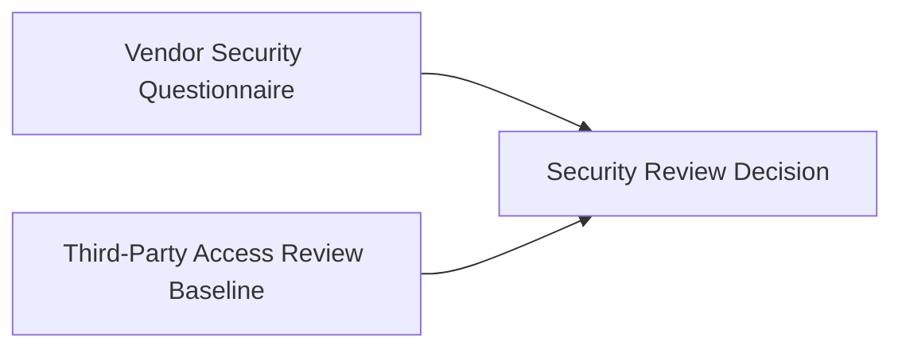
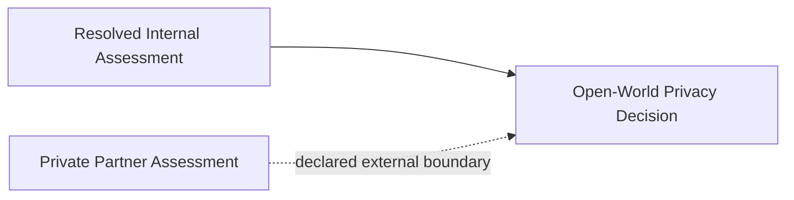
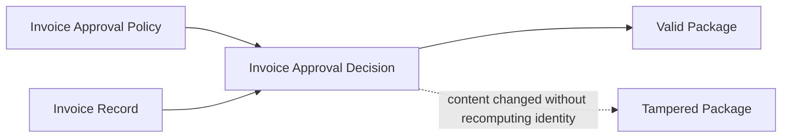
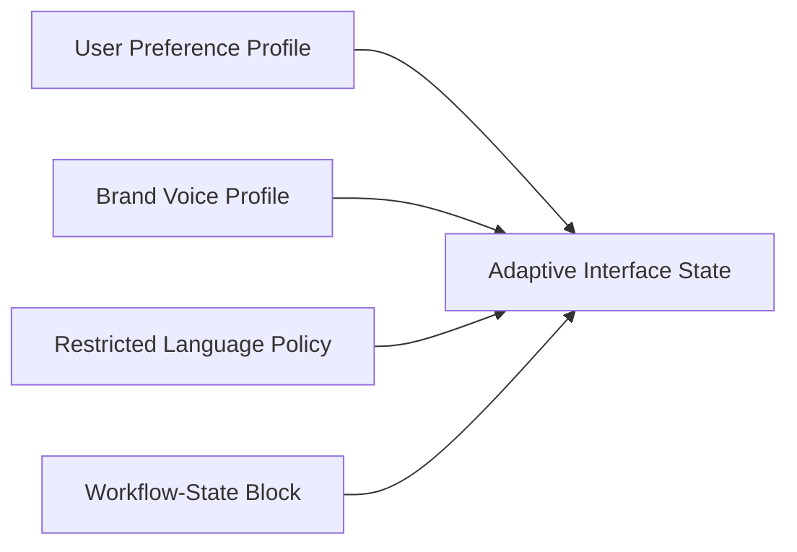

# Start Here: Canonical Artifact Packages

**Status:** tutorial
**Audience:** Reviewers, adoption evaluators, integrators
**Authority:** non-normative reviewer walkthrough

## Purpose

Guide reviewers through five reference examples covering attribution, lineage, open-world boundaries, tamper detection, and adaptive context Blocks.

## Scope

One guided path through five packages, expected `package verify` outcomes, and copy-paste verify commands.

## Non-Goals

Protocol behavior remains defined in [`protocol/spec.md`](../protocol/spec.md). The walkthrough excludes the full package catalog; see [`README.md`](./README.md). The document is non-normative.

The walkthrough covers five topics in order:

```text
attribution → lineage → partial truth → tamper detection → adaptive context
```

Each step starts from committed package files and ends with a verified artifact that includes `blockHash`, lineage, a Trace, a receipt, and storage manifest metadata.

## 0. Trace Attribution Across Sources

Package path:

```text
artifact-packages/attributed-research-output/
```

The package documents source attribution via per-Block `pathCount` values in a six-Block closed-world graph.

Visual lineage (six Blocks — three roots, two intermediates, one conclusion):

```
agent.security_review ──────────────────────────────── [direct citation in rationale]
      │                                                          │
      └──→ security_findings ──────────────────────────→ security_review_decision
      │           │                                             │
      │           └──→ quality_score ───────────────────→      │
      │                      │                                  │
agent.evaluate_artifact ─────┘

blk_auth_session_model_v1 ──→ security_findings ──→ [propagates through to decision]
```

The conclusion Block reaches `agent.security_review` via three distinct paths. The Trace reports `pathCount=3` for that Block. Other sources report lower counts — for example, `agent.evaluate_artifact` has `pathCount=1` because the Block contributes only through the quality score Block.

Verify:

```bash
pnpm run build
node cli/bin/alx.js package verify artifact-packages/attributed-research-output --json
```

The committed package files are canonical. Maintainers may keep local regen scripts under `scripts/` (gitignored) when rebuilding example packages.

Expected verification fields:

- `ok: true`
- `complete: true`
- `pathCount=3` for `agent.security_review` in the trace output (highest-weight source)
- `leaves` contains three root Blocks

The Trace reports two attribution dimensions: graph completeness (`complete`) and per-source path weight (`pathCount`).

See [`attributed-research-output/README.md`](./attributed-research-output/README.md) for the full per-Block attribution table.

## 1. Verify a Business Decision

Package path:

```text
artifact-packages/security-review-decision/
```

The package documents verifiable evidence lineage for a business decision Block derived from two parent Blocks.

Visual lineage:



Run:

```bash
node cli/bin/alx.js package verify artifact-packages/security-review-decision --json
```

Expected verification fields:

- `ok: true`
- `complete: true`
- two parent Blocks
- a Trace listing contributing Blocks

A consequential artifact validates after export from the originating system when packaged Blocks and receipts travel with the decision Block.

## 2. Inspect Open-World Partial Lineage

Package path:

```text
artifact-packages/open-world-private-boundary/
```

The package documents open-world validation with one resolved parent Block and one declared external boundary.

Visual lineage:



Run:

```bash
node cli/bin/alx.js package verify artifact-packages/open-world-private-boundary --json
```

Expected verification fields:

- `ok: true`
- `complete: false`
- `validationMode: "open-world"`
- one declared `externalParents` value
- zero undeclared `missingParents`

The verification result preserves the external boundary in `externalParents` instead of implying a closed-world graph.

## 3. Detect Tampering

Package path:

```text
artifact-packages/tampered-package-detection/
```

The package documents tamper detection via recomputed hash mismatch between `content.json` and declared `contentHash`.

Visual lineage:



Run:

```bash
node cli/bin/alx.js package verify artifact-packages/tampered-package-detection/valid --json
node cli/bin/alx.js package verify artifact-packages/tampered-package-detection/tampered --json
```

Expected verification fields:

- the valid package returns `ok: true`
- the tampered package returns `ok: false`
- verification replays from current package files; stored receipts alone are insufficient

## 4. Adaptive Interface State

Package path:

```text
artifact-packages/adaptive-interface-state/
```

The package documents an interface-state Block derived from four parent context Blocks.

Visual lineage:



Run:

```bash
node cli/bin/alx.js package verify artifact-packages/adaptive-interface-state --json
```

Expected verification fields:

- `ok: true`
- `complete: true`
- four parent Blocks
- interface state fields derived from listed parent Blocks

## Package Summary

| Package | Verification focus |
|---|---|
| `attributed-research-output` | `pathCount` distribution and graph completeness |
| `security-review-decision` | Decision Block lineage from two parent Blocks |
| `open-world-private-boundary` | Open-world mode with declared `externalParents` |
| `tampered-package-detection` | Hash recomputation failure on altered content |
| `adaptive-interface-state` | Four-parent derived interface state Block |

## Related Documents

- [`README.md`](./README.md) — full package catalog and layout variants
- [`../docs/integrators/attributed-outputs.md`](../docs/integrators/attributed-outputs.md) — attribution workflow guide
- [`../docs/integrators/adapters.md`](../docs/integrators/adapters.md) — adapter and package integration guide
- [`../docs/community/repository-surfaces.md`](../docs/community/repository-surfaces.md) — repository surface map
