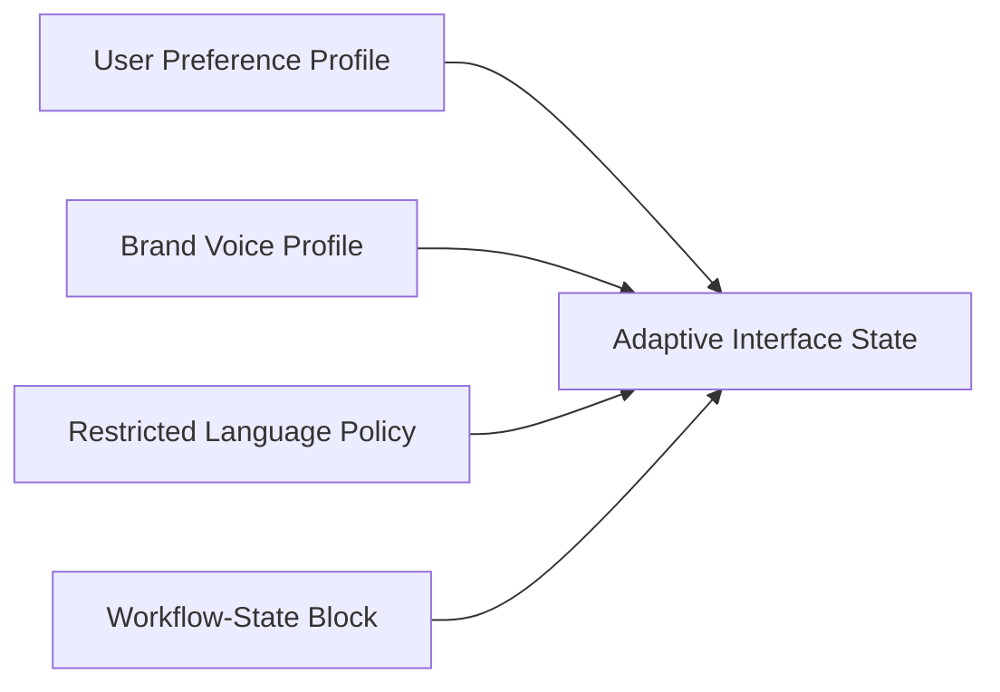

# Adaptive Interface State

**Status:** informative
**Audience:** Reviewers, integrators
**Authority:** non-normative reference example

## Purpose

The reference example documents an interface-state Block derived from four parent context Blocks. The state Block lists a user preference profile Block, brand voice profile Block, restricted-language policy Block, and workflow-state Block in `parentHashes`.

## Scope

Lineage graph, verification outcome, and `package verify` command for committed files in the directory.

## Non-Goals

Protocol behavior remains defined in [`protocol/spec.md`](../../protocol/spec.md). The document is non-normative.

## Visual Lineage



## Package Verification Outcome

The interface state Block is a derived Block with four explicit parents.

A verifier inspects which context Blocks shaped visible sections, primary actions, release-blocker cards, verification badges, and language constraints in the state payload.

## Verifying This Package

```bash
node cli/bin/alx.js package verify artifact-packages/adaptive-interface-state --json
```

Expected result: `ok: true`, `complete: true`, four parent Blocks in the trace.

## Related Documents

- [`../START-HERE.md`](../START-HERE.md) — step 4 of the reviewer walkthrough
- [`../README.md`](../README.md) — full package catalog
