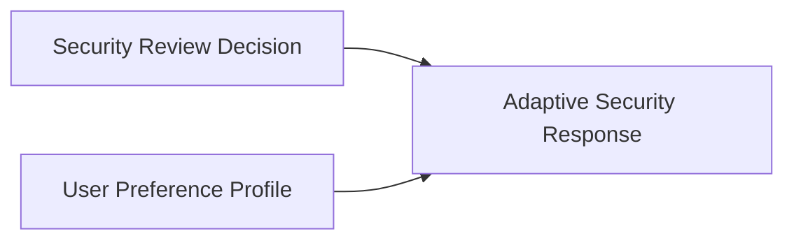

# Adaptive Security Response

**Status:** informative
**Audience:** Reviewers, integrators
**Authority:** non-normative reference example

## Purpose

The reference example documents a personalized response Block derived from verified context Blocks. The response Block lists a security review decision Block and a user preference profile Block in `parentHashes`.

## Scope

Lineage graph, verification outcome, and `package verify` command for committed files in the directory.

## Non-Goals

Protocol behavior remains defined in [`protocol/spec.md`](../../protocol/spec.md). The document is non-normative.

## Visual Lineage



## Package Verification Outcome

The response Block cites the compliance decision Block and the user preference profile Block.

A reviewer inspects both parent Blocks from the Trace and `parentHashes`.

## Verifying This Package

```bash
node cli/bin/alx.js package verify artifact-packages/adaptive-security-response --json
```

Expected result: `ok: true`, `complete: true`, two parent Blocks in the trace.

## Related Documents

- [`../security-review-decision/README.md`](../security-review-decision/README.md) — parent decision package
- [`../agent-user-preference-profile/README.md`](../agent-user-preference-profile/README.md) — parent preference profile
- [`../README.md`](../README.md) — full package catalog
