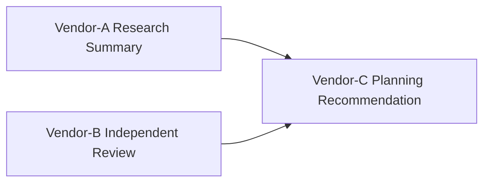

# Cross-Vendor Agent Handoff

**Status:** informative
**Audience:** Reviewers, integrators
**Authority:** non-normative reference example

## Purpose

The reference example documents portable lineage across agent systems. The package contains a planning recommendation Block derived from a Vendor-A research summary Block and a Vendor-B independent review Block.

## Scope

Lineage graph, verification outcome, and `package verify` command for committed files in the directory.

## Non-Goals

Protocol behavior remains defined in [`protocol/spec.md`](../../protocol/spec.md). The document is non-normative.

## Visual Lineage



## Package Verification Outcome

Verification replays from packaged Blocks alone.

No vendor runtime, API key, or platform session is required to confirm lineage at handoff time.

## Verifying This Package

```bash
node cli/bin/alx.js package verify artifact-packages/cross-vendor-agent-handoff --json
```

Expected result: `ok: true`, `complete: true`, two parent Blocks from distinct agent systems.

## Related Documents

- [`../README.md`](../README.md) — full package catalog
- [`../../docs/integrators/agent-integration.md`](../../docs/integrators/agent-integration.md) — agent integration guide
