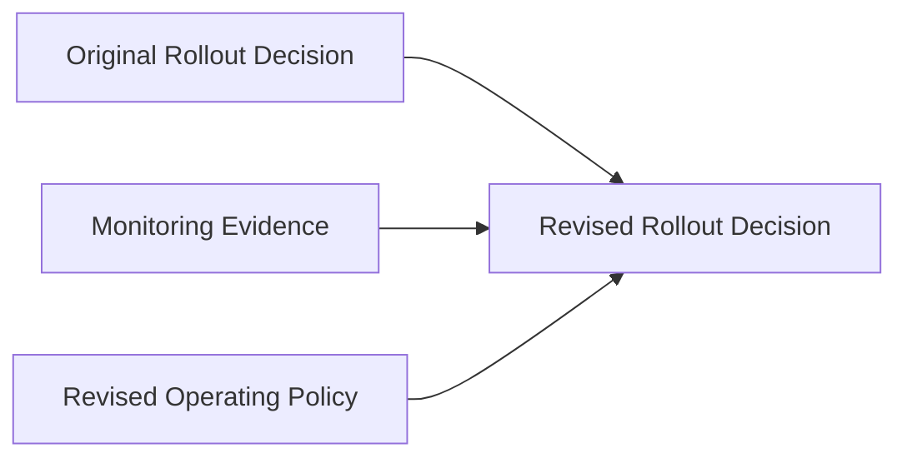

# Decision Evolution

**Status:** informative
**Audience:** Reviewers, integrators
**Authority:** non-normative reference example

## Purpose

The reference example documents revision lineage for rollout decisions. The package contains a revised rollout decision Block derived from the original decision Block, a monitoring evidence Block, and a revised operating policy Block.

## Scope

Lineage graph, verification outcome, and `package verify` command for committed files in the directory.

## Non-Goals

Protocol behavior remains defined in [`protocol/spec.md`](../../protocol/spec.md). The document is non-normative.

## Visual Lineage



## Package Verification Outcome

The revised decision Block cites three parent Blocks: the prior decision Block, the monitoring evidence Block, and the updated policy Block.

A reviewer traces revision causes from `parentHashes` and the Trace.

## Verifying This Package

```bash
node cli/bin/alx.js package verify artifact-packages/decision-evolution --json
```

Expected result: `ok: true`, `complete: true`, three parent Blocks in the trace.

## Related Documents

- [`../README.md`](../README.md) — full package catalog
