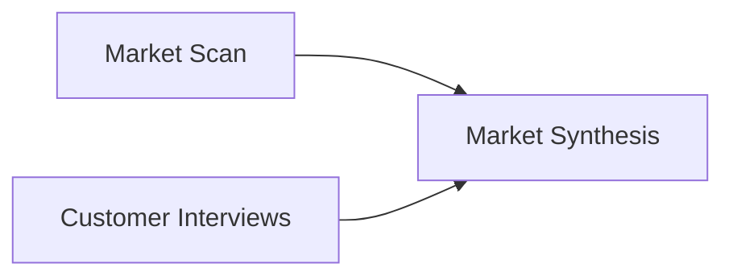

# Market Synthesis

**Status:** informative
**Audience:** Reviewers, integrators
**Authority:** non-normative reference example

## Purpose

The reference example documents source-grounded research synthesis. The package combines a market scan Block and a customer interview Block into a research recommendation Block with source roles, findings, risks, and next actions.

## Scope

Lineage graph, verification outcome, and `package verify` command for committed files in the directory.

## Non-Goals

Protocol behavior remains defined in [`protocol/spec.md`](../../protocol/spec.md). The document is non-normative.

## Visual Lineage



## Package Verification Outcome

The synthesis Block lists two parent Blocks in `parentHashes`.

The verifier inspects contributing source Blocks from the packaged graph alone.

## Verifying This Package

```bash
node cli/bin/alx.js package verify artifact-packages/market-synthesis --json
```

Expected result: `ok: true`, `complete: true`, two parent Blocks in the trace.

## Related Documents

- [`../README.md`](../README.md) — full package catalog
- [`../../docs/integrators/attributed-outputs.md`](../../docs/integrators/attributed-outputs.md) — attribution workflow guide
