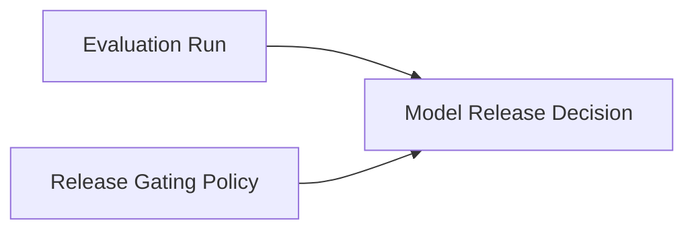

# Model Release Readiness

**Status:** informative
**Audience:** Reviewers, integrators
**Authority:** non-normative reference example

## Purpose

The reference example documents auditable model release approval. The package combines an evaluation run Block and a release-gating policy Block into a staged-release decision Block with thresholds, conditions, risks, and follow-up actions.

## Scope

Lineage graph, verification outcome, and `package verify` command for committed files in the directory.

## Non-Goals

Protocol behavior remains defined in [`protocol/spec.md`](../../protocol/spec.md). The document is non-normative.

## Visual Lineage



## Package Verification Outcome

The release decision Block binds to the evaluation evidence Block and the policy Block in `parentHashes`.

An auditor verifies the decision from packaged Blocks alone.

## Verifying This Package

```bash
node cli/bin/alx.js package verify artifact-packages/model-release-readiness --json
```

Expected result: `ok: true`, `complete: true`, two parent Blocks in the trace.

## Related Documents

- [`../README.md`](../README.md) — full package catalog
