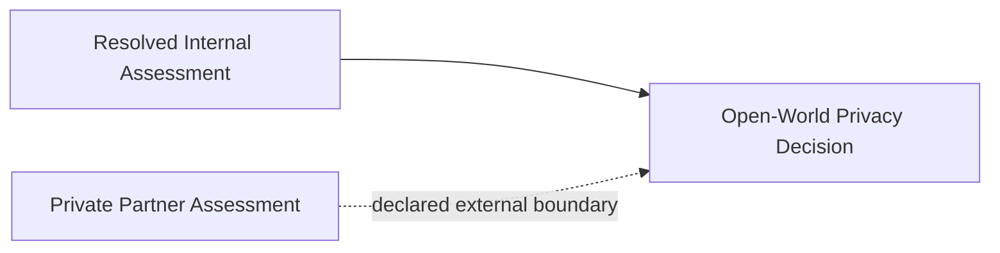

# Open-World Private Boundary

**Status:** informative
**Audience:** Reviewers, integrators
**Authority:** non-normative reference example

## Purpose

The reference example documents open-world validation with a declared external boundary. The package contains a privacy decision Block with one resolved parent Block and one partner assessment Block listed in `externalParents`.

## Scope

Open-world lineage graph, verification outcome, and `package verify` command for committed files in the directory.

## Non-Goals

Protocol behavior remains defined in [`protocol/spec.md`](../../protocol/spec.md). The document is non-normative.

## Visual Lineage



## Package Verification Outcome

The verification result returns `complete: false` with one declared `externalParents` entry.

The resolved parent Block validates locally. The partner assessment Block remains an external boundary in the Trace. Downstream systems preserve the boundary in verification metadata.

## Verifying This Package

```bash
node cli/bin/alx.js package verify artifact-packages/open-world-private-boundary --json
```

Expected result: `ok: true`, `complete: false`, one declared `externalParents` value.

## Related Documents

- [`../START-HERE.md`](../START-HERE.md) — step 2 of the reviewer walkthrough
- [`../README.md`](../README.md) — full package catalog
