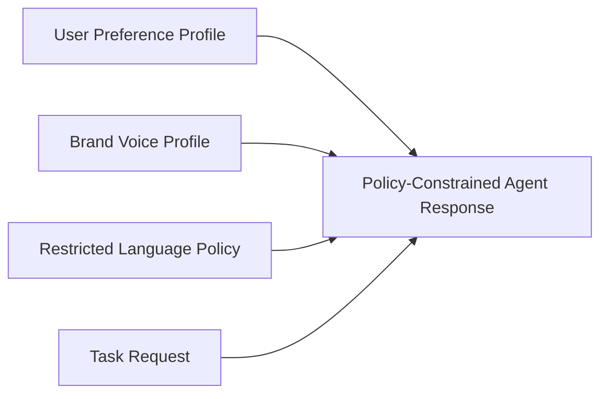

# Policy-Constrained Agent Response

**Status:** informative
**Audience:** Reviewers, integrators
**Authority:** non-normative reference example

## Purpose

The reference example documents constraint lineage for a publishable response Block. The response Block lists user preference, brand voice, restricted-language policy, and task request Blocks in `parentHashes`.

## Scope

Lineage graph, verification outcome, and `package verify` command for committed files in the directory.

## Non-Goals

Protocol behavior remains defined in [`protocol/spec.md`](../../protocol/spec.md). The document is non-normative.

## Visual Lineage



## Package Verification Outcome

The response Block is a derived artifact with four parent Blocks.

A reviewer verifies which Blocks supplied tone preferences, brand terminology, restricted language rules, and the task request that triggered the draft.

## Verifying This Package

```bash
node cli/bin/alx.js package verify artifact-packages/policy-constrained-agent-response --json
```

Expected result: `ok: true`, `complete: true`, four parent Blocks in the trace.

## Related Documents

- [`../README.md`](../README.md) — full package catalog
- [`../../docs/integrators/agent-integration.md`](../../docs/integrators/agent-integration.md) — agent integration guide
