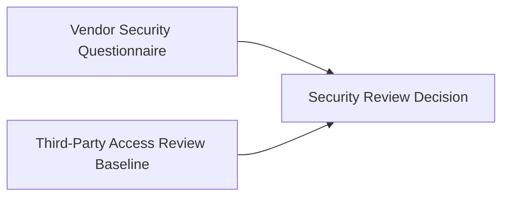

# Security Review Decision

**Status:** informative
**Audience:** Reviewers, integrators
**Authority:** non-normative reference example

## Purpose

The reference example documents verifiable evidence lineage for a business decision Block. The package combines a vendor questionnaire Block and a security baseline Block into a conditional approval Block with conditions, risks, owners, and next actions.

## Scope

Lineage graph, verification outcome, and `package verify` command for committed files in the directory.

## Non-Goals

Protocol behavior remains defined in [`protocol/spec.md`](../../protocol/spec.md). The document is non-normative.

## Visual Lineage



## Package Verification Outcome

The decision Block is a derived Block with two verifiable parent Blocks.

The downstream verifier confirms that the approval cites the questionnaire and baseline Blocks from packaged files alone.

## Verifying This Package

```bash
node cli/bin/alx.js package verify artifact-packages/security-review-decision --json
```

Expected result: `ok: true`, `complete: true`, two parent Blocks in the trace.

## Related Documents

- [`../START-HERE.md`](../START-HERE.md) — step 1 of the reviewer walkthrough
- [`../README.md`](../README.md) — full package catalog
