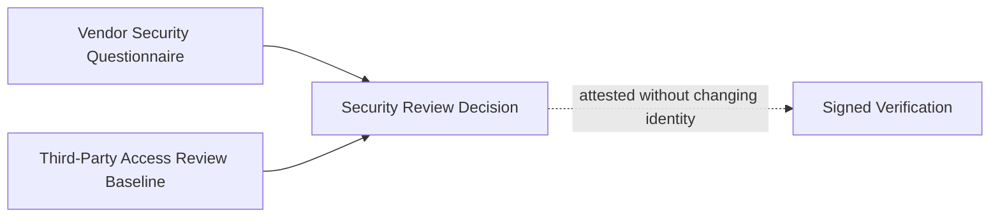

# Signed Security Review Decision

**Status:** informative
**Audience:** Reviewers, integrators
**Authority:** non-normative reference example

## Purpose

The reference example documents additive Ed25519 attestation beside an unchanged core Block. The package reuses the security review decision Block and adds signing files while preserving `blockHash`.

## Scope

Signing layout, verification outcome, and `package verify` command for committed files in the directory.

## Non-Goals

Protocol behavior remains defined in [`protocol/spec.md`](../../protocol/spec.md) and [`protocol/extensions/signing/`](../../protocol/extensions/signing/). The document is non-normative.

The signed data is additive:

- `block.json` remains the same core ALX Block;
- `signed-block.json` wraps the same Block with attestations;
- `attestations.json` contains portable attestation records;
- `signed-verification.json` binds the receipt and attestation metadata.

## Visual Lineage



## Package Verification Outcome

Signing remains orthogonal to Block identity.

A verifier compares the same `blockHash` before and after attestation. The signature adds accountability around the Block; signature material remains outside the Block hash.

## Verifying This Package

```bash
node cli/bin/alx.js package verify artifact-packages/signed-security-review-decision --json
```

Expected result: `ok: true`, `complete: true`, same core `blockHash` as `security-review-decision`.

## Related Documents

- [`../security-review-decision/README.md`](../security-review-decision/README.md) — unsigned base package
- [`../README.md`](../README.md) — full package catalog
