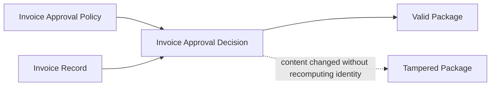

# Tampered Package Detection

**Status:** informative
**Audience:** Reviewers, integrators
**Authority:** non-normative reference example

## Purpose

The reference example documents tamper detection via hash recomputation failure. The `valid/` subdirectory contains the original verified package. The `tampered/` subdirectory alters `data.subject.invoiceTotalUsd` from `48200` to `482000` while leaving `contentHash` and `blockHash` unchanged.

## Scope

Valid and tampered package copies, verification outcomes, and `package verify` commands for both subdirectories.

## Non-Goals

Protocol behavior remains defined in [`protocol/spec.md`](../../protocol/spec.md). The document is non-normative.

## Visual Lineage



## Package Verification Outcome

The tampered package retains surrounding metadata, but `package verify` returns `ok: false` because:

- `content.json` no longer matches the stored `contentHash`;
- `block.json` no longer recomputes to the stored `blockHash`;
- the receipt still refers to the original verified root;
- recomputation from current files fails validation.

## Verifying This Package

```bash
node cli/bin/alx.js package verify artifact-packages/tampered-package-detection/valid --json
node cli/bin/alx.js package verify artifact-packages/tampered-package-detection/tampered --json
```

Expected results: `ok: true` for `valid/`, `ok: false` for `tampered/`.

## Related Documents

- [`../START-HERE.md`](../START-HERE.md) — step 3 of the reviewer walkthrough
- [`../README.md`](../README.md) — full package catalog
