# DDIA Data Model Audit

Audit of ALX Protocol data model artefacts against the principles, trade-offs, and best practices described in *Designing Data-Intensive Applications* by Martin Kleppmann (O'Reilly).

**Audit date:** 2026-07-05
**Repository:** `alx-protocol`
**Auditor scope:** JSON Schemas, recommended SQL patterns, reference storage implementation, retrieval API, and documented access patterns.

> **Visual reference:** See [Diagrams](#diagrams) for Mermaid architecture, ER, sequence, and decision-flow charts.

---

## Artefacts Reviewed

| Layer | Location | Role |
|---|---|---|
| Canonical JSON Schemas | `protocol/schemas/*.schema.json` | Normative document shapes |
| Extension schemas | `protocol/extensions/*/schemas/` | Optional signed blocks, Merkle proofs, IPFS manifests |
| Recommended SQL / Mongo | `docs/integrators/database-guide.md` | Integrator guidance (informative, not deployed DDL) |
| Storage principles | `docs/integrators/storage.md` | Storage independence and adapter patterns |
| Reference storage | `cli/lib/retrieval-store.js`, `cli/lib/resolve.js` | File-backed retrieval + local CID map |
| HTTP access contract | `protocol/retrieval-api.yaml` | Informative Block retrieval API |
| SDK graph operations | `sdk/src/block-lineage.ts`, `sdk/src/block-trace.ts` | Lineage validation and attribution tracing |
| Protocol limits | `protocol/spec.md`, schemas, and canonical vectors | Normative parent-count and canonicalization-depth boundaries |

### Assumptions

- Integrators follow the database guide on PostgreSQL unless otherwise noted.
- Workloads are **read-heavy verification/lineage** with **bursty block creation** from agents.
- Applications define graph workload ceilings as deployment policy outside protocol validity.
- No mixed OLTP+OLAP analytics layer unless added by integrators.
- SQL DDL in the database guide is **recommended**; execution remains an integrator responsibility.

---

## Diagrams

### Storage and protocol boundary

Where normative protocol artefacts end and integrator storage choices begin:

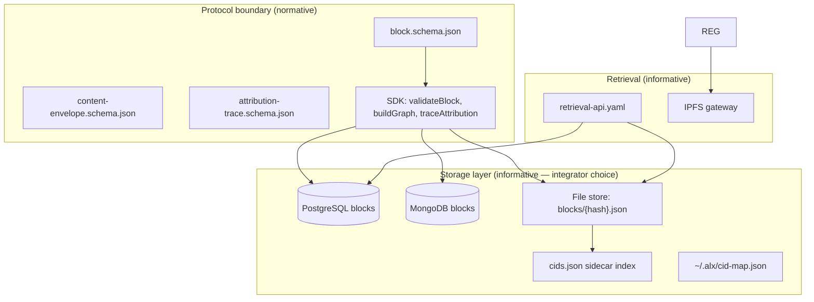

### Block field mapping (impedance mismatch)

The four Block fields map 1:1 across JSON, SQL, MongoDB, and filesystem storage:

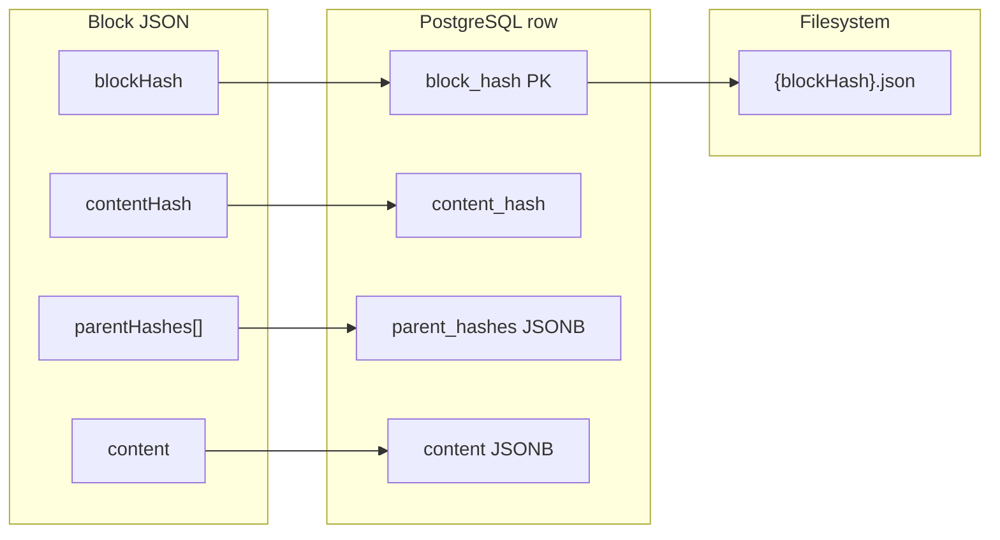

### Lineage DAG (many-to-many across documents)

Each Block stores parent references as hash pointers. A diamond graph emerges across rows:

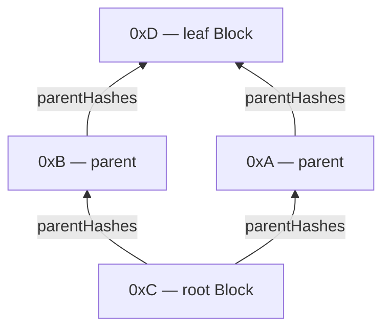

`pathCount` for `0xD` is 2 (two distinct paths from root). `traceAttribution` computes the value; Block rows omit the derived metric.

### `blockHash` And CID Identity

ALX identity and IPFS content addressing are explicitly separate identifiers:

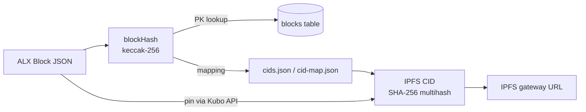

### Minimal And Normalized SQL Schemas

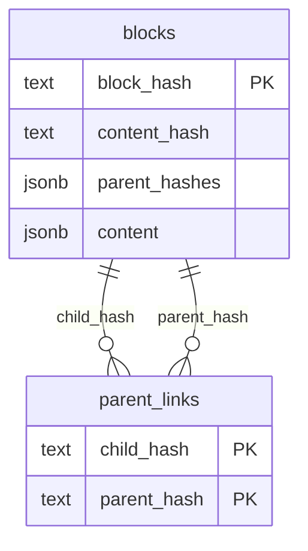

The minimal schema embeds `parent_hashes` in `blocks` and omits `parent_links`. The normalized variant adds referential integrity at the cost of extra writes per edge.

### Normalisation trade-off decision

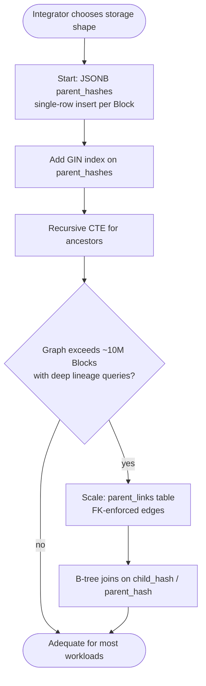

### Integrity enforcement split

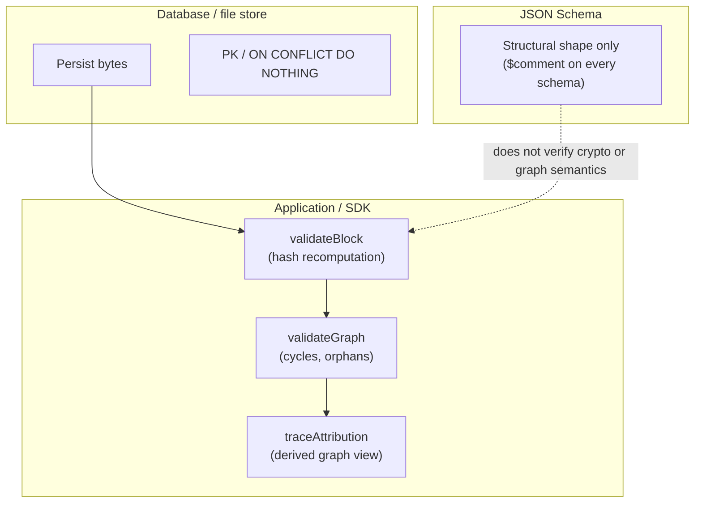

### Block resolution flow

Resolution order implemented in `cli/lib/resolve.js`:

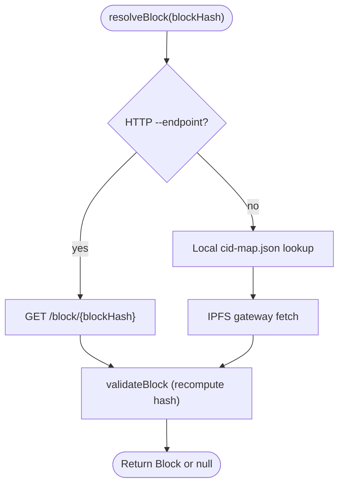

### Lineage query pipeline (SQL + SDK)

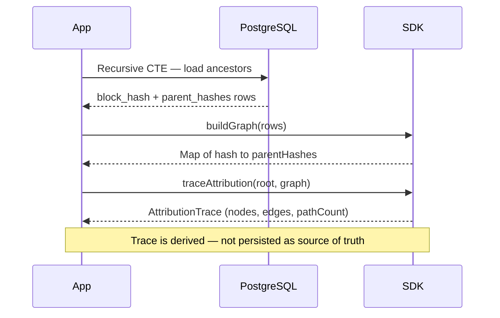

### Common access patterns and indexes

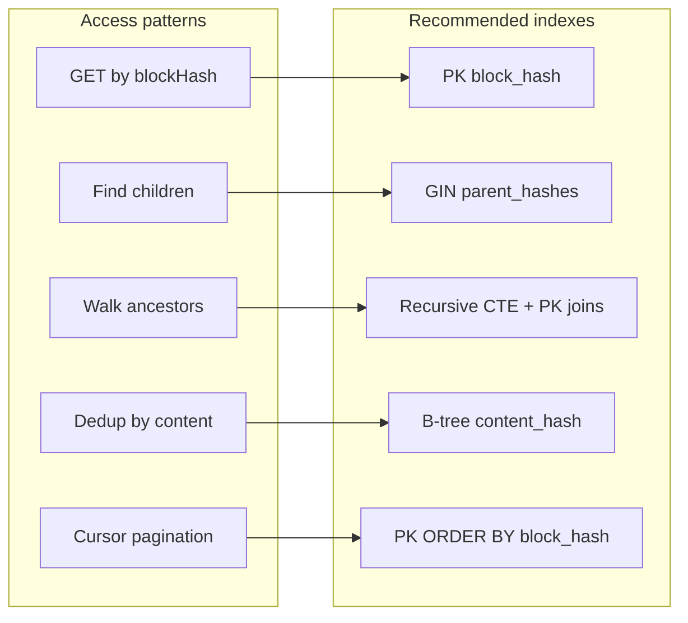

### Content envelope tiers (schema evolution)

Progressive typing inside opaque `content` — optional and backward-compatible:

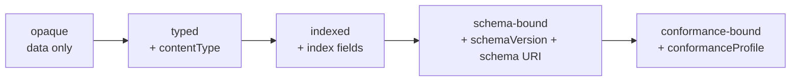

Protocol columns (`block_hash`, etc.) are **schema-on-write**. Envelope `data` is **schema-on-read** at the integrator layer.

### Schema versioning across artefacts

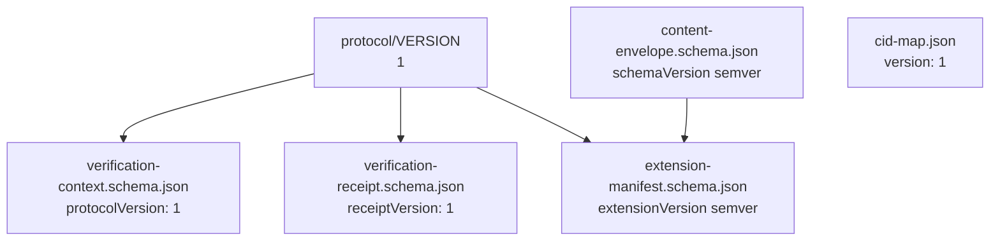

Major protocol bumps gate compatibility; content and extensions evolve independently within v1.

### DDIA principles coverage

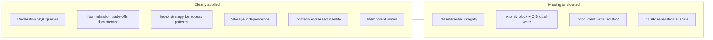

---

## 1. Overall Grade

### A−

ALX Protocol's data model is unusually disciplined for a document-oriented protocol: the core **Block** is a flat, content-addressed record with explicit separation between **identity** (`blockHash`), **content identity** (`contentHash`), **lineage** (`parentHashes`), and **opaque payload** (`content`). That aligns well with Kleppmann's emphasis on choosing structures that match access patterns while keeping storage pluggable.

**Strengths:** canonical JSON Schemas with strict `additionalProperties: false`, tiered optional typing via `content-envelope.schema.json`, and an integrator database guide that documents normalization trade-offs, indexes, recursive lineage queries, idempotent inserts, and cursor pagination. The reference file store validates before write and detects hash collisions.

**Risks:** **referential integrity is largely application-enforced** (no foreign key on `parent_hashes` in the minimal SQL; file store splits blocks and CID index); **AttributionTrace** is a large denormalized derived document; and the reference retrieval store has **no transactional dual-write** between `blocks/{hash}.json` and `cids.json`. These are acceptable at protocol scope but shift burden to integrators at scale.

---

## 2. Data Model Alignment (Chapter 2 – Data Models and Query Languages)

### Relational And Document Storage

The design correctly uses **both models for different jobs**:

- **Document model (canonical):** `block.schema.json` — one JSON object is the unit of verification, transport, and content-addressed storage.
- **Relational model (recommended):** `database-guide.md` — `blocks` table mirrors the four Block fields; graph traversal uses SQL + JSONB or a normalized `parent_links` table.
- **Hybrid reference implementation:** one file per block + sidecar `cids.json` index (`retrieval-store.js`).

This matches DDIA's "use the right tool" guidance: the Block is naturally document-shaped; lineage queries over large graphs benefit from relational indexes and recursive CTEs.

### Impedance mismatch

**Handled well.** The Block schema avoids deep nesting. The four top-level fields in `block.schema.json` are:

- `blockHash`
- `contentHash`
- `parentHashes`
- `content`

Application objects map 1:1 to persistence (`block_hash`, `content_hash`, `parent_hashes`, `content`). Optional structure lives inside `content` via `content-envelope.schema.json` (`definitionLevel`: opaque → typed → indexed → schema-bound → conformance-bound), which avoids forcing all consumers through one rigid envelope.

**AttributionTrace** (`attribution-trace.schema.json`) uses a **materialized graph view** with `nodes[]`, `edges[]`, `leaves[]`, and related fields. The view is appropriate as a **computed API response** rather than the system of record, consistent with derived-data treatment.

### Many-to-one / many-to-many

- **Many-to-one (child → parents):** `parentHashes` array on each Block (maximum 256 per the specification, schema, and canonical vectors).
- **Many-to-many (DAG):** Emerges across blocks — one parent can have many children; diamond graphs are first-class (`block-trace.ts` computes exact `pathCount`).
- **References vs duplication:** Parent references are **hash pointers** rather than embedded documents, which fits a content-addressed lineage graph. The `content_hash` index supports deduplication queries without duplicating lineage.
- **blockHash vs CID:** Explicit dual identity in `retrieval-api.yaml` uses a mapping-table pattern that keeps the identifiers separate.

### Model limitations acknowledged

The repository states that schemas validate **structure only**, excluding cryptographic and graph semantics (`$comment` on every schema; `storage.md` places storage outside the protocol boundary). `verification-context.schema.json` models open-world and closed-world validation explicitly for incomplete Graphs.

### Sub-factor grades (1–5)

| Sub-factor | Score | Rationale |
|---|---:|---|
| **Data locality** | 4 | Block read-by-hash is fully local; lineage requires joins/fetches across hashes |
| **Many-to-many handling** | 4 | DAG via `parentHashes` + documented `parent_links` alternative; no native graph DB |
| **Schema flexibility** | 4 | Opaque `content` + tiered envelope; protocol structs are strict (`additionalProperties: false`) |
| **Impedance mismatch avoidance** | 5 | Block ↔ SQL row ↔ file mapping is direct and documented |
| **Join / graph query fit** | 4 | SQL recursive CTEs + in-memory `Map` for `traceAttribution`; no graph query language |

---

## 3. Schema Design & Normalisation (Chapters 2 and 3)

### SQL normalisation level

**Minimal schema** (from `database-guide.md`):

```sql
CREATE TABLE blocks (
    block_hash    TEXT PRIMARY KEY,
    content_hash  TEXT NOT NULL,
    parent_hashes JSONB NOT NULL DEFAULT '[]',
    content       JSONB NOT NULL
);
```

| Normal form | Assessment |
|---|---|
| **1NF** | Yes — atomic columns; `parent_hashes` is a JSON array (debatably a 1NF violation in strict terms, but intentional) |
| **2NF / 3NF** | Effectively yes for the single entity — no partial key dependencies on a composite key |
| **BCNF** | Not pursued; `content` can repeat across rows with the same `content_hash` (intentional content dedup scenario) |

**Deliberate denormalisation:** `parent_hashes` embedded in the Block row mirrors the protocol document — justified for **write simplicity** and **1:1 mapping to API payloads**. The guide explicitly compares this to normalized `parent_links`:

```sql
CREATE TABLE parent_links (
    child_hash  TEXT NOT NULL REFERENCES blocks(block_hash),
    parent_hash TEXT NOT NULL REFERENCES blocks(block_hash),
    PRIMARY KEY (child_hash, parent_hash)
);
```

**Recommendation in guide:** start with JSONB; switch to `parent_links` beyond ~10 million blocks with deep lineage chains — a sound DDIA-style trade-off call.

### JSON Document Structure And Read Patterns

| Document | Read pattern fit | Update anomaly risk |
|---|---|---|
| **Block** | Point lookup by hash; whole-document fetch | Low — immutable identity; new parent set = new blockHash |
| **AttributionTrace** | Single response for graph analytics | N/A if treated as derived/cache; high if stored as source of truth |
| **VerificationReceipt** | Optional application audit record | Append-only; low |
| **Content envelope `index`** | Search/retrieval within opaque content | Medium — index fields can stale if content changes (but content change changes hashes) |

### Database And Application Integrity

| Constraint | Where enforced | Risk |
|---|---|---|
| `blockHash` matches content + parents | SDK `validateBlock` | **High** if DB accepts unvalidated rows |
| Hash format `^0x[a-f0-9]{64}$` | JSON Schema only | Medium — SQL has no CHECK |
| `parentHashes` sorted/deduped | Protocol implementation | Medium — JSONB array order not constrained in SQL |
| Parent existence (closed-world) | `validateGraph` / application | **High** in minimal schema — no FK on `parent_hashes` |
| Acyclic graph | `validateGraph` | Application-only |
| CID ↔ blockHash mapping | `retrieval-store.js` | **Medium** — separate files, no transaction |
| Same hash, different content | `putBlock` conflict check | Good in reference impl; `ON CONFLICT DO NOTHING` safe only because hash is content-derived |

The design **consciously splits responsibilities**: the database stores bytes; the protocol verifies meaning. That matches storage independence but violates strict "database as gatekeeper" unless integrators add triggers or CHECK constraints.

---

## 4. Query Language & Operability (Chapters 2, 3, and 5)

### SQL query quality

Queries in `database-guide.md` are **declarative and optimizer-friendly**:

- Point read: `WHERE block_hash = $1` (primary key)
- Children: `parent_hashes @> $1::jsonb` (GIN-backed)
- Ancestors: recursive CTE with `jsonb_array_elements_text`
- Idempotent insert: `ON CONFLICT (block_hash) DO NOTHING`
- Pagination: keyset on `block_hash`, avoids `OFFSET`

The graph reconstruction pattern loads rows then calls `buildGraph` / `traceAttribution` — correct separation: **SQL for persistence traversal, SDK for semantics**.

### Index strategy

| Index | Query served | Assessment |
|---|---|---|
| PK `block_hash` | GET by hash, cursor pagination | Correct |
| `idx_blocks_content_hash` | Dedup / same-content lookup | Correct for read-heavy dedup |
| GIN on `parent_hashes` | Find children | Correct; **write amplification** on hot parent nodes |
| Expression index on `attestation->>'attester'` | Signed-block queries | Good optional extension |

**Risks:**

- **Full table scan** on child queries without GIN (explicitly documented).
- **Hot spots:** popular parent hashes (many children) inflate GIN postings.
- **Recursive CTE depth:** deep graphs may hit planner/memory limits before 10M blocks.
- **Reference file store:** `getBlocks()` is O(n) sequential reads — no index beyond filesystem path.

### OLTP And OLAP Workloads

The protocol excludes an analytics warehouse or column store. `AttributionTrace` is OLAP-shaped but computed in-process (`traceAttribution` O(V+E)). Fleet-wide lineage analytics can use **ETL to a column store** as an external application capability.

### Operational concerns

Documented well: bulk import transactions, connection pooling, batch sizes 100–500, prepared statements, async write buffers (`database-guide.md`).

**Gaps:**

- Reference `cids.json` rewritten whole-file on each CID update — **serialization bottleneck**
- No pagination on HTTP batch retrieve beyond client-side hash lists (`POST /blocks`)
- the `resolve.js` CID map is a single JSON file — concurrent CLI writes can race
- No replication/HA guidance (explicitly out of scope in database guide)

---

## 5. Evolvability & Schema Evolution (Chapter 4 – Encoding and Evolution)

### JSON schema evolution

**Strong forward-compat patterns:**

- Optional fields via `definitionLevel` conditionals in `content-envelope.schema.json`
- Version constants: `protocolVersion: "1"`, `receiptVersion: "1"`, `packageVersion: "1"`
- Semver for content schemas: `schemaVersion` in envelope; extension versions in `extension-manifest.schema.json`
- Published `$id` URLs under `xandrlabs.github.io` — stable schema identity
- `compatibleProtocolVersions` on extensions

**Breaking-change friction (intentional):**

- `additionalProperties: false` everywhere — new fields require schema revision
- Renames are breaking unless handled by dual-schema migration
- `$comment` clarifies schema vs verifier semantics — good for evolution boundaries

### SQL migration risk

Minimal four-column schema minimizes DDL churn. Adding columns (e.g. `created_at`, `attestation JSONB`) is low-risk. Promoting `parent_links` normalization is a **heavy migration** (backfill edges); the guide provides migration-timing criteria.

JSONB `content` is **schema-on-read** for payload; table columns are **schema-on-write** for protocol fields — an appropriate split.

### Versioning strategy implied by artefacts

```
protocol/VERSION                → protocol version "1"
verification-context.schema.json → protocolVersion const "1"
extension-manifest.schema.json   → extensionVersion semver + lifecycle
content-envelope.schema.json     → schemaVersion semver + schema URI
resolve.js CID map               → version: "1"
```

Backward compatibility is **major-version scoped** at protocol level; content evolves via envelope tiers and extension manifests.

---

## 6. Principles Coverage Inventory

| Principle | Status | Chapter | Evidence |
|---|---|---|---|
| Favour declarative query languages | **Applied** | Ch.2 | Recursive CTEs, JSONB containment in `database-guide.md` |
| Data locality through nested documents | **Partial** | Ch.2 | Block is flat (good for identity); trace is nested derived doc |
| Normalisation vs denormalisation trade-offs | **Applied** | Ch.3 | JSONB `parent_hashes` vs `parent_links` comparison table |
| Index selection for read/write workloads | **Applied** | Ch.3 | PK, B-tree on `content_hash`, GIN on parents, cursor pagination |
| Schema evolution without downtime | **Partial** | Ch.4 | Version fields + optional envelope tiers; strict `additionalProperties` limits silent evolution |
| Avoid impedance mismatch | **Applied** | Ch.2 | Four-field Block maps 1:1 to SQL row and `.json` file |
| Many-to-many via graph structure | **Applied** | Ch.2 | DAG through `parentHashes`; `traceAttribution` over `Map<string,string[]>` |
| Storage independence | **Applied** | Ch.2–3 | `storage.md`: validity independent of persistence location |
| Content-addressed identity | **Applied** | Ch.2 | `blockHash` / `contentHash` keccak-256 derivation |
| Single source of truth for structure | **Applied** | Ch.4 | Canonical schemas under `protocol/schemas/` |
| Database-enforced referential integrity | **Missing** | Ch.2 | Minimal SQL has no FK on `parent_hashes`; orphans allowed |
| Atomic dual-write (block + index) | **Violated** | Ch.7 | `retrieval-store.js`: separate block files and `cids.json` |
| Transaction isolation for concurrent writes | **Missing** | Ch.7 | File-backed CID map is not lock-safe |
| Separation of OLTP and analytics | **N/A / Missing** | Ch.3 | No warehouse; trace computed in SDK (fine at current scale) |
| Idempotent writes | **Applied** | Ch.3 | `ON CONFLICT DO NOTHING`; `putBlock` returns `exists` vs `conflict` |

> **Note:** Chapter 7 (*Transactions*) is adjacent to DDIA storage reliability themes even though the primary audit rubric focused on Chapters 2–5.

---

## 7. Actionable Recommendations

Ordered by impact on grade. Each item ties directly to a DDIA concept.

### 1. Add optional SQL integrity pack (Ch.2 – relational constraints)

Publish supplementary DDL with:

- `CHECK (block_hash ~ '^0x[a-f0-9]{64}$')`
- Optional `parent_links` with foreign keys
- Optional trigger or application hook documenting `validateBlock` semantics

Closes the application/database responsibility gap while preserving the minimal schema.

### 2. Document closed-world ingest order (Ch.2 – referential integrity)

Require topological insert (parents before children) or deferred constraint checks when using `parent_links`. Tie to `validateGraph` closed-world mode in `verification-context.schema.json`.

### 3. Make reference store dual-write atomic (Ch.7 – transactions)

Write block + CID mapping via temp file + rename, or use SQLite for the reference server. Fixes `retrieval-store.js` / `cids.json` consistency risk.

### 4. Add composite index guidance for time-ordered queries (Ch.3 – index selection)

If integrators add `created_at`, document `(created_at, block_hash)` for "recent blocks," a common agent pipeline pattern currently outside the guide.

### 5. Define `AttributionTrace` As Derived Data

Add an integrator note that traces should be computed or cached with TTL rather than stored as canonical rows alongside Blocks, avoiding update-anomaly confusion.

### 6. Batch CID index updates (Ch.3 – write amplification)

Replace whole-file `cids.json` rewrite with append-only log or embed CID in the block file when provided at POST time — reduces hot-write path in reference implementation.

### 7. Extension schema compatibility matrix (Ch.4 – evolution)

Link `extension-manifest.schema.json` `compatibleProtocolVersions` to a published migration guide when protocol v2 ships — forward-compat story is good for v1 extensions but untested across major bumps.

### 8. Lineage query depth limits (Ch.3 – operability)

Document workload-specific PostgreSQL `work_mem` and recursion limits for recursive CTEs. These limits remain deployment controls outside protocol validity.

---

## Summary

`alx-protocol` is a **strong protocol-level data design** with unusually good integrator SQL guidance. The design aligns closely with DDIA on model choice, denormalisation trade-offs, declarative lineage queries, and schema evolution boundaries.

The main gaps are **expected for a storage-agnostic protocol** but would matter in production: **referential integrity in SQL**, **atomic index updates in the reference store**, and **explicit guidance that AttributionTrace is derived rather than stored**.

---

## Related Documents

- [`database-guide.md`](./database-guide.md) — recommended PostgreSQL, SQLite, and MongoDB schemas
- [`storage.md`](./storage.md) — storage independence principle
- [`performance.md`](./performance.md) — SDK operation costs and optimization patterns
- [`../architecture.md`](../architecture.md) — layered protocol architecture
- [`../../protocol/schemas/`](../../protocol/schemas/) — canonical JSON Schemas
- [`../../protocol/retrieval-api.yaml`](../../protocol/retrieval-api.yaml) — Block retrieval HTTP contract
