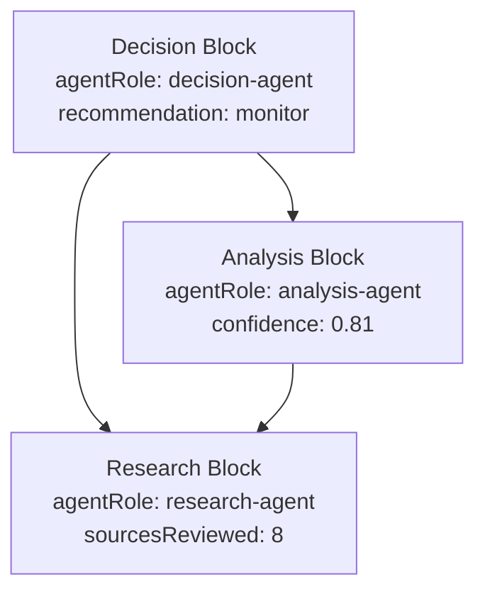
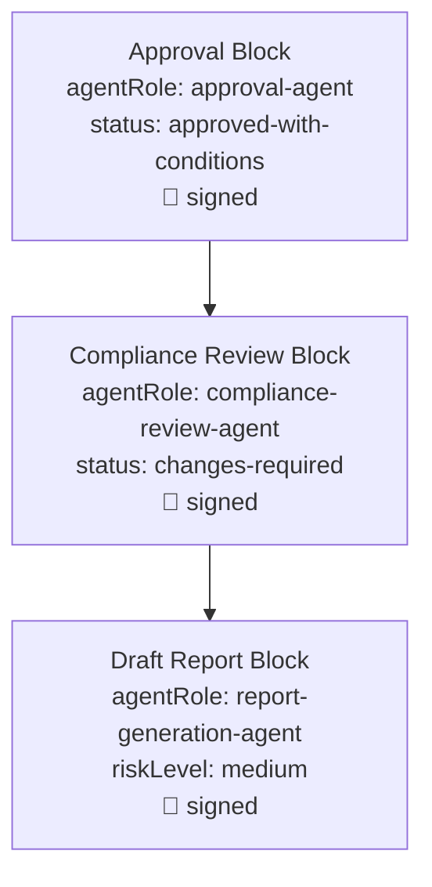
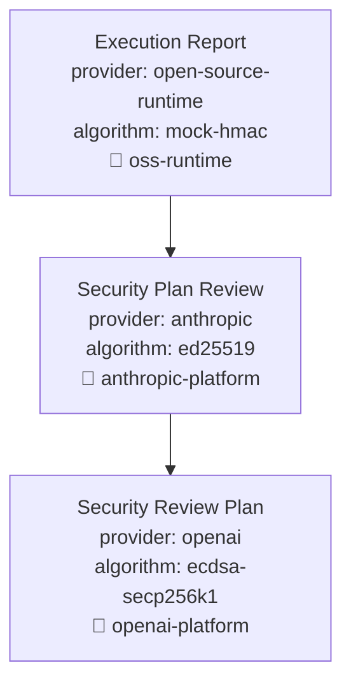

# Real-World Workflow Examples

The document demonstrates product-facing workflow patterns around ALX Protocol. Workflow examples remain outside the protocol specification. See [`protocol/spec.md`](../../protocol/spec.md).

---

## Purpose

Three workflow examples show how product systems can use Blocks, lineage, Trace output, and receipts. Each example uses realistic, high-value content.

> Content is realistic application-layer data. The protocol treats domain semantics as opaque. Identity is derived from canonical content + lineage.

## Scope

- Multi-agent research pipeline (provenance, attribution)
- Compliance audit trail (tamper detection, signed attestations)
- Multi-vendor agent marketplace (cross-organizational trust, algorithm-agnostic signing)

## Non-Goals

- Domain-specific validation (the protocol evaluates no financial, medical, or security correctness)
- Storage or transport patterns (see [Storage Guide](./storage.md))
- Settlement economics (see [Settlement](./settlement.md))

---

## 1. Multi-Agent Research Pipeline

**Properties demonstrated:** Deterministic identity, lineage-sensitive blockHash, stable contentHash, pathCount reflecting multi-source contribution.

**Scenario:** An investment firm runs three agents: a research agent gathers raw market data, an analysis agent synthesizes findings from two research branches, and a decision agent produces a final recommendation. The decision Block references both the research and analysis, so `pathCount` shows dual contribution from the research.

### Graph



The research Block is reachable from the decision via two paths: directly (`decision -> research`) and indirectly (`decision -> analysis -> research`). This means `pathCount = 2` for the research node.

### Code

```js
import {
  createBlock,
  buildGraph,
  validateGraph,
  traceAttribution,
} from "@alx-protocol/sdk";

// --- Step 1: Research agent gathers raw market data ---

const researchBlock = createBlock({
  workflow: "multi-agent-research",
  task: "evaluate-gpu-infrastructure-demand",
  agentRole: "research-agent",
  findings: [
    {
      claim: "GPU demand remains elevated due to AI training and inference workloads.",
      evidenceType: "market-signal",
      confidence: 0.86,
    },
    {
      claim: "Enterprise inference workloads are becoming a larger share of accelerator demand.",
      evidenceType: "adoption-pattern",
      confidence: 0.79,
    },
  ],
  sourcesReviewed: 8,
  outputType: "research-brief",
});

// --- Step 2: Analysis agent synthesizes findings ---

const analysisBlock = createBlock(
  {
    workflow: "multi-agent-research",
    task: "analyze-gpu-infrastructure-demand",
    agentRole: "analysis-agent",
    dependsOn: ["market-research"],
    conclusion:
      "Demand is likely to remain structurally strong, but supply constraints and margin pressure create execution risk.",
    riskFactors: [
      "supply-chain constraints",
      "customer concentration",
      "pricing compression",
      "regulatory restrictions",
    ],
    confidence: 0.81,
    outputType: "investment-analysis",
  },
  [researchBlock.blockHash],
);

// --- Step 3: Decision agent produces final recommendation ---
// References both research (directly) and analysis (which also references research).

const decisionBlock = createBlock(
  {
    workflow: "multi-agent-research",
    task: "produce-investment-thesis",
    agentRole: "decision-agent",
    recommendation: "monitor",
    rationale:
      "The opportunity is strong, but risk-adjusted timing requires further validation.",
    requiredFollowUps: [
      "compare revenue growth against capex expansion",
      "review customer concentration",
      "track inference margin trends",
    ],
    outputType: "decision-memo",
  },
  [researchBlock.blockHash, analysisBlock.blockHash],
);

// --- Verify the entire pipeline ---

const graph = buildGraph([researchBlock, analysisBlock, decisionBlock]);
const graphResult = validateGraph(graph);
console.log(graphResult.ok);     // true
console.log(graphResult.blocks); // 3
console.log(graphResult.edges);  // 3

// --- Trace attribution from the decision ---

const trace = traceAttribution(decisionBlock.blockHash, graph);
console.log(trace.nodes.length); // 3
console.log(trace.leaves);       // [researchBlock.blockHash] - the original source

const researchNode = trace.nodes.find((n) => n.hash === researchBlock.blockHash);
console.log(researchNode.pathCount); // 2 - reached via two distinct paths
```

### Multi-Agent Pipeline Verification Outcome

| Property | Demonstrated by |
|----------|----------------|
| **Deterministic identity** | `createBlock` with the same content always produces the same `blockHash` |
| **Lineage changes identity** | Analysis Block with research as parent has a different `blockHash` than analysis without |
| **Content identity is stable** | Same content + different parents -> different `blockHash`, same `contentHash` |
| **pathCount reflects contribution** | Research Block has `pathCount = 2` because decision references it directly and indirectly via analysis |
| **Graph validation** | `validateGraph` confirms no cycles, self-references, or missing parents |

---

## 2. Compliance Audit Trail

**Properties demonstrated:** Signed attestations, tamper detection, immutable chain of custody, attestation orthogonal to identity.

**Scenario:** A report-generation agent produces a financial risk summary. A compliance-review agent checks the summary and flags issues. An approval agent signs off with conditions. Each step is signed by the responsible agent. Any retroactive tampering invalidates the chain.

### Graph



### Code

```js
import {
  createBlock,
  createSignedBlock,
  validateBlock,
  validateSignedBlock,
  buildGraph,
  validateGraph,
} from "@alx-protocol/sdk";

// Use any Signer implementation - mock shown here, see Eip712Signer for production.
// Each agent has its own signing identity.

const reportSigner = { /* Signer for report-generation-agent */ };
const reviewSigner = { /* Signer for compliance-review-agent */ };
const approvalSigner = { /* Signer for approval-agent */ };

// --- Step 1: AI generates a draft financial risk summary ---

const reportBlock = await createSignedBlock(
  {
    workflow: "compliance-audit-trail",
    task: "generate-financial-risk-summary",
    agentRole: "report-generation-agent",
    reportType: "financial-risk-summary",
    summary:
      "The customer shows moderate liquidity risk due to increased debt obligations and uneven cash flow.",
    riskLevel: "medium",
    assumptions: [
      "cash flow data is current as of report generation",
      "no undisclosed liabilities are present",
      "credit exposure remains within policy limits",
    ],
    requiredReview: true,
    outputType: "draft-report",
  },
  [],
  reportSigner,
);

// --- Step 2: Compliance review agent checks the report ---

const reviewBlock = await createSignedBlock(
  {
    workflow: "compliance-audit-trail",
    task: "review-financial-risk-summary",
    agentRole: "compliance-review-agent",
    reviewStatus: "changes-required",
    findings: [
      {
        issue: "Risk summary lacks explicit source references.",
        severity: "medium",
        requiredAction: "attach source evidence for each material claim",
      },
      {
        issue: "Confidence score missing from final recommendation.",
        severity: "low",
        requiredAction: "include confidence score before approval",
      },
    ],
    outputType: "compliance-review",
  },
  [reportBlock.blockHash],
  reviewSigner,
);

// --- Step 3: Approval agent signs off with conditions ---

const approvalBlock = await createSignedBlock(
  {
    workflow: "compliance-audit-trail",
    task: "approve-reviewed-report",
    agentRole: "approval-agent",
    approvalStatus: "approved-with-conditions",
    conditions: [
      "source references must remain attached",
      "material claims must remain traceable to reviewed evidence",
    ],
    signedOffBy: "approval-agent",
    outputType: "approval-record",
  },
  [reviewBlock.blockHash],
  approvalSigner,
);

// --- Verify the full audit chain ---

const graph = buildGraph([reportBlock, reviewBlock, approvalBlock]);
console.log(validateGraph(graph).ok); // true

// Each block carries its agent's attestation
console.log(reportBlock.attestation.attester);  // "report-generation-agent"
console.log(reviewBlock.attestation.attester);   // "compliance-review-agent"
console.log(approvalBlock.attestation.attester); // "approval-agent"

// --- Tamper detection ---

const tamperedReport = { ...reportBlock, content: { ...reportBlock.content, riskLevel: "low" } };
console.log(validateBlock(tamperedReport).ok); // false - integrity broken

// --- Attestation is separate from identity ---

const unsignedReport = createBlock(reportBlock.content);
console.log(unsignedReport.blockHash === reportBlock.blockHash); // true - same identity
console.log(unsignedReport.attestation);                          // undefined - no signature
```

### Compliance Audit Verification Outcome

| Property | Demonstrated by |
|----------|----------------|
| **Immutable chain** | Any retroactive change to `riskLevel` invalidates the report Block's hash |
| **Role-based signing** | Each agent signs its own step; signatures don't alter block identity |
| **Attestation is orthogonal** | Signed and unsigned Blocks with same content have same `blockHash` |
| **Audit-ready** | An external regulator can verify the entire graph with only the Blocks and the protocol |
| **Tamper detection** | `validateBlock` on modified content returns `ok: false` |

---

## 3. Multi-Vendor Agent Marketplace

**Properties demonstrated:** Cross-vendor lineage, algorithm-agnostic signing, vendor identity separate from block identity, protocol interoperability without shared runtime.

**Scenario:** A SaaS security review pipeline uses agents from three different providers. An OpenAI planning agent defines the review scope. An Anthropic review agent identifies gaps. An open-source execution agent runs the actual checks. Each vendor signs with a vendor-chosen algorithm; the protocol accepts any conformant signing algorithm.

### Graph



### Code

```js
import {
  createSignedBlock,
  buildGraph,
  validateGraph,
  traceAttribution,
} from "@alx-protocol/sdk";

// Each vendor provides a Signer conforming to the protocol interface.
// Algorithm is vendor-specific - the protocol is agnostic.

const openaiSigner = {
  algorithm: "ecdsa-secp256k1",
  getId: async () => "openai-platform",
  sign: async (data) => { /* vendor-specific: AWS KMS, HSM, etc. */ },
};

const anthropicSigner = {
  algorithm: "ed25519",
  getId: async () => "anthropic-platform",
  sign: async (data) => { /* vendor-specific signing service */ },
};

const ossSigner = {
  algorithm: "mock-hmac",
  getId: async () => "oss-runtime",
  sign: async (data) => { /* open-source signing implementation */ },
};

// --- Step 1: OpenAI planning agent defines scope ---

const planBlock = await createSignedBlock(
  {
    workflow: "multi-vendor-agent-marketplace",
    task: "plan-saas-security-review",
    provider: "openai",
    agentRole: "planning-agent",
    plan: [
      "review authentication boundaries",
      "inspect authorization checks",
      "validate billing webhook handling",
      "check tenant isolation",
      "review audit logging",
    ],
    outputType: "security-review-plan",
  },
  [],
  openaiSigner,
);

// --- Step 2: Anthropic review agent identifies gaps ---

const reviewBlock = await createSignedBlock(
  {
    workflow: "multi-vendor-agent-marketplace",
    task: "review-saas-security-plan",
    provider: "anthropic",
    agentRole: "review-agent",
    review: {
      strengths: [
        "covers critical SaaS control points",
        "includes billing and tenant-isolation risks",
      ],
      gaps: [
        "missing rate-limit abuse testing",
        "missing incident-response validation",
        "missing secret-rotation review",
      ],
    },
    outputType: "security-plan-review",
  },
  [planBlock.blockHash],
  anthropicSigner,
);

// --- Step 3: Open-source agent executes the checks ---

const execBlock = await createSignedBlock(
  {
    workflow: "multi-vendor-agent-marketplace",
    task: "execute-saas-security-checklist",
    provider: "open-source-runtime",
    agentRole: "execution-agent",
    completedChecks: [
      "auth-session-expiration",
      "rbac-route-protection",
      "webhook-signature-verification",
      "tenant-data-access-boundaries",
    ],
    failedChecks: [
      {
        check: "rate-limit-abuse-testing",
        reason: "no rate-limit policy found for public API routes",
      },
    ],
    outputType: "execution-report",
  },
  [reviewBlock.blockHash],
  ossSigner,
);

// --- Verify the cross-vendor pipeline ---

const graph = buildGraph([planBlock, reviewBlock, execBlock]);
console.log(validateGraph(graph).ok); // true - protocol doesn't care about vendor

// Each block carries its vendor's algorithm and identity
console.log(planBlock.attestation.algorithm);   // "ecdsa-secp256k1"
console.log(reviewBlock.attestation.algorithm); // "ed25519"
console.log(execBlock.attestation.algorithm);   // "mock-hmac"

// --- Cross-vendor attribution trace ---

const trace = traceAttribution(execBlock.blockHash, graph);
console.log(trace.nodes.length); // 3
console.log(trace.maxDepth);     // 2
console.log(trace.leaves);       // [planBlock.blockHash] - OpenAI initiated

// --- Vendor identity is separate from block identity ---

// If Anthropic signs the same plan content, blockHash is identical.
// Only the attestation differs.
const anthropicPlan = await createSignedBlock(
  planBlock.content,
  [],
  anthropicSigner,
);
console.log(anthropicPlan.blockHash === planBlock.blockHash);       // true
console.log(anthropicPlan.attestation.attester);                     // "anthropic-platform"
console.log(anthropicPlan.attestation.algorithm);                    // "ed25519"
console.log(anthropicPlan.attestation.attester === planBlock.attestation.attester); // false
```

### Multi-Vendor Marketplace Verification Outcome

| Property | Demonstrated by |
|----------|----------------|
| **Algorithm-agnostic** | Three different signing algorithms in one Graph |
| **Vendor-neutral** | Graph validates regardless of which providers contributed |
| **Deterministic identity** | Same content and parentHashes produce identical `blockHash` regardless of which vendor created the Block |
| **Cross-vendor trace** | `traceAttribution` works across vendor boundaries |
| **No central coordinator** | Each vendor signs independently; verification is decentralized |

---

## Related Documents

- [`./agent-frameworks.md`](./agent-frameworks.md) - framework-specific integration patterns (LangChain, CrewAI, AutoGen)
- [`./api-reference.md`](./api-reference.md) - full SDK API reference
- [`./quickstart.md`](./quickstart.md) - five-minute getting-started tutorial
- [`./settlement.md`](./settlement.md) - using `pathCount` for economic coordination
- [`../../protocol/spec.md`](../../protocol/spec.md) - normative specification
