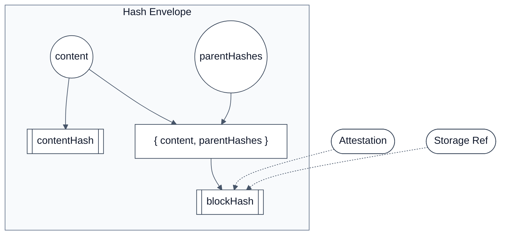
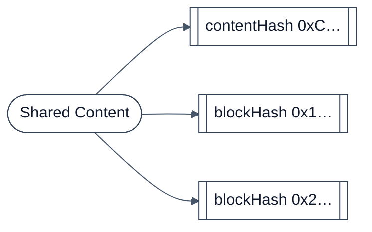
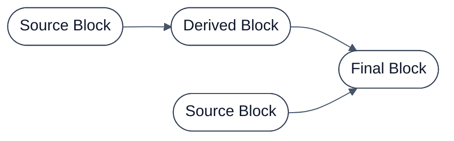
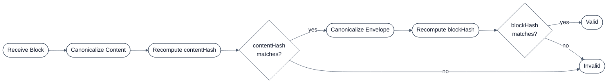
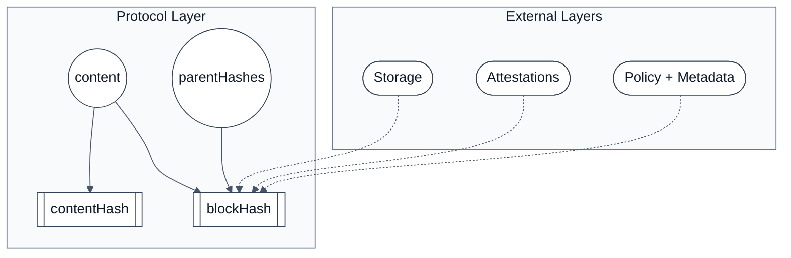
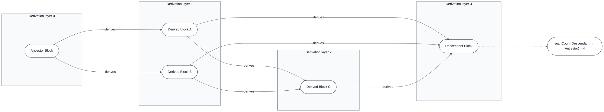
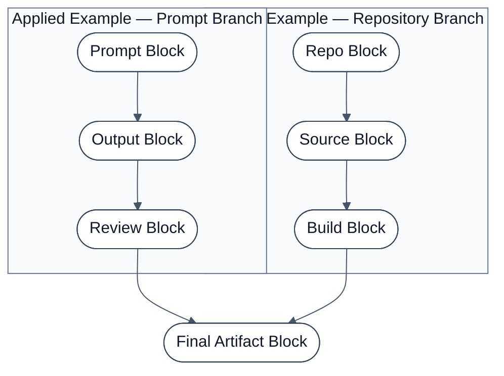

# ALX Protocol — Whitepaper Figure Packages

<strong>Publication-Ready Figures For Technical Documentation</strong>

<em>70% Agnostic Protocol · 30% Applied Composition Examples</em>

---

## Chart Strategy

### Core Protocol Figures (Agnostic — Part III)

Figures **1–5** appear early in the whitepaper. The figures visualize only protocol primitives: `content`, `parentHashes`, `contentHash`, `blockHash`, Block identity, local verification, derivation Graph structure, and external attachments. The figures exclude prompts, GitHub, specific SDKs, storage vendors, and AI workflows.

### Applied Composition Figures (Examples — Part V)

Figures **6–7** appear later as **illustrative application examples** rather than protocol requirements. The figures show how the same Block primitive composes across SDK-mediated creation, prompts, repositories, and agent outputs.

### Content Opacity (Whitepaper Framing)

> ALX Protocol leaves digital-material types to applications. A Block may carry a prompt, model output, agent handoff, evaluation result, workflow state, repository reference, build record, policy decision, or other JSON-serializable content. Application-layer conventions define payload types. The protocol verifies the same structural properties in each case: Block identity, content integrity, declared parent lineage, and derivation Graph relationships.

### Non-Goals (This Document)

- Keeps [`whitepaper.md`](./whitepaper.md) inline figures and numbering unchanged pending a later integration pass
- Defers benchmark bar charts until cited data supports whitepaper claims
- Defers CI coverage for diagram export resolution

---

## White Paper Visual Standards

Standards below adapt general white-paper visual design guidance to ALX's Mermaid-first, protocol-spec context. Where a guideline conflicts with repository constraints, the **verdict** column records adopt, adapt, or push back.

### Purpose Gate

Before adding any figure, require a yes to at least one:

- Simplifies a complex protocol concept (hash envelope, verification, `pathCount`)
- Provides cited proof (benchmarks, TEI study) — **only when data exists**
- Helps the reader understand a process, architecture, or comparison

When all three answers are no, use prose or a pull quote instead of a figure.

### Accept / Adapt / Pushback Matrix

| Principle | Verdict | ALX application |
|---|---|---|
| Restrained palette, 2–3 brand colors | **Adapt** | In-repo diagrams use **line style + shape** as primary signal (solid/dashed, rounded/rect/diamond). Brand palette is **export-time** guidance for Figma/Illustrator redraw — not `classDef` fills in Mermaid (breaks Mintlify dark mode; fails color-blind-only tests). |
| 8–10pt typography | **Adapt** | Enforce **short node labels** (≤4 words per node where possible) in source; final point size is an export concern. |
| Bar/line/scatter charts | **Push back** (for now) | Protocol figures are flowcharts and architecture diagrams. Benchmark data lives in [`benchmarks.md`](./benchmarks.md) but is not whitepaper-grade cited TEI. Do **not** add chart templates until a figure has a named source and a single claim. |
| Infographics, pyramids, buzzword loops | **Push back** | Replace with concrete process or architecture (Figures 1–7). [`whitepaper.md`](./whitepaper.md) Figure 4 adoption phases is a future refactor risk — not touched in this pass. |
| Cloud/DB/server iconography | **Push back** (agnostic figures) | Figures 1–5 stay abstract boxes — icons imply vendor-specific infrastructure and fight content opacity. Icons permissible only in applied examples (6–7) if redrawn in one consistent set at export. |
| Data integrity (axes at zero, etc.) | **N/A** | No quantitative charts in the current figure set. When added later, require on-visual source citation. |
| Architecture diagram best practices | **Adopt** | Layering (Figures 1–5 core, 6–7 applied), consistent arrow semantics, bounding boxes (`subgraph`), directionality legend. |
| Descriptive insight captions | **Adopt** | Every caption states claim + implication — not title only (see figure package template below). |
| Cross-reference before appearance | **Adopt** | Each figure package includes a **Lead-in** field for authors pasting into body text. |
| Vector/300dpi export | **Adapt** | Mermaid source in this file is canonical; SVG export via Mermaid CLI or Mintlify; 300dpi PNG for print is a one-time production step, not a CI requirement. |
| Accessibility | **Adopt** | Never rely on color alone; duplicate meaning in labels and line styles; test grayscale export. |
| Orphan visuals / marketing fluff / slide-deck paste | **Adopt** | Each figure gets Lead-in + Takeaway; no standalone buzzword diagrams. |

### When To Use Which Visual (Protocol-Scoped)

| Type | Use in ALX whitepaper | Do not use for |
|---|---|---|
| Flowchart | Verification flow (Fig 3), SDK creation (Fig 6) | Generic "AI loop" metaphors |
| Architecture diagram | Hash envelope (Fig 1), protocol boundary (Fig 4) | Vendor-specific cloud layouts in Part III |
| Derivation graph | Lineage + `pathCount` (Fig 2, 5) | Org charts or maturity pyramids |
| Comparison matrix | Future: ALX vs signed logs (prose table OK) | Feature checkbox marketing grids |
| Bar/line chart | Only with cited benchmark from named harness/study | Implied performance without data |

### ALX Pre-Publish Checklist

- Single clear key message per figure
- No 3D, gradients, or decorative chartjunk
- Labels readable at Mintlify preview (no micro-type in dense nodes)
- Meaning conveyed by shape and line style in addition to color; captions carry the line-style key without a separate legend box
- Insight-rich caption (figure + caption understandable alone)
- Data source on-visual **if** quantitative
- Lead-in sentence drafted for body text
- Mermaid source committed; export format noted for PDF
- Second reader test: Takeaway field answers "so what?"

### Figure Package Template

Each figure below follows:

| Field | Role |
|---|---|
| **Visual type** | Flowchart, architecture diagram, or derivation graph |
| **Key message** | One sentence — the single point this figure proves |
| **Lead-in** | Body-text sentence referencing the figure before it appears |
| **Takeaway** | One sentence for the reader |
| **Mermaid** | Source diagram |
| **Explanation** | Supporting prose |

---

## Protocol Boundary (All Figures)

**ALX verifies structure:** Block identity (`blockHash`), content integrity (`contentHash`), declared parent lineage (`parentHashes`), derivation Graph relationships, and structural `pathCount`.

**Verification exclusions:** semantic truth, content quality, real-world authorship, storage availability, legal status, policy compliance, institutional trust, and economic meaning.

---

## Visual Design Norms

| Element | Convention |
|---|---|
| **Solid arrow** | `parentHashes` parent reference (parent Block → child Block) |
| **Dashed arrow** | External attachment (attestation, storage reference, schema, policy, etc.) |
| **Rounded node `( )`** | Block or protocol input field |
| **Rectangular node `[ ]`** | Hash output |
| **Diamond `{ }`** | Verification decision |
| **Layout** | `LR` for processes and chains; `TB` for layered architecture |
| **Density** | One concept per figure; ≤8–10 nodes where possible |
| **Legends** | Avoid in-diagram legend boxes; explain solid vs dashed line meaning in the figure **Caption** |
| **Lineage arrows** | Solid arrows run **parent Block → child Block** (child declares parent in `parentHashes`) |

**Primary Signals (In-Repo):** solid vs dashed arrows, node shapes, subgraph bounding boxes. Figure captions state line-style meaning instead of separate in-diagram legend boxes.

**Palette** (Mermaid `theme: base` — see [`mermaid-theme.json`](./assets/whitepaper-figures/mermaid-theme.json)):

| Role | Hex | Use |
|---|---|---|
| Background | `#FFFFFF` | Canvas |
| Node fill | `#F8FAFC` / `#F1F5F9` / `#E2E8F0` | Protocol nodes |
| Subgraph fill | `#F8FAFC` | Grouping boxes |
| Border / edge | `#334155` / `#475569` / `#64748B` | Slate blue-grey |
| Text | `#0F172A` / `#1E293B` / `#334155` | Labels |

**Export Styling Reference** (Figma/Illustrator redraw — matches Mermaid theme above):

| Class | Role | Suggested export fill |
|---|---|---|
| `protocol` | Core protocol layer | `#F8FAFC` |
| `hash` | `contentHash` / `blockHash` | `#F1F5F9` |
| `external` | External attachment (dashed border) | `#E2E8F0` |
| `metric` | Structural `pathCount` | `#CBD5E1` |
| `valid` / `invalid` | Verification result | `#F1F5F9` / `#94A3B8` |
| `applied` | Application-layer example (Figures 6–7) | `#F8FAFC` |

---

## Figure Index

| Figure | Title | Section | Type |
|---|---|---|---|
| 1 | Block Identity Model | Part III — The Block | Agnostic |
| 2 | Chained Blocks And Parent References | Part III — Composition | Agnostic |
| 3 | Local Verification Flow | Part III — Verification | Agnostic |
| 4 | Protocol Layer And External Layers | Part III — Protocol boundary | Agnostic |
| 5 | Derivation Graph And `pathCount` | Part III / V — Structural attribution | Agnostic |
| 6 | SDK-Mediated Block Creation | Part V — Applied example | Applied |
| 7 | Composable Context Across Prompts, Repositories, And Agent Outputs | Part V — Applied example | Applied |

**Reading order:** 1 → 2 → 3 → 4 → 5 (core) → 6 → 7 (composition examples).

### Downloadable PNGs

| Figure | PNG |
|---|---|
| 1 — Block Identity Model | [Download](./assets/whitepaper-figures/figure-01-block-identity-model.png) |
| 1a — Hash Distinction (inset) | [Download](./assets/whitepaper-figures/figure-01a-hash-distinction-inset.png) |
| 2 — Chained Blocks And Parent References | [Download](./assets/whitepaper-figures/figure-02-chained-blocks-and-parent-references.png) |
| 3 — Local Verification Flow | [Download](./assets/whitepaper-figures/figure-03-local-verification-flow.png) |
| 4 — Protocol Layer And External Layers | [Download](./assets/whitepaper-figures/figure-04-protocol-layer-and-external-layers.png) |
| 5 — Derivation Graph And pathCount | [Download](./assets/whitepaper-figures/figure-05-derivation-graph-and-pathcount.png) |
| 6 — Composable Context Across Prompts, Repositories, And Agent Outputs | [Download](./assets/whitepaper-figures/figure-06-composable-context-across-prompts-repositories-and-agent-outputs.png) |
| 7 — SDK-Mediated Block Creation | [Download](./assets/whitepaper-figures/figure-07-sdk-mediated-block-creation.png) |

Regenerate after editing Mermaid source: `pnpm run docs:export-whitepaper-diagrams`

---

# Part A — Core Protocol Figures (Agnostic)

---

### Figure 1 — Block Identity Model

**Recommended placement:** Part III — *The Block* (before Block Structure table)

**Visual type:** Architecture diagram

**Key message:** `contentHash` fingerprints content alone; `blockHash` binds content to declared lineage — external attachments change neither.

**Lead-in:** As shown in Figure 1, ALX separates content-only identity from lineage-bound identity inside a single hash envelope.

**Purpose:** Show how `content` and `parentHashes` derive `contentHash` and lineage-bound `blockHash`, and how external attachments remain outside the hash envelope.

<a href="./assets/whitepaper-figures/figure-01-block-identity-model.png" download>Download PNG</a>

**Takeaway:** Hash the envelope for identity; associate external data with `blockHash` while preserving Block identity.

**Explanation:** The Block binds opaque `content` and declared upstream references in `parentHashes` into deterministic identity. `contentHash` fingerprints `content` alone. `blockHash` fingerprints `content` together with declared parent lineage. Changing either input produces a new `blockHash`.

#### Hash Distinction — Same `content`, Different Lineage

**Key message:** Same `contentHash`, different `blockHash` when lineage differs.

<a href="./assets/whitepaper-figures/figure-01a-hash-distinction-inset.png" download>Download PNG</a>

| Field | Role | In hash envelope |
|---|---|---|
| `content` | Opaque JSON-serializable payload | Yes |
| `parentHashes` | Declared parent Block references | Yes |
| `contentHash` | Content-only identity | Derived |
| `blockHash` | Lineage-bound identity | Identity |

**Boundary note:** Attestations and storage references are external attachments and remain outside `blockHash` derivation.

---

### Figure 2 — Chained Blocks And Parent References

**Recommended placement:** Part III — *Block Lifecycle* / *Composition*

**Visual type:** Derivation graph

**Key message:** Lineage is declared inside each Block via `parentHashes` and bound into every child `blockHash`.

**Lead-in:** As shown in Figure 2, workflows compose as chained Blocks where each child declares parent `blockHash` values that participate in its own identity.

**Purpose:** Show Source Blocks, derived Blocks, and a multi-parent final Block linked through declared `parentHashes`.

<a href="./assets/whitepaper-figures/figure-02-chained-blocks-and-parent-references.png" download>Download PNG</a>

**Takeaway:** Follow solid arrows backward to trace provenance; each hop is a declared, hash-bound parent reference.

**Explanation:** Workflows are expressed as chained Blocks forming a derivation graph. A Source Block declares `parentHashes: []`. Each child Block lists parent `blockHash` values. Lineage is declared inside the Block and participates in deterministic identity.

| Block role | `parentHashes` | Role |
|---|---|---|
| Source Block | `[]` | Upstream origin |
| Derived Block | one parent | Single dependency |
| Final Block | multiple parents | Branch merge |

**Boundary note:** ALX verifies declared references and hash binding. Fetching parent Blocks from storage is application-layer resolution.

---

### Figure 3 — Local Verification Flow

**Recommended placement:** Part III — *Verification*

**Visual type:** Flowchart

**Key message:** Structural validity follows from local deterministic recomputation without a blockchain, registry, or hosted service.

**Lead-in:** As shown in Figure 3, a verifier confirms structural validity by canonicalizing received data and recomputing hashes locally.

**Purpose:** Show that structural verification requires only received Block data and local hash recomputation.

<a href="./assets/whitepaper-figures/figure-03-local-verification-flow.png" download>Download PNG</a>

**Takeaway:** If declared hashes match recomputed hashes, the Block is structurally valid; everything else is application-layer judgment.

**Explanation:** Local verification establishes content integrity and lineage-bound identity through deterministic recomputation. Graph-level validation — parent resolution, acyclicity, completeness — is a separate operation.

| Step | Confirms |
|---|---|
| `contentHash` match | Content integrity |
| `blockHash` match | Lineage-bound identity |

**Boundary note:** Local verification excludes storage availability, attestation validity, policy compliance, and semantic truth of `content`.

---

### Figure 4 — Protocol Layer And External Layers

**Recommended placement:** Part III — introductory architecture / protocol boundary

**Visual type:** Architecture diagram

**Key message:** Only the hash envelope defines identity; external layers associate data with `blockHash` while preserving that identity.

**Lead-in:** As shown in Figure 4, ALX draws a verification boundary between protocol fields that define identity and external layers that enrich without altering `blockHash`.

**Purpose:** Separate the hash envelope from external layers that attach without changing `blockHash`.

<a href="./assets/whitepaper-figures/figure-04-protocol-layer-and-external-layers.png" download>Download PNG</a>

**Takeaway:** Verify structure inside the envelope; treat everything outside as optional, non-identity-changing context.

**Explanation:** ALX governs deterministic identity through the hash envelope. External layers may persist, index, attest, or enforce policy around Blocks. Structural verification remains the protocol operation at the verification boundary.

| Layer | Changes `blockHash`? | Required for structural validity? |
|---|---|---|
| Protocol fields | Yes | Yes |
| Storage, CID, registries | No | No |
| Attestations, schemas, indexes | No | No |
| Policy, hosted services, metadata | No | No |

**Boundary note:** `cidHash` and CID are external storage references — not replacements for `contentHash` or `blockHash`.

---

### Figure 5 — Derivation Graph And `pathCount`

**Recommended placement:** Part III or Part V — structural attribution (before applied examples)

**Visual type:** Derivation graph

**Key message:** `pathCount` counts directed paths from the selected Trace root to a reachable Block as structural topology independent of quality or credit assignment.

**Lead-in:** As shown in Figure 5, when multiple directed paths connect the selected descendant Trace root to a reachable ancestor Block, `pathCount` records how many distinct routes exist over declared parent relationships.

**Purpose:** Show directed paths in a derivation graph and structural `pathCount` between ancestor and descendant Blocks.

<a href="./assets/whitepaper-figures/figure-05-derivation-graph-and-pathcount.png" download>Download PNG</a>

**Recommended caption:** Figure 5 — `pathCount(Descendant → Ancestor) = 4`: four distinct traversal paths connect the selected descendant Trace root to the reachable ancestor over declared parent relationships (see path table). Solid arrows show derivation direction from parent Block to child Block; traversal follows each child's declared `parentHashes` upstream. The metric describes structural topology independent of quality, credit, or economics.

**Takeaway:** Use `pathCount` to quantify how many distinct derivation paths link an ancestor Block to a descendant Block; the path table makes each route explicit.

**Explanation:** Chained Blocks form a derivation graph. Solid arrows show parent-to-child derivation; each edge exists because the child Block lists the parent's `blockHash` in `parentHashes`. Layer labels mark derivation distance from the ancestor Block. Derived Blocks A and B each declare the ancestor; Derived Block C declares both A and B; the Descendant Block declares A, B, and C — yielding four traversal routes from the descendant to the ancestor through declared parent references.

| Derivation layer | Blocks | Count |
|---|---|---|
| 0 | Ancestor Block | 1 |
| 1 | Derived Block A, Derived Block B | 2 |
| 2 | Derived Block C | 1 |
| 3 | Descendant Block | 1 |

| Path | Directed route |
|---|---|
| 1 | Ancestor → Derived A → Descendant |
| 2 | Ancestor → Derived B → Descendant |
| 3 | Ancestor → Derived A → Derived C → Descendant |
| 4 | Ancestor → Derived B → Derived C → Descendant |

**Boundary note:** `pathCount` excludes policy compliance, institutional trust, and economic meaning.

---

# Part B — Applied Composition Figures (Examples)

> Figures 6–7 are **illustrative** examples of application-layer use of the same Block primitive. The illustrated patterns remain outside protocol requirements.

---

### Figure 7 — SDK-Mediated Block Creation *(Applied Example)*

**Recommended placement:** Part V — *Adoption* or integrator overview (applied example)

**Visual type:** Flowchart

**Key message:** SDKs are one conformant path to emit Blocks — storage and anchoring are optional external steps.

**Lead-in:** Figure 7 is an applied, non-normative example. A typical SDK receives digital material, canonicalizes content, computes hashes, emits a Block, and may persist the Block externally.

**Purpose:** Show how an SDK or runtime may observe artifact creation, canonicalize content, compute hashes, and emit a Block — with optional external persistence.

<a href="./assets/whitepaper-figures/figure-06-sdk-mediated-block-creation.png" download>Download PNG</a>

**Takeaway:** The protocol defines identity and verification independently of optional SDK and runtime conveniences.

**Explanation:** Implementations commonly wrap Block creation in SDKs, CLIs, or middleware. The protocol defines identity and verification rules; an SDK is one conformant path to produce Blocks. External persistence remains outside `blockHash` derivation.

**Boundary note:** No specific SDK, vendor, or runtime is required by the protocol. Independent implementations may produce identical Blocks from identical inputs.

---

### Figure 6 — Composable Context Across Prompts, Repositories, And Agent Outputs *(Applied Example)*

**Recommended placement:** Part V — *What verifiable artifacts enable* (applied example)

**Visual type:** Derivation graph

**Key message:** One derivation Graph can merge heterogeneous payload types because protocol verification evaluates structure independently of content semantics.

**Lead-in:** Figure 6 is an applied, non-normative example. Parallel branches represent different payload types as Blocks and merge at a final artifact through declared `parentHashes`.

**Purpose:** Show maximum composability in one chart — prompt lineage, repository-linked lineage, and agent output lineage — as parallel branches in one composable context graph.

<a href="./assets/whitepaper-figures/figure-07-composable-context-across-prompts-repositories-and-agent-outputs.png" download>Download PNG</a>

**Takeaway:** Content opacity lets one protocol span AI workflows, CI lineage, and cross-domain merges without prescribing artifact types.

**Explanation:** Because `content` is opaque JSON-serializable application data, one derivation Graph may include prompt Blocks, repository reference Blocks, build records, model outputs, and review decisions. The protocol verifies the same structural properties regardless of payload type: Block identity, content integrity, declared parent lineage, and derivation Graph relationships.

| Branch | Example Blocks | Application convention |
|---|---|---|
| Prompt-to-output | prompt → modelOutput → reviewDecision | AI agent workflow |
| Repository-linked | repo reference → source artifact → build output | CI / release lineage |
| Merge | finalArtifact | Cross-branch composable context |

**Boundary note:** ALX is a general protocol for Blocks, independent of prompt systems, GitHub, or a specific SDK product. Figure 6 illustrates optional artifact types and topologies.

---

## Core Diagram Principles

| Concept | Figures |
|---|---|
| `content` + `parentHashes` → `blockHash` | 1, 2, 5 |
| `content` → `contentHash` | 1 |
| content-only vs lineage-bound identity | 1 (inset) |
| `parentHashes` arrows | 2, 5, 7 |
| Local verification without external authority | 3 |
| Verification boundary | 4 |
| Structural `pathCount` | 5 |
| Real-world composability (examples) | 6, 7 |

---

## Diagram Conventions (Canonical)

### Term Disambiguation

| Term | Meaning |
|---|---|
| **Source Block** | `parentHashes: []` |
| **Derived Block** | Any non-Source Block with one or more parents declared in `parentHashes` |
| **Ancestor Block** | Upstream Block reachable from a target via `parentHashes` |
| **Descendant Block** | Downstream Block that declares upstream `blockHash` values in `parentHashes` |
| **parent Block** | Upstream Block in child's `parentHashes` |
| **child Block** | Downstream Block listing parents |
| **traversal root** | Start Block for `traceAttribution` |

---

## Export Notes

- **Source of truth:** Mermaid in this file
- **PNG exports:** committed under [`docs/assets/whitepaper-figures/`](./assets/whitepaper-figures/); regenerate with `pnpm run docs:export-whitepaper-diagrams`
- **Web/PDF via Mintlify:** render as-is; verify tablet readability before publication
- **Print/PDF production:** export SVG (`mmdc -i figure.mmd -o figure.svg`); rasterize at 300dpi only for print vendor handoff
- **Icons:** use MIT-licensed sets only at export; protocol-agnostic figures exclude embedded icons
- **Cross-ref:** authors copy each figure's **Lead-in** into [`whitepaper.md`](./whitepaper.md) when figures are inlined (future pass)

---

## Related Documents

- [`whitepaper.md`](./whitepaper.md) — narrative specification
- [`deep-dives/lineage.md`](./deep-dives/lineage.md) — graph validation rules
