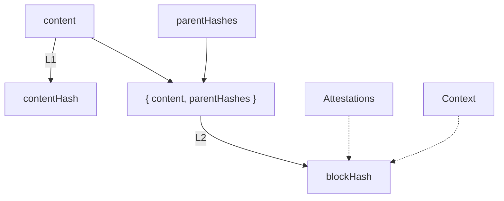
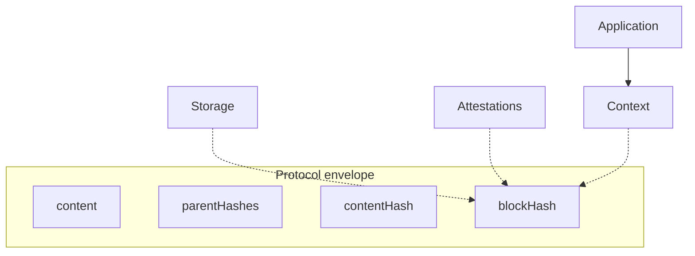
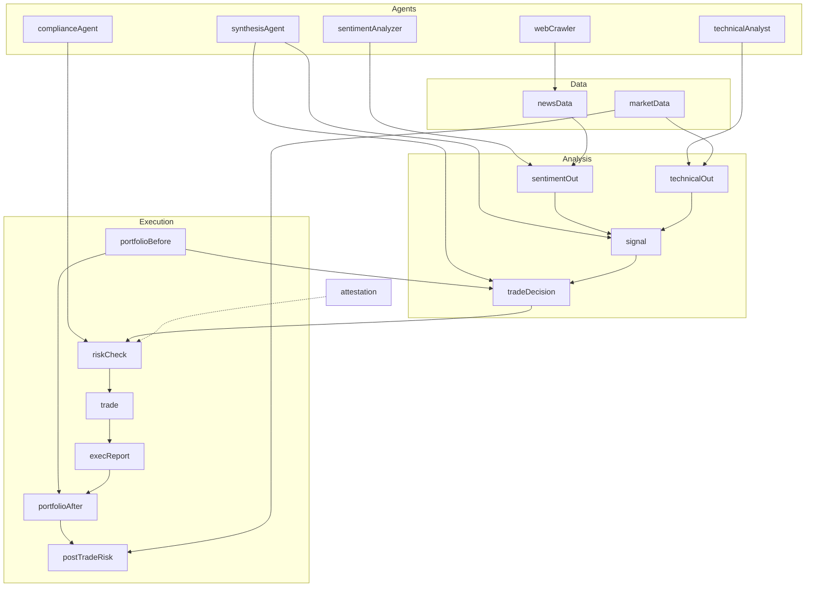
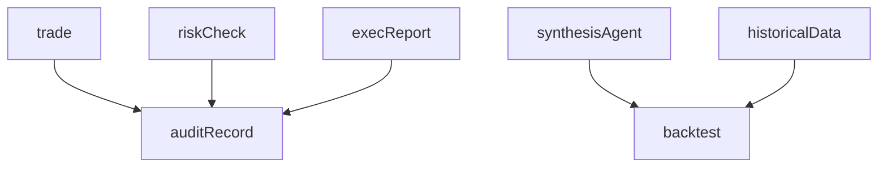
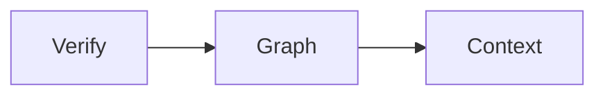
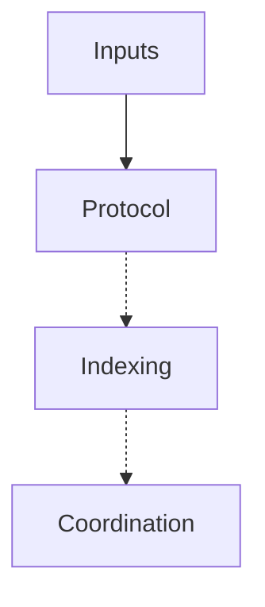

# ALX Protocol Whitepaper

Audience: Evaluators, integrators, investors  
Last reviewed: 2026-05-30

---

**ALX Protocol**  
Infrastructure for verifiable intelligent systems  

Xandr Labs · Version 1.0.0 · 2026-05-30

---

## Document Map

- **Part I** — The Problem
- **Part II** — Existing Verification Systems and ALX Compositional Layer
- **Part III** — The Block, Lifecycle, Verification Model, and Derivation Graphs
- **Part IV** — Protocol Properties, Guarantees, Scope, Security, and Interoperability
- **Part V** — What Verifiable Artifacts Enable
- **Part VI** — Adoption and Productization
- **Part VII** — Ecosystem Coordination
- **Part VIII** — Toward Verifiable AI Infrastructure

# Abstract

Digital systems produce, transform, and exchange artifacts at unprecedented scale—and AI is accelerating that shift. Most infrastructure was not designed around artifact lineage. Metadata, logs, and platform records are often fragmented, mutable, or detached once an artifact leaves the originating system.

The result is a widening trust gap. Organizations hold artifacts without reliable answers to basic questions: What is this object? Has it changed? Which upstream artifacts contributed? Can derivation history be verified independently and ported across tools and institutions?

ALX Protocol addresses the trust gap by defining open infrastructure for verifiable intelligent systems: deterministic identity, traceable lineage, and portable evidence of creation, transformation, and derivation.

At the center is the **Block**, a minimal protocol primitive for durable, verifiable protocol objects. A Block binds artifact content and parent lineage into a cryptographic identity that conformant systems can recompute and validate without external services.

This whitepaper introduces the motivation, design principles, core primitives, and system architecture of ALX Protocol.

## Executive Summary

ALX Protocol provides deterministic identity, parent-bound lineage, and local structural verification for any digital artifact.

**Block primitive** — A Block seals arbitrary JSON `content` and a list of parent Block hashes (`parentHashes`) into a deterministic `blockHash = keccak256(canonical({ content, parentHashes }))`. Verification recomputes the hash locally.

**Verifiable derivation graph** — Blocks reference parents via `parentHashes`, forming a directed derivation graph. Lineage is cryptographically bound into each Block's identity, not inferred from logs.

**Structural attribution** — The protocol computes `pathCount`, the number of distinct directed paths from an ancestor Block to a descendant Block, as a deterministic structural metric.

**Local-first** — No blockchain, token, or external service is required. Creation, validation, and graph traversal run entirely as local computation on protocol data.

**Composable with external layers** — Storage (IPFS, S3, databases), attestations (signatures, timestamps), and policy logic attach in optional context layers that do not affect `blockHash` or identity.

**Verification boundary** — ALX verifies artifact identity, content integrity, declared parent lineage, graph consistency, and structural `pathCount`. ALX does not verify semantic truth, content quality, storage availability, or policy compliance.

# Part I — The Problem

Part I develops the trust gap, operational pressures, and verification landscape introduced in the Abstract and Executive Summary.

## The Trust Gap for Consequential Artifacts

As AI-generated outputs enter high-stakes workflows, organizations require portable answers to:

- What created this artifact?
- Which sources informed this artifact?
- Which agents, models, or systems transformed this artifact?
- Which changes occurred across the artifact’s lifecycle?
- Which derivation path produced this artifact?
- Which chained Blocks represent the artifact’s lineage?
- Which systems provide independent verification of historical state?

Current infrastructure rarely provides durable, portable, independently verifiable representations for the questions above. ALX addresses verification at the artifact layer: each Block binds deterministic identity and explicit lineage; chained Blocks form inspectable derivation graphs. Domain truth, model correctness, compliance judgment, and trust evaluation remain external to the protocol.

## Agentic Systems Multiply Invisible Handoffs

Multi-agent workflows generate intermediate artifacts at every handoff. Without structured preservation of those artifacts, reconstructing how a final output was produced becomes operationally difficult. Chained Blocks preserve intermediate steps, transformation history, and parent-linked derivation across the full workflow.

## Enterprises Need Source-Grounded AI

RAG systems, copilots, and workflow agents must preserve traceable relationships to approved sources and intermediate transformations. ALX binds outputs to parent artifacts, source materials, and derivation steps through explicit parentHashes.

## Regulation & Governance Are Moving from Policy to Proof

Regulated workflows increasingly require inspectable evidence of source lineage, model participation, review events, and artifact integrity—validatable at the artifact level across distributed environments.

## Personalization Requires Verified Context

Context-aware systems depend on preferences, prior decisions, and intermediate reasoning artifacts that carry verifiable identity and lineage across interactions and system boundaries.

## Existing Provenance Remains Trapped Inside Platforms

Logs, dashboards, and vendor APIs provide system-local visibility. Portable verification requires artifact-level evidence that persists across vendors, tools, and organizational boundaries without platform-specific observability.

# Part II — Existing Verification and Provenance Systems

## The Modern Verification Stack

Modern verification infrastructure spans versioning, content addressing, media provenance, supply-chain attestation, trust signatures, shared ledgers, observability, and notarization. Each layer addresses a distinct scope. ALX operates at the artifact layer: deterministic Block identity and `parentHashes` lineage that compose with each layer below.

| Layer              | Representative Systems | Primary Guarantee              | ALX Composition                    |
| ------------------ | ---------------------- | ------------------------------ | ---------------------------------- |
| Versioning         | Git                    | Change history in repositories | Parent reference to commit hash    |
| Content addressing | IPFS, IPLD             | Content retrieval by CID       | Parent reference with local verify |
| Media provenance   | C2PA                   | Embedded signed claims         | Parent Block in derivation graph   |
| Build integrity    | SLSA                   | Pipeline attestations          | Parent-linked build evidence       |
| Attestation        | EIP-712, in-toto       | Signed assertions              | Optional attachment at Block       |
| Shared commitment  | Blockchains            | Append-only anchor             | Optional **ALX anchor** on Base    |
| Observability      | Logs, traces           | Runtime telemetry              | Elevated to verifiable Blocks      |
| Notarization       | Timestamp services     | Time and existence proof       | Parent-linked external proof       |

## ALX as a Compositional Artifact Layer

ALX composes with verification-layer systems by introducing a shared primitive for:

- Deterministic artifact identity
- Parent-bound lineage
- Local verification across environments

The compositional primitive applies uniformly across AI-generated, human-authored, and machine-produced artifacts.

## Content Versioning Systems

Git preserves structured history through commits, branches, diffs, and authorship metadata. However, AI-generated artifacts increasingly flow through broader pathways: prompts, APIs, vector stores, agent systems, SaaS platforms, and distributed workflows.

ALX introduces artifact-carried identity and parent-bound lineage that persist across agent pipelines, APIs, vector stores, and SaaS workflows. Git and ALX compose directly, enabling a Block to reference a Git commit hash as a parent, binding repository-level history into artifact-level lineage.

## Content Addressing & Distributed Storage

IPFS and IPLD enable content-addressed retrieval where identical content resolves to the same CID regardless of location.

ALX extends content addressing by binding lineage into artifact identity. A Block can reference IPFS-stored content as a parent while preserving deterministic verification semantics. Lineage binding enables artifacts to be both content-addressed and lineage-aware within a unified derivation structure.

## Media & Artifact Provenance Standards

C2PA defines structured provenance for media (images, video, audio) through embedded metadata and signed records.

ALX generalizes provenance beyond media-specific constraints. ALX applies identity, lineage, and verification uniformly across summaries, model outputs, structured records, and agent-generated artifacts.

C2PA and ALX compose directly: C2PA-signed media can be incorporated as parent Blocks within broader ALX derivation graphs.

## Supply Chain & Build Integrity

SLSA provides verified build provenance through dependency tracking, pipeline integrity, and reproducible build assurances.

ALX integrates SLSA by binding build outputs into deterministic artifact identity and lineage structures. A Block may reference SLSA attestations as parent-linked evidence, embedding supply-chain verification directly into the artifact graph.

Build outputs, dependencies, and transformation steps become first-class, verifiable components in ALX derivations.

## Attestation & Trust Systems

Attestation systems provide signed assertions about artifact properties such as authorship, execution context, compliance, or validation state.

ALX incorporates attestation claims as part of lineage without altering verification semantics. A Block can reference attestation records as parent-linked evidence, enabling external trust signals to participate in derivation graphs while preserving local identity verification.

## Blockchains

Blockchains provide shared commitment systems through append-only ledgers, consensus validation, and immutable state records.

ALX composes with blockchain systems by enabling optional **ALX anchor** commits on Base (existence-time for `blockHash` values) while preserving independent verification of artifact identity and lineage. Merkle proofs and catalog/index policy remain off-chain (`alx.index`, `alx.registry`, SDK).

## Observability Systems

Logging and observability systems provide runtime visibility into system behavior through event traces, execution logs, and operational telemetry.

ALX composes with observability and logging systems by elevating log-derived artifacts into verifiable Blocks with deterministic identity and parent-bound lineage. Log events, traces, and operational outputs can be structured as first-class artifacts within ALX graphs, enabling runtime behavior to become part of verifiable derivation history.

## Centralized notarization

Centralized notarization services provide timestamping and verification within a product or organizational boundary, establishing when an artifact existed and which entity submitted it.

ALX composes with notarization systems by binding externally issued timestamps or identity proofs as parent-linked evidence within derivation graphs.

## ALX Artifact Model

Existing systems operate as infrastructure within distinct verification layers. ALX composes with verification-layer systems by introducing a primitive at the artifact layer: deterministic identity and parent-bound lineage across any conformant implementation.

Git, IPFS, C2PA, SLSA, attestation systems, blockchains, logging systems, and centralized notarization systems each provide mechanisms for provenance, integrity, and verification across distinct scopes and domains. ALX extends this ecosystem by defining a unified artifact identity layer that applies uniformly to AI-generated, human-authored, and machine-produced outputs.

The artifact identity layer enables interoperability across existing provenance and verification systems by standardizing how artifacts are identified, linked, and verified independent of storage medium, transport mechanism, execution environment, or application boundary.

# Part III — The ALX Protocol

## Agent Pipelines Without Artifact Identity

The trust gap becomes most visible in multi-agent systems.

A single model output can be difficult to verify. A multi-agent workflow increases verification requirements because each agent receives context, transforms that context, produces an output, and passes that output downstream.

By the end of the workflow, the system may produce a high-value artifact such as a legal brief, credit assessment, clinical summary, software architecture, market research report, or compliance recommendation.

The final artifact may persist while the derivation path becomes incomplete or inaccessible.

A research workflow illustrates this pattern. One agent summarizes source documents into a brief. A second agent extracts claims and citations. A third agent transforms the material into an executive report. A fourth agent reviews the report for factual consistency before publication.

The final report persists. Intermediate artifacts are often retained only in orchestration state, logs, transient responses, or application memory.

Missing Block sealing at workflow handoffs introduces verification gaps where artifact identity, lineage continuity, and derivation integrity are not preserved across system boundaries:

- Which sources informed which claims?
- Which citation set supported by which paragraph?
- Which draft did the review agent inspect?
- Which chained Blocks represent each transformation?
- Which step introduced an error or unsupported claim?
- Which systems can verify the full derivation path independently?

The system produced an answer. ALX enables the system to represent the full derivation of the answer as a verifiable artifact graph.

## Workflow Derivation Structure

Each agent plays a role in the workflow. ALX gives the workflow a shared, durable record of the composition. The final performance exists as the output. The score exists as the derivation graph: a verifiable structure that records the handoffs, dependencies, transformations, and contributions that shaped the final artifact.

A concrete multi-agent trading pipeline—data ingestion, signal synthesis, compliance, execution, portfolio update, and audit sealing—is worked through in Part V (Figure 3), including computed `pathCount` over the derivation graph.

## The Block

**Figure 1 — L1 canonicalization → L2** `contentHash` **/** `blockHash`

*Caption:* `content` *→* `contentHash`*;* `{ content, parentHashes }` *→* `blockHash`*.*

ALX addresses the artifact verification problem with one primitive: the **Block**.

A Block is an independently verifiable container for any meaningful artifact. A Block can represent research finding, code reviews, financial analysis, compliance assessment, legal draft, model evaluation, creative work, agent handoff, or output from an AI agent.

The protocol verifies artifact identity and lineage while preserving content opacity. Schema validation, truth assessment, policy checks, and domain judgment remain application-layer functions.

ALX verifies structure.

Content opacity makes the protocol general. Systems that verify identity and lineage without interpreting content can operate across domains, vendors, agents, models, storage systems, and applications.

### Block Structure

A Block binds five fields: two author-provided inputs, two protocol-computed hashes, and one optional attestation array.

| Field          | Source   | Role                                                | In Hash Envelope                 |
| -------------- | -------- | --------------------------------------------------- | -------------------------------- |
| `content`      | Author   | Opaque artifact payload (JSON-serializable)         | Yes (`blockHash`, `contentHash`) |
| `parentHashes` | Author   | Unordered set of upstream `blockHash` references    | Yes (`blockHash`)                |
| `contentHash`  | Protocol | Keccak-256 of canonical `content`                   | Stored; derived                  |
| `blockHash`    | Protocol | Keccak-256 of canonical `{ content, parentHashes }` | Identity                         |
| `attestations` | Optional | EIP-712 signatures over `blockHash`                 | No                               |

Identical `content` and identical `parentHashes` yield identical `blockHash` values across conformant implementations.

## Block Lifecycle

- Creation
- Attachment
- Verification
- Composition
- Inspection
- Anchoring
- Governance

The Block lifecycle begins with creation. During creation, content and parentHashes are provided and canonicalized into a deterministic representation. The canonicalized content produces the contentHash, while the combined canonicalized structure of content and parentHashes produces the blockHash.

Verification occurs through local recomputation. A conformant implementation reconstructs the canonical representation and recomputes blockHash to validate structural integrity. Verification requires no external dependencies or third-party systems.

Composition occurs when a new Block references existing Blocks through parentHashes, establishing explicit lineage relationships and extending the derivation graph across the full workflow.

## Block Creation in Practice

Block creation and lineage binding follow a deterministic and implementation-agnostic pattern.

Block creation does not require a dedicated storage interface, blockchain interface, model provider integration, or application framework. The selection criterion is whether an artifact requires persistent identity binding and explicit lineage preservation for downstream consumption.

ALX functions as a minimal verification interface over agent handoffs, research outputs, compliance artifacts, model evaluations, and enterprise workflows. Over time, Blocks generated across workflow contexts form a shared derivation graph that remains portable, inspectable, and independently verifiable across systems.

### Block Creation Modes

ALX defines three Block creation modes.

#### Manual Creation

Manual Blocks originate from human invocation through user interfaces, web applications, or command-line tools.

Manual creation applies when an artifact requires explicit sealing for purposes such as citation, review, publication, archival, or formal preservation.

Manual Blocks encode intentional human selection of identity-bound artifacts.

#### Programmatic Creation

Programmatic Blocks originate from application-level systems through SDKs, APIs, or automated services.

Programmatic creation applies when software systems generate artifacts intended for reuse across services, pipelines, or workflows.

Programmatic Blocks encode deterministic system-level generation of identity-bound outputs.

#### Automatic Creation

Automatic Blocks originate from middleware within agent systems, retrieval pipelines, CI/CD systems, and orchestration frameworks.

Automatic creation applies when system design requires meaningful transformations and handoffs produce verifiable artifacts by default.

Automatic Blocks encode workflow-level transitions where artifact generation is embedded into execution paths.

## Block Creation Criteria

Block creation is triggered when an artifact requires preservation of identity, lineage, or contextual binding such that omission would introduce ambiguity in future interpretation, reuse, or verification.

Block creation applies to artifacts that are:

- Reused in downstream workflows
- Cited as evidence or referential material
- Incorporated into decision-making processes
- Transferred between agents or systems
- Reviewed, validated, or approved
- Published or externally distributed
- Included in compliance, audit, or regulatory workflows
- Used as persistent user-level or institutional context
- Designated for future reconstruction or replay

## Selection Principle

The operating rule defines a selection constraint for Block creation:

Artifacts that require future verifiability or trust-dependent reuse MUST be sealed as Blocks.

Block creation follows future dependency risk on identity and lineage preservation.

## Operational Model

The three creation modes define adoption across operational layers:

- Human systems produce Blocks through explicit intent.
- Application systems produce Blocks through deterministic execution
- Agent systems produce Blocks through automated workflow transitions

Together, manual, programmatic, and automatic creation modes ensure consistent Block generation across human, application, and agent environments while preserving uniform identity and lineage semantics.

## Block Verifiability

A Block carries a deterministic identity derived from canonical `content` and declared `parentHashes`.

The same content with the same parents always produces the same Block identity: on any machine, in any language, across any conformant implementation. Any modification to Block content, parent references, or derivation structure produces a different Block identity. Block identity commits to both the artifact and the derivation path encoded in `parentHashes`.

In most systems, provenance is metadata. Metadata can be stored separately, rewritten, stripped, or lost. In ALX, lineage forms part of identity. Parent references are structurally bound into what the artifact is.

A root Block is a Block with no parent references. A derived Block includes one or more parent references, where each parent reference explicitly identifies an upstream Block used in construction. An analysis Block derived from a source Block includes the source Block as a parent. A decision Block derived from the analysis includes the analysis Block as a parent. A final report Block may include multiple parent references, such as source documents, intermediate analysis Blocks, review Blocks, policy validation Blocks, and human approval Blocks. Each parent reference encodes a directed dependency edge from the child Block to the parent Block. The resulting structure forms a derivation graph in which nodes are Blocks and edges are parent-to-child relationships, producing a complete, verifiable record of artifact construction and transformation history across the system.

## Independent Verification

Verification in ALX Protocol is local computation. A verifier computes Block identity by applying the ALX identity function to canonical `content` and declared `parentHashes`. The computed identity is compared against the Block's declared `blockHash`. Matching values indicate structural validity under ALX Protocol rules.

## Structural Verification Model

The protocol defines structural verification over the Block layer.

Structural verification includes:

- Validation of canonical content
- Computation of contentHash
- Computation of blockHash
- Inspection of parentHashes

Verification is performed by a conformant implementation through local recomputation.

Verifier operations include:

- Canonicalization of content
- Recomputation of contentHash
- Recomputation of blockHash using content and parentHashes
- Validation of lineage structure via parentHashes

Verification operates independently of external services, hosted systems, or coordination layers.

## Immutability by Design

A Block is immutable. Block identity is computed from canonical `content` and declared `parentHashes` through a deterministic identity function. Any modification to canonical content produces a distinct Block identity. Any substitution, removal, or insertion of intermediate artifacts within a derivation chain produces a distinct downstream Block identity.

The original Block persists unchanged as a stable reference in identity space. Any modified artifact is represented as a new Block instance with a distinct identity and a distinct position in a derivation graph.

Immutability is enforced at the protocol layer through identity determinism over canonical content and lineage structure. No external storage constraints, access controls, or mutability restrictions are required for preservation of prior states.

Block identities provide version-specific, time-stable references to AI-generated artifacts, including reports, analyses, recommendations, and reviews.

Block identities enable precise referential integrity across time-bounded and multi-stage workflows requiring reproducibility and accountability, including audit processes, regulatory review, research replication, vendor dispute resolution, model evaluation, legal discovery, and enterprise AI governance.

## Trust Anchor Definition

The Block identity defines the trust anchor layer.

The trust anchor interface provides:

- Deterministic identity
- Lineage binding
- Verifiable structure
- Contextual artifacts define the context interface surrounding the Block.

The context interface provides:

- Interpretive metadata
- External references
- Application-level semantics

Contextual artifacts do not contribute to identity computation or protocol validity.

## Blocks, Context, and Machine Consumption

The Block functions as a trust anchor within the ALX protocol. Applications and machines associate additional context with a Block without modifying the Block definition or altering Block identity.

## External References and Contextual Artifacts

A Block may reference content stored in distributed storage networks, enterprise document systems, object storage systems, or local file systems.

A Block may also reference or include attestations, signatures, model cards, evaluation reports, schemas, policy documents, retrieval metadata, tool-call transcripts, embeddings, and other machine-readable or human-readable artifacts that assist in interpreting the Block’s content.

Contextual artifacts constitute the context layer.

The context layer is excluded from:

- Block identity computation
- Canonicalization inputs
- Validity determination
- Block structural definition

## Machine Consumption Model

Machines and applications consume contextual artifacts associated with a Block.

Contextual artifacts support:

- Interpretation of Block content
- Retrieval of related information
- Enforcement of application-level policy constraints
- Continuation of reasoning workflows
- Augmentation of semantic understanding of Block origin and usage

Context processing operates independently of protocol-level verification.

## Layered Architecture

ALX defines a minimal protocol layer consisting of:

- content
- parentHashes
- contentHash
- blockHash

Only the protocol layer participates in identity computation and validity rules.

All other systems operate as external layers, including:

- Storage
- Schema
- Attestation
- Application

External layers may associate metadata, references, and contextual structures with a Block without affecting identity computation or protocol validity.

## Separation of Concerns

**Figure 2 — Protocol envelope vs external attachments**

*Caption:* `content`*,* `parentHashes`*,* `contentHash`*,* `blockHash` *define identity; storage, attestation, context, and application attach at* `blockHash`*.*

The separation between protocol and context interface defines infrastructure independence.

The protocol interface defines:

- Deterministic identity
- Lineage structure
- Structural verification

The context interface defines:

- Semantic interpretation of Block-associated artifacts
- Contextual enrichment through external metadata and auxiliary artifacts
- External reference association across storage, attestation, and application systems
- Application-specific processing, policy evaluation, and workflow behavior

Protocol–context separation enables portability across storage systems, execution environments, and network architecture while preserving a stable and minimal protocol surface.

## From Individual Blocks to Verified Derivation Graphs

A single Block provides a durable identity for a discrete artifact. The Block identity enables stable reference across storage systems, transmission environments, and verification contexts. Identity computation produces equivalent results across conformant implementations for equivalent canonical inputs.

Multiple chained Blocks form a structured derivation graph. Parent references encoded through parentHashes establish explicit relationships between artifacts. Each parent reference defines a directed dependency relationship between a derived Block and one or more upstream Blocks. The resulting graph encodes derivation structure as deterministic references within Block identities.

In an agent workflow, each transformation produces a new Block. A root input produces a Block with no parent references. A derived transformation produces a Block referencing one or more upstream Blocks through parentHashes. Different transformation stages may reference different numbers and combinations of parent Blocks, including single-source derivations, multi-source aggregations, and multi-step compositions. Each transformation extends the derivation graph through deterministic lineage relationships encoded in Block structure.

The resulting structure represents a verifiable artifact graph. The graph encodes both artifact outputs and transformation history as a deterministic, computable structure derived from Block identities and parent-reference relationships.

The graph provides addressability through deterministic Block identities. Each node in the graph is identified by a unique blockHash. Relationships between nodes are defined through parentHashes, which establish directed edges from derived Blocks to declared parent Blocks.

Graph traversal operates over `parentHashes` edges to navigate derivation paths across the artifact structure. Lineage propagation operates through dependency relationships encoded in parentHashes, enabling analysis of upstream influence across downstream Blocks. Temporal ordering of transformations is represented as sequences of Block derivations, where each derived Block extends the graph relative to its parent set.

## Identity as Structural Primitive

The protocol defines identity as the core primitive.

Block identity is established through:

- Canonicalized content
- Structured parentHashes
- Deterministic computation of blockHash

Identity is derived exclusively from canonical `content` and declared `parentHashes` and is invariant under conformant implementations for equivalent canonical states.

### Identity Guarantee

ALX defines deterministic identity for each Block. Block identity is computed from canonicalized content and parentHashes. The resulting blockHash functions as a stable identifier for the artifact. Identity is invariant across conformant implementations for equivalent canonical inputs.

### Lineage Guarantee

ALX defines explicit lineage encoding for each Block. Each Block contains parentHashes referencing upstream Blocks. `parentHashes` references define directed relationships between artifacts. Lineage is embedded into identity computation through inclusion of parentHashes in blockHash derivation, ensuring structural coupling between artifact state and derivation history.

### Verification Guarantee

ALX defines local verification for each Block. Verification is performed by recomputing:

- Canonical representation of content
- Canonical representation of parentHashes
- contentHash from canonicalized content
- blockHash from canonical inputs

Verification validates structural consistency without reliance on external services, coordination interface, or third-party systems.

### Graph Construction Guarantee

ALX defines graph derivation construction over Blocks. Each Block defines a node in a directed graph identified by blockHash. Each entry in parentHashes defines a directed edge from a derived Block to an upstream Block. The resulting structure encodes artifact derivation as a deterministic graph over identity and lineage relationships.

# Part IV — Protocol Properties and Boundaries

## Protocol Claims and Boundaries

ALX defines a constrained set of protocol-level guarantees centered on deterministic artifact identity and lineage binding. The protocol establishes claims over structure, computation, and verification. The protocol excludes claims over semantic correctness, availability guarantees, and external system behavior.

### Explicit Exclusions

ALX excludes semantic evaluation of content. The protocol does not determine correctness, truth value, quality, usefulness, or validity of any artifact content or derived output. ALX excludes availability guarantees. The protocol does not define persistence, storage durability, or retrieval guarantees for Blocks or parent references.

ALX excludes external trust modeling. The protocol does not evaluate or assign trust to authors, storage systems, attestation providers, or application-layer frameworks.

### Protocol Scope and Constraints

ALX defines a minimal structural model for artifact identity, lineage binding, and verification.

The protocol specifies:

- Required fields participating in identity computation
- Computed fields derived from canonical inputs
- Excluded concerns outside identity formation

### External Boundary Definition

Non-identity metadata, including contextual, semantic, and application-level information, exists outside the protocol boundary.

Non-identity metadata, including contextual, semantic, and application-level information, may be associated with a Block but does not participate in:

- Canonicalization
- Identity computation
- Lineage encoding
- Verification rules

### System Property

The value of a Block emerges from protocol constraints that enforce:

- Deterministic identity generation
- Explicit lineage representation
- Local verifiability
- Minimal structural surface area

Protocol constraints ensure consistent interpretation of artifact structure across systems while preserving separation between protocol-defined integrity and application-level semantics.

## Protocol Design: Minimal, Open, and Composable

ALX defines a minimal protocol surface designed to support ecosystem expansion around a stable identity primitive. The Block remains intentionally compact. The surrounding derivation graph enables integration across heterogeneous systems spanning storage, verification, orchestration, and application interfaces.

### Protocol Scope

ALX does not define a full application platform.

The protocol does not prescribe:

- Storage networks
- Execution environments
- Blockchains systems
- Identity providers
- Content schemas
- Model providers
- Governance frameworks

Storage, execution, blockchain, identity, and schema domains remain external, as multiple independent systems already provide mature implementations.

### Core Primitive

ALX defines a primitive composed of:

- Deterministic artifact identity
- Parent-bound lineage
- Local verification

Structural guarantees are established through:

- Canonicalization of content
- Deterministic Hash Computation
- Inclusion of parent references in identity derivation

Deterministic identity, parent-bound lineage, local verification, and content opacity remain invariant across conformant implementations.

### Composability Across Systems

The protocol supports composability across external infrastructure.

A Block may reference content stored in IPFS, Filecoin, S3, PostgreSQL, local file systems, or enterprise document systems.

A Block may associate attestations from multiple signing systems.

A Block may use optional **ALX anchor** on Base for neutral existence-time, or other external timestamping services, without affecting `blockHash`.

A Block may integrate application-specific schemas for domain interpretation.

Storage, attestation, indexing, and application integrations operate outside the protocol surface and do not affect identity computation or verification rules.

### System Integration Model

The Block defines the trust anchor of the system.

External systems operate as complementary interfaces:

- Storage systems provide content availability
- Attestation systems provide signed claims
- Optional **ALX anchor** on Base provides public existence-time for `blockHash` values.
- Application systems provide semantic interpretation.
- Policy systems provide governance enforcement
- AI systems consume contextual inputs and produce derived artifacts

The protocol binds content and lineage into a deterministic identity that remains independently verifiable across implementations.

### Separation of Concerns

Separation of concerns between the protocol surface and external interface produces:

#### Portability

Verification remains possible across storage systems, execution environments, vendor infrastructures, and blockchain networks without dependency on originating systems.

#### Extensibility

New storage adapters, signing mechanisms, application profiles, agent frameworks, and anchoring systems integrate without modification to the protocol primitive.

#### Independent Implementable

Multiple conformant implementations arise from the specification and conformance criteria across independent runtimes.

### System Design Property

The protocol surface remains minimal in scope. The derivation graph remains expressive in structure and composition.

The design establishes a minimal open primitive enabling systems to:

- Create Blocks
- Link artifacts through lineage
- Verify structural integrity
- Enrich with external context
- Compose derivation graphs across heterogeneous environments

## The Minimal Protocol Surface

The ALX primitive defines a single protocol object: the Block.

A Block consists of the following fields:

- content — the opaque payload representing the artifact state
- contentHash — the deterministic hash computed from content
- parentHashes — a canonical set of references to parent Blocks
- blockHash — the deterministic identifier computed from canonicalized content and parentHashes under the ALX identity function

The computation of blockHash binds both artifact state and derivation structure into a single identity. Protocol core fields define both artifact identity and lineage structure within the protocol.

From this structure, the protocol derives three core properties:

- Immutability — any change to content or parent produces a new Block
- Lineage integrity — all derivations are explicitly traceable through parent references
- Local verifiability — a Block’s validity can be checked by recomputing blockHash from its inputs

All external systems— including databases, blockchains, storage networks, model providers, schema frameworks, and hosted services—operate as optional infrastructure or application layers. External systems may store, transmit, index, or attest to Blocks. No modification, override, or reinterpretation of ALX protocol semantics, identity functions, canonicalization rules, or validation rules occurs in external layers.

#### Canonicalization Algorithm

The canonicalization algorithm produces a deterministic byte sequence from a JSON-serializable value.

- Lexicographically sorted object keys
- Array ordering preserved
- undefined → null normalization
- -0 → 0 normalization

#### Canonicalization Constraints

- Maximum recursion depth: 128
- Maximum serialized size: 16 MB

#### Hash Function Specification

- Keccak-256 as hash function
- Input = canonical byte sequence
- Output = digest

#### Hash Encoding Format

- 0x prefix
- lowercase hex
- 64 characters
- 32 bytes

### Block Interaction Model

Blocks may participate in additional operations that do not modify lifecycle state:

- **Attachment**: optional metadata such as context references, attestations, storage pointers, schemas, and policy information. Attachment metadata does not affect Block identity or hashing.
- **Inspect**: traversal of derivation graph via parentHashes to interpret lineage and structure.
- **Anchoring**: association of external commitments such as optional **ALX anchor** on Base, off-chain `**alx.registry*`* / `**alx.index**` catalogs, or signed attestation with Block identities.

### Application Layer

**Governance**: policy enforcement including access control, retention rules, compliance constraints, and operational policies. Governance operates outside protocol identity and does not affect canonicalization or verification.

## The Case for an Open Protocol

ALX defines a protocol for deterministic artifact identity and lineage without coupling to a specific infrastructure stack. An open protocol enables multiple independent implementations that share a common verification model while preserving flexibility across storage, execution, and application interfaces.

Openness establishes interoperability across independent systems. Conformant implementations can create Blocks, verify Blocks, and traverse derivation graphs without coordination through centralized services or proprietary runtimes. Interoperability emerges from shared rules governing canonicalization, hash computation, and lineage binding across independent infrastructure.

An open protocol preserves artifact durability across system boundaries. A Block maintains deterministic identity independent of the system that produced it. Verification is performed by recomputing identity from canonical inputs, without requiring access to the originating environment. As a result, derivation graphs remain interpretable across storage backends, application frameworks, and organizational boundaries.

The protocol also enables composability across heterogeneous systems. Storage systems provide persistence, attestation systems provide signed claims, execution systems generate artifacts, application systems provide domain-specific interpretation, and AI systems perform synthesis over contextual inputs. Storage, attestation, execution, application, and AI systems integrate through the Block interface without requiring modification of the protocol primitive.

Independent implementation is a core property of the design. ALX is defined through normative rules for canonicalization, hashing, and graph construction, with conformance determined by adherence to specification and canonical test vectors. Protocol behavior is derived from specification alone.

Open protocol design supports ecosystem expansion without centralized coordination. New storage mechanisms, signing systems, agent frameworks, indexing systems, and governance layers can integrate through the same Block structure while the protocol surface remains stable and minimal.

The resulting system functions as a shared verification substrate for artifact-based systems. The Block provides deterministic identity and lineage binding, while external interfaces provide storage, interpretation, governance, and computation. The separation between protocol surface and external systems preserves openness while maintaining verifiability across heterogeneous environments.

## Four Protocol Guarantees

ALX Protocol defines four core guarantees. Each guarantee establishes an independent structural property of artifacts. The four guarantees form a verification substrate for artifacts used in trust-sensitive, audit-sensitive, reconstruction-sensitive, and compositional workflows.

The protocol scope is intentionally constrained. ALX does not evaluate semantic truth, content quality, author intent, or domain-specific correctness. ALX does not replace expert review, governance systems, or institutional oversight.

Instead, the protocol defines structural guarantees required by higher-level systems before interpretation, policy enforcement, or operational decision-making can be performed reliably.

The protocol guarantees are:

## 1. Deterministic Identity

Every Block defines an identity that is independently reproducible from canonicalized inputs. Equivalent content and equivalent parentHashes yield identical blockHash values across conformant implementations.

Deterministic identity across implementations is a protocol requirement. Verification depends on consistent identity generation across programming languages, runtime environments, operating systems, and infrastructure providers.

The protocol defines deterministic serialization and cryptographic hashing rules to enforce reproducible identity generation. Canonicalization transforms structured input into a deterministic byte sequence. Cryptographic hashing transforms the canonicalized representation into a fixed blockHash value.

Conformance is defined through normative serialization behavior and canonical test vectors. Implementations are conformant when each implementation produces identical blockHash values for identical canonical inputs under defined rules.

Deterministic identity enables interoperability across independent systems. Blocks generated in one environment can be verified in another without coordination through shared infrastructure. Enterprises can perform local recomputation-based verification, regulators can validate artifacts independently of originating systems, and developers can generate and verify Blocks across heterogeneous programming environments using the same protocol rules.

The protocol constrains identity generation strictly to canonicalization and hashing rules. Implementations execute canonicalization and hashing rules without introducing alternative identity semantics.

## 2. Parent-Bound Lineage

A Block’s lineage participates directly in Block identity computation. The protocol includes parentHashes as an input to blockHash derivation, meaning parent references are part of deterministic identity generation.

A Block that declares parent references produces a blockHash derived from canonicalized content and canonicalized parentHashes. Any modification to the parent set results in a different blockHash. Any removal of a parent reference produces a different identity. Any reordering of parent references outside canonical ordering rules changes the canonical representation and therefore produces a different blockHash. Distinct derivation paths therefore correspond to distinct Blocks.

The protocol enforces explicit structural binding between child Blocks and parent Blocks. Each Block encodes a declared derivation path through its parentHashes, and that path is inseparable from identity once the Block is formed.

The protocol excludes inferred provenance models. Lineage is represented as explicit structural input encoded in `parentHashes`. Parent relationships exist within identity computation, not as external annotations or post-hoc attribution layers.

The distinction separates protocol-level lineage from external metadata systems. Traditional metadata systems allow provenance information to be detached from artifacts, rewritten at storage boundaries, or inconsistently replicated across systems. ALX avoids this separation by encoding lineage directly into identity computation through deterministic hashing rules.

Lineage binding enables verifiable derivation across AI systems and enterprise workflows. A compliance assessment references policy documents, source material, and review outputs through explicit parent relationships. A research summary references source papers and intermediate analyses through structured lineage. A software design references requirements, architectural reviews, and security evaluations as upstream dependencies. A financial recommendation references market data, model outputs, and approval artifacts as part of its derivation structure.

The resulting structure forms a verifiable derivation graph in which transformation history, dependency relationships, and lineage are encoded as persistent, computable structure within Block identity.

## 3. Traceable Attribution

Once artifacts form a derivation graph, contribution becomes a computable property of structure.

ALX defines pathCount as a deterministic measure over the derivation graph. pathCount computes the number of distinct directed paths from an ancestor Block to a descendant Block.

pathCount is defined over graph structure. pathCount operates on node connectivity and edge relationships encoded through blockHash identity and parentHashes references. pathCount evaluates path multiplicity across all valid derivation routes between two Blocks.

pathCount evaluates structural connectivity. pathCount does not evaluate semantic meaning, interpretive content, or application-level assessments. The protocol defines pathCount as a structural metric derived from graph topology.

In multi-step workflows, artifacts propagate through repeated derivation and recombination. A source artifact produces multiple derived summaries. Each summary produces additional analytical artifacts. Multiple analytical artifacts may contribute to synthesis artifacts. Synthesis artifacts may contribute to downstream recommendations. Each derivation step introduces additional graph edges through parentHashes, increasing the number of valid traversal paths within the graph.

The protocol exposes connectivity as a deterministic property of graph structure. Connectivity is derived from explicit lineage relationships encoded in Blocks and represented through directed edges in the derivation graph.

ALX enables computation of contribution relationships across heterogeneous workflows. A research dataset connects to multiple analyses. Each analysis connects to multiple synthesis artifacts. Each synthesis connects to downstream outputs. The originating dataset participates in multiple structural paths that extend through intermediate derivation steps into final artifacts.

`pathCount` supports external systems that define attribution logic. Research systems compute contribution allocation. Royalty systems compute distribution models. Accounting systems compute dependency-based attribution. Provenance systems compute lineage-based scoring. Model evaluation systems compute contribution tracking across training and inference artifacts.

The protocol does not define economic policy, governance policy, or attribution policy. The protocol defines a structural measurement primitive over derivation graphs. Contribution is represented as a function of path structure encoded in the Block graph.

## 4. Content Opacity

ALX verifies artifacts without interpreting content. The protocol computes hashes over canonicalized inputs. The protocol excludes inspection of semantic meaning, classification of content type, schema validation, field enforcement, policy evaluation, truth assessment, or interpretation of intent.

Content opacity defines the protocol boundary for semantic interpretation. Content opacity enables the protocol to operate as a general verification layer across heterogeneous artifact domains.

The protocol applies the same verification process to all JSON-serializable artifacts. A medical summary, legal memo, software review, creative output, financial model, compliance assessment, research paper, dataset, benchmark result, agent handoff, or machine-generated decision record can each be represented as a Block. Each Block undergoes identical structural processing through canonicalization and hashing.

Content representations may include text, structured data, media metadata, policy evidence, model outputs, or other serializable forms. The protocol does not require interpretation of representation format. The protocol applies to deterministic transformation rules over serialized inputs.

Content opacity enables cross-system composition without shared schema alignment. One system produces a Block representing research finding. A second system produces a Block representing a compliance review. A third system produces a Block derived from both inputs to produce a decision artifact. Each system operates with independent internal schemas while participating in the same verification graph through shared Block structure.

The protocol maintains local semantics within each producing system. The protocol maintains universal verification across all systems through deterministic identity and lineage binding.

Meaning remains local to the producing application. Verification remains consistent across all implementations of the protocol.

## Verification Scope

### ALX Verification Scope

The following tables define the ALX verification boundary. The protocol specifies structural verification guarantees and excludes non-structural evaluation domains.

**Structural Verification (in scope)**

| Property                         | Verification Mechanism                                                        |
| -------------------------------- | ----------------------------------------------------------------------------- |
| Block identity                   | Recompute `blockHash` from canonical `{ content, parentHashes }`              |
| Content binding                  | Recompute `contentHash` from canonical `content`                              |
| Lineage structure                | Validate `parentHashes` references; acyclic graph                             |
| Attribution structure            | Compute `pathCount` over derivation graph                                     |
| Cross-implementation consistency | Identical canonical inputs yield identical hashes                             |
| Signed attestation (optional)    | Verify EIP-712 signature over `blockHash`                                     |
| Merkle inclusion (optional)      | Verify proof against off-chain root (SDK; not a protocol requirement on Base) |

**Application and External Domains (out of scope)**

| Domain                          | Rationale                                                            |
| ------------------------------- | -------------------------------------------------------------------- |
| Semantic correctness / truth    | `content` is opaque to the protocol                                  |
| Model or reasoning quality      | Structurally valid Blocks may contain incorrect conclusions          |
| Real-world identity             | Attestations prove key control; identity binding is external         |
| Parent availability             | `parentHashes` are references, not storage guarantees                |
| Storage durability              | Persistence is a storage-layer responsibility                        |
| Policy and compliance judgment  | Governance operates above the protocol surface                       |
| Economic meaning of `pathCount` | Structure is protocol-defined; value assignment is application-layer |

## Implications of the Four Guarantees

The four guarantees operate through a separation between verification and interpretation. Deterministic identity enables reproducible artifact references. Verifiable lineage enables inspectable derivation paths. Traceable attribution enables computable contribution over graph structure. Content opacity enables protocol applicability across heterogeneous artifact domains.

Deterministic identity, verifiable lineage, traceable attribution, and content opacity define a structural foundation for auditable AI systems without requiring alignment across models, vendors, databases, blockchain networks, application frameworks, or schema definitions.

ALX defines a verification layer that attaches to artifacts at the Block. The protocol binds deterministic identity and lineage into each Block, enabling verification to persist across storage systems, execution environments, and organizational boundaries.

The four guarantees define structural invariants over identity, lineage, attribution, and representation. The protocol excludes semantic correctness, trust evaluation, policy enforcement, and domain-specific validation. Interpretation, governance, and decision-making operate at application and institutional layers above the protocol surface.

Protocol correctness is defined by adherence to identity, lineage, attribution, and content-opacity invariants. ALX specifies identity binding, lineage encoding, attribution structure, and content opacity, while delegating interpretation and governance to external systems operating above the protocol boundary.

## Security Model and Threat Boundaries

ALX defines a security model centered on the structural integrity of artifacts and derivation graphs. The protocol enforces integrity through deterministic identity generation and lineage binding within each Block.

The protocol protects against artifact mutation by binding content into contentHash through deterministic canonicalization and cryptographic hashing. Any modification to content produces a different contentHash and a different blockHash, resulting in a distinct Block identity.

The protocol protects against lineage modification by including parentHashes in blockHash computation. Any modification, removal, or substitution of parent references produces a different blockHash. Lineage remains structurally encoded within identity through `parentHashes` inclusion in `blockHash`.

The protocol protects against inconsistent representation through canonicalization rules that define deterministic transformation of JSON-serializable inputs into a stable byte sequence. Canonicalization ensures equivalent inputs produce equivalent hash inputs across all conformant implementations.

The protocol protects against unverifiable derivation by requiring explicit parent references as inputs to identity computation. Derivation exists only when encoded in parentHashes and reflected in blockHash. Absence or alteration of lineage produces a distinct Block identity.

ALX defines structural verification as the protocol security boundary. Verification includes recomputation of contentHash, recomputation of blockHash, and validation of parentHashes under canonicalization rules across conformant implementations.

Security responsibilities beyond structural verification operate at application layers. Application-layer responsibilities include governance systems, identity systems, storage systems, policy engines, and domain-specific validation frameworks that operate outside the protocol surface.

## Privacy and Data Lifecycle

ALX does not require persistent storage of content to preserve artifact identity. A Block maintains deterministic identity through contentHash and blockHash, while underlying content may be retained, modified, or deleted by external systems according to local policy.

Storage systems define content lifecycle behavior. Lifecycle policies include controlled access, private storage, time-based retention, deletion workflows, and hash-only persistence depending on regulatory, operational, or organizational constraints. Lifecycle policies operate outside the protocol surface.

The protocol verifies structural integrity over the state of an artifact at the time of validation. Verification operates over canonicalized content and declared parentHashes. Verification evaluates whether the presented inputs produce a valid blockHash under protocol rules. The protocol does not enforce storage availability, retention duration, or access continuity.

Applications govern data availability, access control, retention enforcement, and deletion or redaction workflows. Applications determine whether content is stored, how long it persists, and under what conditions it is accessible or removed.

The security model defines structural guarantees over identity and lineage. The system model enables composability through a minimal protocol surface and deterministic primitives across independent implementations.

## Open and Interoperable by Design

ALX operates as an infrastructure-neutral protocol. The Block structure is independent of any specific storage system, execution environment, identity provider, or application framework.

Multiple independent implementations can create and verify Blocks using shared rules for canonicalization, cryptographic hashing, and lineage binding. Interoperability is defined through deterministic specification and shared canonical rules.

Blocks remain portable across systems. A Block produced in one environment can be verified in another environment without requiring access to the originating system or execution context. Verification depends only on canonical inputs and protocol-defined computation rules.

The protocol supports integration across heterogeneous and evolving ecosystems. Storage systems, attestation systems, indexing systems, agent frameworks, and AI applications connect to Blocks through stable interfaces without modifying the Block primitive or identity semantics.

The protocol surface remains fixed. External systems evolve independently while continuing to operate over the same verification model. Interoperability arises from consistent application of protocol rules across diverse infrastructure implementations.

ALX operates as an open protocol at the structural layer and remains neutral across infrastructure dimensions where AI systems commonly diverge. Protocol–context separation defines the composability boundary of the system.

Openness enables independent implementation of the protocol across runtimes, programming languages, and execution environments. Neutrality enables composition of artifacts across heterogeneous dimensions, including content formats, storage systems, identity mechanisms, cryptographic signing schemes, vendor ecosystems, and application domains.

ALX defines a stable verification substrate across otherwise independent systems. The protocol enforces consistent rules for deterministic identity generation and lineage binding while remaining agnostic to external infrastructure design choices.

ALX occupies the structural layer where fragmentation typically occurs across AI systems. Within the protocol boundary, artifacts remain deterministically verifiable and compositionally consistent across heterogeneous environments without requiring shared infrastructure dependencies.

## Content-Neutral

ALX does not interpret content. The protocol does not assign semantic meaning to Block contents. Structural processing remains identical regardless of whether a Block contains a compliance assessment, poem, legal memo, code review, financial model, medical summary, dataset, or agent handoff.

ALX computes hashes over canonicalized representations of content. The protocol evaluates structural validity only. The protocol does not evaluate correctness, quality, intent, safety, or domain-specific validity. Verification is limited to deterministic transformation and consistency of representation under protocol rules.

Schemas, output types, domain constraints, safety policies, and business logic operate at the application layer. Applications define semantic interpretation, validation rules, and domain-specific meaning over content. Applications determine how content is understood, classified, and operationalized.

ALX defines verification over structure. Applications define semantics over content. The protocol boundary separates structural consistency from interpretive logic.

Content opacity enables cross-domain reuse of a single primitive. Healthcare systems can generate and verify Blocks without embedding healthcare semantics into the protocol. Legal systems can generate and verify Blocks without defining legal document structures at the protocol level. AI systems can generate and verify Blocks without coupling protocol behavior to reasoning, planning, or generation logic.

Content remains localized within the producing system. Verification remains consistent across all conformant implementations of the protocol, independent of domain, application context, or system origin.

## Storage-Agnostic Design

ALX does not require any specific storage system. A Block can be stored in PostgreSQL, S3, distributed storage networks, flat files, enterprise document systems, local machines, or in-memory systems. Storage systems operate independently of the protocol.

Storage systems define availability, performance characteristics, cost models, access control policies, and retention behavior. Storage systems do not define Block identity or Block validity.

Block validity is determined by protocol rules over canonicalized content, computed hashes, and declared lineage. Protocol validity rules remain independent of storage location, storage format, or storage provider.

Storage–verification separation defines a base protocol boundary between structural verification and data persistence. Within the protocol boundary, ALX specifies identity and lineage computation, while storage systems operate as external infrastructure responsible for persistence and access.

Storage adapters provide retrieval, distribution, and integration pathways for applications, agents, and systems. Storage adapters do not define Block identity or Block validity. A Block referencing content in distributed storage verifies identically to a Block referencing content in a private database.

Verification operates over canonical structure and declared `parentHashes`. Integrity is evaluated from protocol-defined inputs and deterministic computation rules. The protocol does not require permanent storage of underlying content, only that canonical inputs are available at the time of verification.

## Language-Independent

ALX is not a library dependency. ALX is a protocol contract. Reference implementations exist in TypeScript, Rust, and Python. Each conformant implementation produces identical Block identities for identical inputs.

A Block created in one language can be validated in another language and inspected in a third, with consistent blockHash results across implementations.

Infrastructure environments are inherently multi-language. Agent frameworks, enterprise systems, compliance tools, developer platforms, data pipelines, and research workflows operate across heterogeneous runtimes without shared execution assumptions. A verification system constrained to a single language becomes an application library. A verification system that produces consistent results across languages functions as infrastructure.

ALX enforces cross-language consistency through canonical test vectors and conformance rules. Implementing ALX in a new language requires adherence to the specification and passing the conformance suite, not integration with a specific SDK or framework.

The protocol defines the authoritative rules for identity, lineage, and verification. SDKs serve as implementation pathways for adoption, not as sources of protocol semantics.

## Chain-Optional

ALX does not require a blockchain. Blocks remain valid without on-chain anchoring. Creation, linkage, and verification operate through deterministic computation over canonicalized content and declared parent references. No token system, consensus mechanism, gas model, wallet infrastructure, or chain dependency participates in protocol validity.

Platform catalogs and approval lists live off-chain in `**alx.index`** and `**alx.registry**` Blocks. Trust defaults to `validateBlock` plus index membership—not to ledger storage of Block JSON.

Chain optionality reduces integration friction across **enterprise**, developer, and regulated environments. Enterprise systems often operate under constraints that exclude public ledger participation for sensitive workflows. Developer systems often prioritize minimal integration complexity without introducing blockchain-specific infrastructure into execution paths. Regulated environments often require private storage and controlled execution contexts.

ALX operates as a local-first verification protocol. Verification is performed through canonicalization and deterministic hashing, independent of external consensus or ledger systems.

Optional **ALX anchor** on Base (**ALXAnchor** contract) records existence-time for a `blockHash` or **blockset** when cross-party audit requires a neutral on-chain timestamp. **ALX anchor** does not store catalogs, verify Block content, or replace `**alx.index`**. **ALX anchor** operates outside protocol validity rules.

ALX integrates with optional Base anchoring without requiring it. The ledger does not define or participate in verification rules, identity computation, or lineage binding.

## Signing-Algorithm Neutral

ALX supports multiple signing systems across heterogeneous identity infrastructures. A Block can associate attestations generated using different cryptographic signing schemes. Supported systems include EIP-712 for Ethereum-compatible wallets, Ed25519 for modern public-key infrastructure, P-256 for WebAuthn and passkey-based authentication, and additional algorithms introduced through extension mechanisms.

Identity infrastructure varies across deployment environments. Developer systems may integrate wallet-based signing. Enterprise systems may integrate managed key infrastructure and hardware-backed key stores. Consumer systems may integrate passkey authentication. Regulated environments may require specific cryptographic standards. Future environments may introduce additional signing mechanisms as infrastructure evolves.

ALX does not constrain identity to a single signing model. The Block remains the structural primitive for deterministic identity and lineage binding. Signing systems generate attestations that reference blockHash without modifying Block structure or identity computation.

Attestations function as externally attached cryptographic claims bound to a Block. Attestation claims operate independently of the protocol's identity rules and do not participate in contentHash, parentHashes, or blockHash computation.

Protocol extensibility enables introduction of new signing mechanisms without modification of canonicalization rules, hashing rules, or lineage semantics. Signing systems operate as interoperable external interfaces layered above the Block structure, providing identity assertions without altering protocol-level validity.

## Vendor-Neutral

ALX defines a protocol layer beneath platform-specific boundaries. Protocols derive value from interoperability across independent implementations. Platforms derive value from centralized control over execution, distribution, and access.

The protocol is defined through a normative specification and distributed under permissive licensing. Multiple independent implementations validate behavior through conformance criteria and canonical test vectors. The protocol does not require a token system, registry service, mandatory network, or vendor-operated verification endpoint.

Vendor neutrality functions as both a design constraint and a deployment property. The protocol introduces no centralized control surface for identity generation, lineage construction, or verification execution.

Enterprise environments evaluate integration risk in terms of dependency coupling and vendor lock-in exposure. A verification layer without centralized coordination reduces infrastructure coupling. Developer environments evaluate integration cost in terms of adoption friction. A primitive that operates without permissioned access, hosted coordination, or platform-specific dependencies reduces integration overhead. Partner ecosystems evaluate interoperability in terms of shared standards without enforced migration to a single execution environment.

Xandr Labs develops ALX reference implementations, SDKs, CLI tools, middleware, and optional hosted services. ALX protocol rules remain independent of Xandr Labs product packaging and deployment choices.

Separation between protocol specification and product implementation preserves independent implementability, reduces systemic coupling, and maintains protocol-level neutrality across ecosystem participants.

## Protocol Surface and Adoption Model

ALX operates with a narrow protocol surface. The protocol excludes storage systems, content schemas, model providers, blockchain networks, signing systems, economic policy layers, semantic validation frameworks, and hosted service dependencies from its definition.

The remaining primitive defines deterministic artifact identity and parent-bound lineage over arbitrary serialized content.

ALX occupies a bounded layer within the system stack. A lower abstraction would reduce ALX to a hashing convention without structural semantics. A higher abstraction would extend ALX into a platform with application-specific constraints. The protocol defines a middle layer: a neutral verification substrate applicable across heterogeneous systems without requiring ownership, coordination, or centralized control.

The ALX specification is public, MIT-licensed, and designed for independent implementation. Developers can implement the protocol in any programming language without registration, approval, or coordination with any vendor. Organizations can adopt ALX without vendor agreements, licensing dependencies, or hosted service requirements.

Conformance is defined through a canonical test suite covering serialization, hashing, validation, lineage construction, and attribution computation. Correctness is determined by adherence to deterministic test vectors.

Authority in the protocol is derived from specification and conformance behavior. Test vectors define expected outcomes. Implementations derive correctness from alignment with deterministic test-vector outputs. SDKs function as implementation pathways for adoption.

## Interoperability and Minimal Setup

Interoperability reduces setup complexity through a single deterministic validity function over canonicalized content and declared parent references. Protocol operation does not require chain configuration, storage initialization, signing infrastructure setup, hosted service dependencies, or framework-specific integration.

Local systems can create and verify Blocks without external dependencies. Verification operates directly over canonicalization rules, hash computation, and lineage binding defined in the specification.

Additional capabilities integrate incrementally as workflow requirements evolve: storage, attestation, on-chain anchoring, agent middleware, and graph indexing. No external layer is a prerequisite for Block validity.

ALX begins as a verification primitive. Production environments extend functionality through layered, additive integrations above the protocol surface without altering core identity or lineage rules.

# Part V — What Verifiable Artifacts Enable

When artifacts carry deterministic identity, verifiable lineage, and structurally measurable contribution relationships, AI systems operate over persistent, composable, and independently verifiable units.

## Enterprise AI Workflows as Multi-Party Artifact Graphs

Enterprise AI workflows operate across multiple independent parties and execution environments. Credit-risk, lending, and trading pipelines share the same structural requirement: each stage may run under different vendors, model providers, or execution runtimes, yet downstream audit must reconstruct which data, rules, and agents contributed to each outcome without re-executing the pipeline. The verifiable trading pipeline in Part V (Figure 3) illustrates that pattern as a multi-party Block graph with post-trade audit and computed `pathCount`.

## Reproducible AI Research

AI research faces reproducibility constraints that become more pronounced as evaluation pipelines increase in complexity. A research lab publishes a benchmark study comparing reasoning performance across model families. The study references multiple datasets, evaluation frameworks, prompt sets, model checkpoints, and aggregated result tables. The evaluation process spans heterogeneous components including data sources, execution scripts, model configurations, and scoring logic.

Over time, components of the original workflow diverge from the published baseline. Data sets are updated or removed. Evaluation frameworks evolve and modify scoring behavior. Model checkpoints become unavailable or versioned differently. Prompt templates are edited. Intermediate artifacts are overwritten or not preserved. The published paper describes methodology, but the full artifact structure behind the results is no longer reconstructable.

Reproduction becomes dependent on incomplete or inconsistent artifacts. System state is inferred from documentation, residual files, or partial availability of external resources.

With ALX, each dataset, model card, evaluation script, prompt set, intermediate result, and final output is represented as a Block. Each Block encodes deterministic identity and declares explicit parent references to upstream artifacts. The published result references the Block derivation graph.

Reproducibility becomes a structural question over the artifact graph:

- Parent graph resolution over declared parentHashes across available Blocks
- Deterministic recomputation of blockHash and validation of identity consistency
- Exact dataset version identification through referenced dataset Blocks
- Evaluation provenance through linked evaluation-script Blocks and execution artifacts
- Downstream derivation tracking through transitive references in the Block graph

Hash-based identity preserves version determinism even when underlying content is no longer available. A dataset can be removed from storage while historical identity remains verifiable through the Block representation.

## Source-Grounded Derivation

Enterprises are adopting retrieval-augmented generation systems to ground AI outputs in approved knowledge sources. Operational systems synthesize responses from internal documents, regulatory filings, customer records, and real-time data streams. Compliance requirements increasingly demand structural evidence that output originates from approved sources with explicit `parentHashes` lineage.

Current architectures often lack durable, artifact-level grounding guarantees. Audit workflows depend on retrieval logs, prompt traces, application metadata, or execution records to infer source usage after system execution. In log-based architectures, grounding is reconstructed from runtime artifacts. ALX represents grounding as a verifiable property encoded in `parentHashes` and Block identity.

ALX encodes grounding as structural lineage within the artifact graph. Approved source documents are represented as root Blocks. Data feeds are represented as root Blocks. Policy definitions are represented as root Blocks. Derived outputs encode grounding through explicit `parentHashes` references to approved source Blocks.

Grounding becomes a property of graph structure:

- Outputs reference approved source Blocks through explicit lineage links
- Absence of approved parent references indicates absence of grounding within the defined corpus
- Presence of external or unapproved parents indicates structural deviation from defined source boundaries

Verification operates over artifact relationships and `parentHashes` in the derivation graph. Grounding is evaluated through deterministic inspection of the derivation graph and recomputation of Block identity.

Regulated environments—including banking, healthcare, insurance, legal, and government systems—can treat grounding as a verifiable structural property of generated artifacts encoded in the Block graph.

## Quantifiable Contribution Structures

AI workflows increasingly operate as collaborative systems spanning multiple participants and infrastructure boundaries.

A consortium of research organizations may jointly operate shared evaluation pipelines. Multiple vendors may contribute agents within enterprise workflows. Open-source contributors may generate artifacts reused in commercial systems. Data providers, model developers, evaluators, and human reviewers may all participate in the creation of a single downstream output.

Current contribution measurement approaches rely on contracts, self-reported attribution, usage logs, or platform-specific telemetry systems. Contribution measurement mechanisms are typically coupled to individual systems and do not generalize consistently across heterogeneous infrastructure environments.

ALX defines a structural measurement interface over the artifact graph through pathCount, a deterministic metric representing the number of distinct derivation paths connecting an ancestor Block to a downstream artifact.

pathCount defines a deterministic structural property over the derivation graph representing connectivity between ancestor and descendant Blocks through directed lineage paths. The metric is derived from graph structure and declared parent relationships under deterministic evaluation rules, without encoding economic value, priority, quality, intent, correctness, compensation, ranking, or reward distribution.

## From Verification to Machine-Readable Context

Verified derivation graphs introduce structured, machine-readable context: prior outputs become addressable artifacts; dependence becomes inspectable relationships; transformation sequences exist as computable graph structure over `parentHashes`.

### Example: Verifiable Trading Pipeline

The following sequence creates a verifiable derivation graph for an AI-driven trading decision. Each step seals an artifact as a Block with explicit `parentHashes` references to upstream Blocks. Content fields remain opaque to the protocol; `type` labels below are application-layer conventions only.

1. **Agent definitions** (`agent`) — `webCrawler`, `sentimentAnalyzer`, `technicalAnalyst`, `synthesisAgent`, `complianceAgent`
2. **Data ingestion** (`dataset`) — `newsData` ← `webCrawler`; `marketData` (root)
3. **Analysis and signal** (`analysis`, `signal`) — `sentimentOut` ← `sentimentAnalyzer` + `newsData`; `technicalOut` ← `technicalAnalyst` + `marketData`; `signal` ← `synthesisAgent` + `sentimentOut` + `technicalOut`
4. **Portfolio state** (`portfolio_state`) — `portfolioBefore` ← prior portfolio Block or root
5. **Trade decision and compliance** (`analysis`, `compliance`) — `tradeDecision` ← `synthesisAgent` + `signal` + `portfolioBefore`; `riskCheck` ← `complianceAgent` + `tradeDecision`
6. **Trade execution and reporting** (`trade`, `execution_report`) — `trade` ← `riskCheck`; `execReport` ← `trade`
7. **Portfolio update and risk metric** (`portfolio_state`, `risk_metric`) — `portfolioAfter` ← `portfolioBefore` + `execReport`; `postTradeRisk` ← `portfolioAfter` + `marketData`
8. **Audit log** (`audit_log`) — `auditRecord` ← `trade` + `riskCheck` + `execReport`
9. **Offline backtest** (`backtest_result`) — `backtest` ← `synthesisAgent` + `historicalData` (parallel branch, not on the live execution path)

The same Block primitive scales from a single signal to a full institutional workflow spanning execution, portfolio state, post-trade risk, and regulator-facing audit evidence.

**Figure 3a — Live trading pipeline**

*Caption: Solid arrows are parentHashes references. Dashed attestation attaches to riskCheck outside the hash envelope.*

**Figure 3b — Audit and offline validation**

*Caption: auditRecord aggregates live-path Blocks; backtest branches from synthesisAgent and historicalData.*

The following tables illustrate structural `pathCount` over the live trading path. Values were computed with the reference implementation trace function over the parent map defined in the pipeline steps above.

**Ancestor → descendant `pathCount*`*

| Target Block  | Ancestor Block | `pathCount` |
| ------------- | -------------- | ----------- |
| `trade`       | `marketData`   | 1           |
| `auditRecord` | `marketData`   | 3           |
| `auditRecord` | `webCrawler`   | 3           |

**Graph summary**

| Metric                             | Value                                                                                                                       |
| ---------------------------------- | --------------------------------------------------------------------------------------------------------------------------- |
| Root Blocks in `auditRecord` trace | `complianceAgent`, `marketData`, `portfolioBefore`, `sentimentAnalyzer`, `synthesisAgent`, `technicalAnalyst`, `webCrawler` |
| Total Blocks in graph              | 20                                                                                                                          |

`pathCount` counts distinct directed paths between the named ancestor and descendant Blocks. Application layers define economic or semantic attribution on top of this structural metric.

Audit verification operates through structural reconstruction over the artifact graph. Access to the original agent framework, vendor environment, or execution system is not required to validate workflow integrity.

Machine systems traverse the derivation graph to reconstruct contextual state. Context is derived through graph traversal over verifiable `parentHashes` relationships.

# Part VI — Adoption and Productization

Verified derivation graphs function as machine-readable context for adaptive systems. Preferences, prior decisions, source documents, workflow outputs, and review events can each be represented as Blocks; applications traverse derivation graphs to assemble context aligned with operational intent.

ALX does not define application behavior, personalization logic, or reasoning policy. ALX defines a verification substrate over which applications construct context-aware systems.

## The Adoption Path

**Figure 4 — Adoption Phases: Verify → Graph → Context**

*Caption: Verify — Block creation and local verify. Graph — cross-system artifact graphs and indexing. Context — derivation-graph context assembly.*

ALX adoption begins within developer and infrastructure workflows before extending into organizational and ecosystem-level coordination. The adoption model progresses through three operational stages.

### Stage One: Developer Integration

Meaningful workflow transitions are represented as Blocks. Agent handoffs, retrieval-augmented outputs, model evaluations, compliance artifacts, and workflow decisions become independently verifiable artifacts with deterministic identity and explicit lineage.

Modern agent systems, orchestration frameworks, and retrieval pipelines already operate in environments where provenance discontinuities emerge naturally. Intermediate artifacts often retain operational significance while lacking durable identity, verifiable lineage, or reconstructable derivation structure. Failure analysis depends on logs and runtime traces. Workflow reconstruction depends on platform-specific execution state that may no longer persist.

ALX integrates at this infrastructure boundary.

Middleware and adapters for frameworks such as LangChain, CrewAI, AutoGen, MCP-compatible agent systems, and workflow orchestration environments enable Block generation without redesigning existing application architecture. Each workflow transition can produce a verifiable Block while preserving the surrounding execution stack.

- early integration introduces persistent structural properties into existing workflows:
- audit trails with durable lineage across environments
- source grounding encoded through explicit derivation structure
- compliance artifacts with independently verifiable provenance
- observability across agent and pipeline transitions

Audit trails, source grounding, compliance artifacts, and cross-agent observability emerge through local integration of deterministic identity and lineage binding.

### Stage Two: Enterprise Artifact Graphs

Accumulated Blocks form verified derivation graphs that encode structured relationships across teams, vendors, and workflows.

At this stage, system behavior shifts from isolated verification to graph-level infrastructure. Enterprises operate over verified derivation graphs to support indexing, lineage inspection, governance enforcement, and compliance validation across distributed environments.

Common capabilities at this stage include:

• inspection of source grounding across retrieval-augmented generation systems

• chain-of-custody traversal across multi-vendor pipelines

enforcement of approved-source constraints through explicit lineage rules

• deterministic measurement of contribution across systems through graph structure

At scale, ALX supports a structural interface over distributed enterprise workflows. Artifact relationships accumulate into persistent, queryable graph structure. Organizational systems operate over verifiable derivation graphs with explicit `parentHashes` references.

### Stage Three: Context-Aware Systems from Verified Derivation

Verified derivation graphs extend beyond structural verification into machine-readable context. Each group encodes a structured record of inputs, transformations, and dependencies that produced system outputs. Applications query this structure to reconstruct contextual state, condition behavior, and extend system execution based on verified historical relationships.

Systems built on the Block interface operate over persistent, inspectable context from verified derivation graphs. Each interaction produces new Blocks that extend the derivation graph, continuously accumulating contextual structure over time.

Context-aware systems derive state from explicit artifact relationships in the derivation graph: behavior is conditioned on verifiable lineage, and operational context is assembled through graph traversal over `parentHashes`.

### Adoption Progression

The adoption path begins with integration at the workflow level through middleware and agent system. Extending into enterprise-scale derivation graphs spanning teams, vendors and processes. Culminating in context-aware systems built over verified contextual continuity.

Each stage increases value without requiring changes to the underlying protocol. A single integration provides immediate utility. Multi-system adoption compounds lineage.

## The ALX Stack

ALX is delivered as a layered protocol stack.

The specification defines the base protocol rules for deterministic artifact identity and parent-bound lineage. Reference implementations demonstrate independent realization of base protocol rules across environments. Conformance test vectors define expected outputs for canonical inputs. SDKs and adapters provide integration interfaces for developer and production systems.

Each component operates independently. The protocol specification defines the invariant layer.

ALX is structured as open infrastructure with reference implementations in TypeScript, Python, and Rust. Additional implementations extend support to other environments through adherence to the shared specification and conformance suite.

Consistency across implementations is enforced through specification and canonical test vectors.

The protocol layer remains stable across implementations, languages, and deployment environments.

## Protocol and Product Separation

The ALX Protocol defines an open verification standard: normative specification, canonical test vectors, and reference implementations. Xandr Labs develops ALX tooling and optional hosted services—SDKs, CLI tools, middleware, adapters, verification services, and applications operating over verified derivation graphs.

The protocol layer remains independent of hosted services, databases, tokens, blockchain networks, or proprietary platforms. Conformant implementations can create and verify Blocks without coordination with any vendor.

### From Protocol to Product

Xandr Labs develops ALX as its protocol product: developer adoption through SDKs, middleware, and CLI; optional managed infrastructure for indexing, storage adapters, and attestation; enterprise governance through lineage visualization, audit exports, and policy workflows; and context-aware applications over verified derivation graphs. The Xandr platform—separate from ALX Protocol validity—orchestrates SWE best-practice Blocks into intelligent system design and may compose with ALX-verified artifacts.

### Commercial Architecture

The commercial structure spans those four interfaces. Each operates over the same ALX protocol primitive. Commercial value is generated through infrastructure, operational tooling, governance systems, hosted services, and applications operating over verified derivation graphs.

# Part VII — Ecosystem Coordination

## Optional Ecosystem Services

Optional services sit above the ALX protocol and are **not required for conformance**.

### Local-first core

Block creation, linking, and verification are deterministic computations over canonicalized inputs and declared `parentHashes`. Protocol execution does not require payment systems, hosted services, blockchain infrastructure, or economic settlement mechanisms.

### Hosted indexing

Optional services for registered Blocks:

- Registration and discovery
- Graph indexing and search
- Lineage visualization and traversal
- Availability and retrieval
- Access control
- Attestation workflows and verification receipts
- Context APIs for downstream applications

Hosted indexing preserves deterministic identity and lineage binding. It does not modify Block creation rules or validation semantics.

### External parent references

The protocol supports Blocks that reference external Blocks—for example, from other graphs or legacy systems—through **open-world** validation mode. Declared external `parentHashes` are recorded in verification context; they do not alter local `blockHash` computation. Trace output may validate structurally while marking unresolved boundaries explicitly.

### Economic coordination (XAN)

A separate optional layer may coordinate staking, publishing fees, and usage-based rewards on top of verified artifact graphs. Economic rules sit outside core ALX validity and are defined in the XAN Economic Whitepaper. The protocol core operates without tokens or settlement.

## Ecosystem architecture

**Figure 5 — Stack: protocol / indexing / coordination**

*Caption: Protocol — identity and local verify. Indexing — discovery and lineage APIs. Coordination — optional ecosystem layer including economic coordination.*

## Design Philosophy

ALX is designed around adoption, independence, and interoperability as primary properties of the protocol.

The protocol defines a minimal verification primitive for artifacts, enabling deterministic identity computation and parent-based lineage construction over canonicalized representations without dependence on external coordination systems.

ALX remains independent of specific infrastructure choices, including hosted platforms, storage systems, blockchain networks, token mechanisms, and vendor-controlled registries.

# Part VIII — Toward Verifiable AI Infrastructure

ALX defines a verification protocol for artifacts operating across intelligent systems, enterprise workflows, and machine-driven environments. The protocol establishes deterministic identity, parent-bound lineage, and reproducible verification through canonical serialization and cryptographic hashing. ALX introduces a bounded verification primitive focused on artifact identity and lineage. ALX does not define semantic correctness, truth evaluation, governance authority, intelligence, storage requirements, or policy interpretation.

Chained Blocks form verified derivation graphs that represent relationships across workflows, systems, organizations, models, agents, and infrastructure environments. Growing derivation graphs function as operational infrastructure for provenance inspection, governance workflows, reproducibility, source grounding, contribution measurement, and context-aware machine systems.

The protocol layer establishes a shared verification substrate on which indexing systems, governance infrastructure, attestation systems, context-aware applications, and ecosystem coordination interfaces operate without modifying protocol-level correctness. Artifact identity, lineage, and derivation remain durable, composable, and independently verifiable across systems, organizations, and time.

## Related Documents

- ALX Protocol Specification — normative protocol behavior, canonicalization rules, and conformance requirements
- ALX Trust Model — verification boundaries, trust assumptions, and threat model summary
- ALX Documentation Hub — integrator guides, API reference, and developer onboarding material
- XAN Economics Framework — staking, publishing fees, and usage-based rewards

