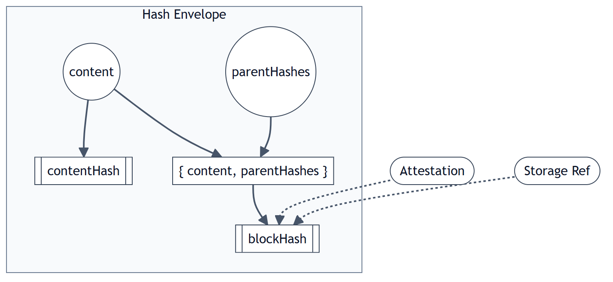
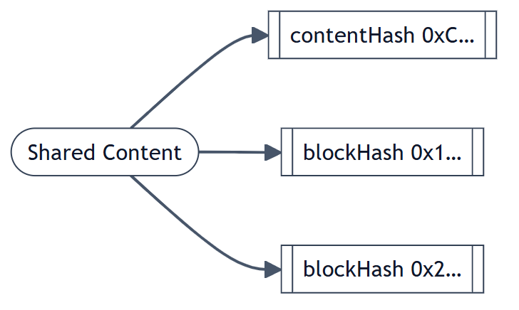
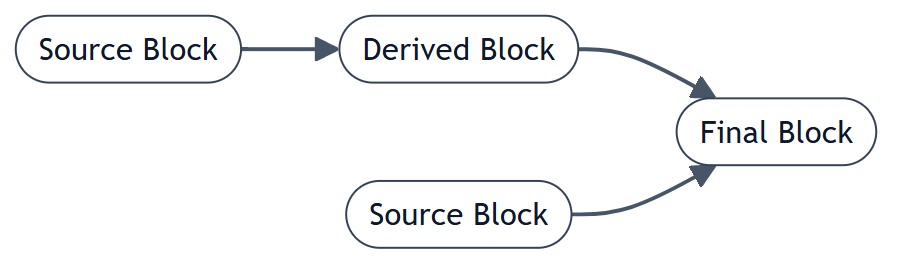
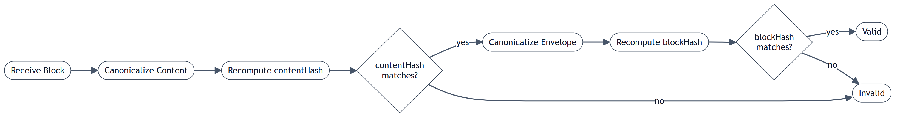
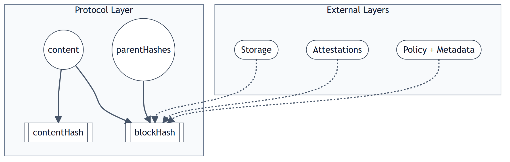
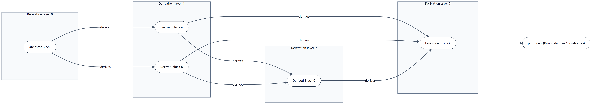
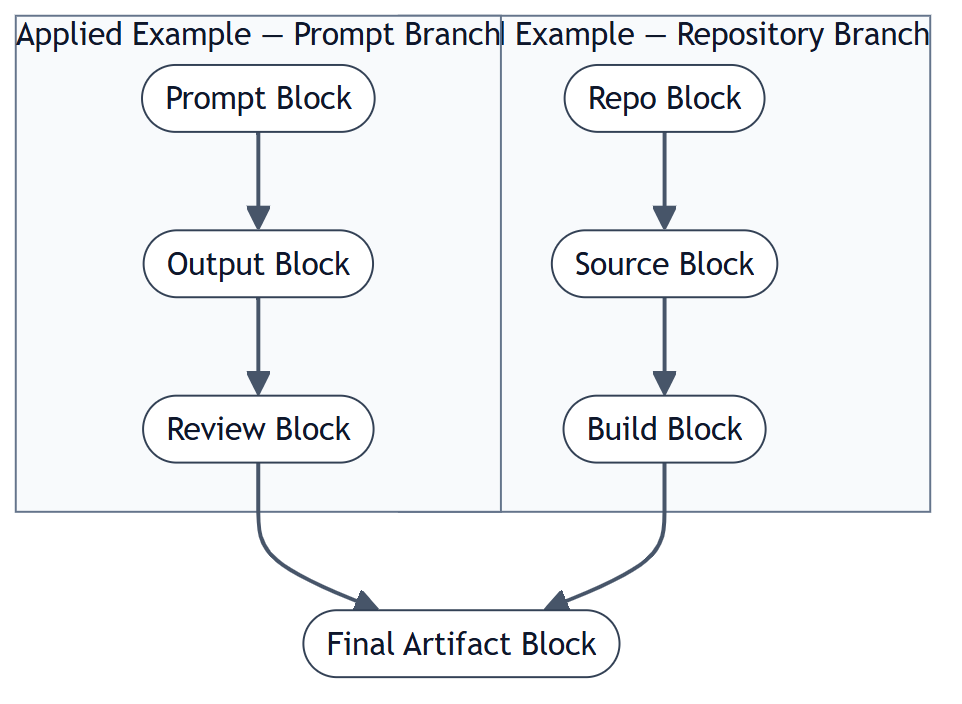
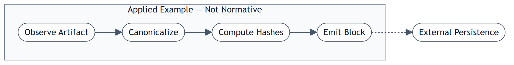
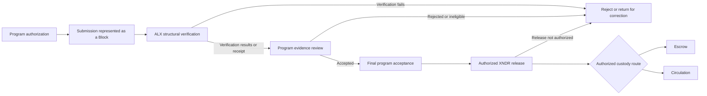

# ALX Protocol

An open protocol for composable digital artifacts

**Status:** Informative, non-normative whitepaper

**Audience:** Evaluators, integrators, implementers, researchers, and ecosystem participants

**Authority:** This paper explains ALX Protocol. protocol/spec.md, protocol/schemas/, and protocol/test-vectors/ define conformance.

**Protocol version:** 1

**License:** MIT

**Maintainer:** ALX Foundation

**Founding contributor:** Xandr Labs

**Last reviewed:** 2026-07-15

---

# Table of Contents

The publication DOCX contains an automatically generated table of contents.

---

# Abstract

ALX Protocol is an open-source protocol for composable digital artifacts.

A Block binds opaque JSON-serializable `content` and normalized parent Block identities into deterministic content-only and lineage-bound identities. Declared parent relationships form a structural Graph that conformant implementations can verify and traverse when the required Block data is available.

Open protocol design means that public rules, schemas, and canonical test vectors support independent implementation. Block creation and verification require no hosted service, vendor, blockchain, storage network, or economic mechanism.

Artificial intelligence and agent workflows provide leading applications because those systems create lineage-critical handoffs at high volume. The same Block model applies to human-authored, machine-produced, software, media, research, and institutional artifacts. Applications retain responsibility for semantic meaning, truth, quality, permissions, safety, and acceptance.

# Executive Summary

ALX Protocol is an open protocol for composable digital artifacts. Digital artifacts are the application-facing materials. Blocks are the protocol representations. The normalized `parentHashes` set creates structural composition, and Graph traversal makes declared relationships machine-consumable.

- Block primitive — A Block contains four required fields: `blockHash`, `contentHash`, `parentHashes`, and `content`. Protocol version 1 also permits optional `protocolVersion`.

- Deterministic identity — `contentHash` identifies canonicalized `content`. `blockHash` identifies canonicalized `content` together with normalized `parentHashes`.

- Structural composition — `parentHashes` binds a declared, unordered dependency set into Block identity. Applications determine the meaning and compatibility of each relationship.

- Local verification — Conformant implementations recompute identities and inspect available Graph relationships through canonical protocol rules.

- Application boundary — ALX Protocol verifies structure. Applications evaluate truth, quality, authorship, legal rights, policy, usefulness, and semantic compatibility.

- External layers — Storage, attestations, timestamps, application indexes, hosted discovery systems, governance systems, and economic mechanisms can operate around Blocks while core conformance remains independently implementable.

# Terminology and Reading Model

The following vocabulary separates the protocol object, application-facing material, structural relationships, and application interpretation.

| Term | Meaning |
| --- | --- |
| Digital artifact | Digital material that an application may represent as `content` in a Block |
| Block | The ALX Protocol primitive that binds `content` and declared parent Block identities into deterministic identity |
| Composition | A structural relationship created through normalized `parentHashes` |
| Graph | The formal structure created by parent relationships among Blocks |
| Context | An application-layer interpretation assembled from artifact `content` and Graph relationships |
| Verification Context | A protocol input that selects Graph validation mode and declares external parent boundaries; distinct from application-layer context |
| Machine-consumable | A supporting property produced by canonical representation and deterministic traversal |
| Open protocol | Public rules, schemas, and test vectors supporting independent conformant implementations |

This paper uses Block for the protocol primitive and digital artifact for the material represented by an application. Composition refers to parent-linked Block structure. Integration refers to external systems that store, attest to, index, interpret, or govern Blocks.

# Part I—The Artifact Composition and Lineage Gap

Digital systems increasingly depend on artifacts produced across tools, models, agents, databases, workflows, and organizations. Artificial intelligence increases the volume and speed of this exchange, but the structural problem applies to human-authored, machine-produced, and AI-generated artifacts alike.

A digital artifact is digital material that an application may represent as opaque JSON-serializable `content` in a Block. Examples include source inputs, model outputs, agent handoffs, evaluations, decision records, workflow states, tool responses, schema objects, media records, and other materials that downstream systems can reference, verify, reuse, or extend.

Lineage is the declared structural relationship between a Block and upstream Blocks. Parent relationships describe source materials, decisions, handoffs, workflow states, or other dependencies, while applications determine the semantic meaning of each relationship.

AI systems, applications, and implementers need durable answers to structural questions:

- Which Block identity represents this artifact?

- Has the artifact `content` changed?

- Which upstream artifacts are declared as dependencies?

- Which application records or attestations identify participating people, agents, models, systems, or workflows?

- Which intermediate artifacts influenced the final artifact?

- Which derivation path connects this artifact to prior context?

- Can Block identity, `content` integrity, and declared lineage be verified outside the originating environment?

The artifact composition and lineage gap is the absence of a shared structure for deterministic identity, declared relationships, and local verification across system boundaries. Digital artifacts are difficult to compose across independent systems when identity, lineage, attribution, and validation use incompatible representations.

## Agentic Workflows Produce Lineage-Critical Handoffs

Multi-agent workflows generate intermediate artifacts at each handoff. One agent retrieves source material. Another agent summarizes the source material. Another agent extracts claims. Another agent produces a draft. Another agent reviews the result. Each step creates operational context for the next step.

These intermediate artifacts carry value because downstream agents, models, and applications can rely on prior outputs as inputs. Source selections, extracted claims, draft revisions, evaluation results, policy checks, and review decisions can all shape the final artifact.

Agentic workflows benefit from durable representation of handoffs as digital artifacts. A handoff represented by a Block can carry `content` identity and declared parent lineage. Applications can then interpret the handoff within the surrounding workflow while conformant implementations inspect the structural relationships.

## Source Grounding Depends on Portable Lineage

Retrieval-augmented generation systems, copilots, and workflow agents increasingly depend on approved source material. Output reliability depends on relationships between the output and the sources, policies, datasets, or prior decisions that informed the output.

Source grounding benefits from grounding relationships represented at the Block layer. An output can declare upstream source artifacts through explicit parent references. A downstream system can evaluate declared dependencies from protocol data.

Portable lineage gives source-grounded AI a reusable structure across tools, teams, vendors, and institutions. Outputs can carry declared relationships to upstream artifacts, and downstream systems can verify Block identity, `content` integrity, and parent-bound lineage through local computation.

## Platform-Local Provenance Provides Operational Context

Existing systems provide useful forms of visibility. Logs show runtime behavior. Dashboards show application state. Vendor APIs expose provider-specific records. Observability systems capture traces. Governance systems track review and approval events.

These systems create valuable operational records. ALX Protocol adds an artifact-level structure that can move across environments. Applications can represent context-bearing records as Blocks, allowing conformant implementations to verify Block identity and declared lineage across tools, vendors, and organizations.

Systems that compose digital artifacts benefit from provenance that remains associated with each artifact representation. Artifact-level provenance allows downstream systems to reference, verify, reuse, and extend Block data after export, transfer, ingestion, summarization, or reuse.

# Part II—Composable Digital Artifacts and the Block Model

## Overview

ALX Protocol represents composable digital artifacts through a minimal Block model. The model separates application-facing artifacts from protocol objects and separates structural composition from semantic interpretation.

## The ALX Artifact Model

ALX Protocol provides a shared Block model across application and infrastructure boundaries. A Block supplies deterministic `content`-only identity, lineage-bound identity, declared parent relationships, and local verification. Applications can reference external records inside `content`, represent them directly as Blocks, or link them into a Graph through `parentHashes`.

The Block model allows AI-generated, human-authored, and machine-produced artifacts to participate in a common structural Graph across storage systems, execution environments, applications, verification tools, and organizations. External systems retain their native responsibilities while ALX Protocol supplies deterministic identity and declared relationships.

## The Block Primitive

The Block is the core primitive of ALX Protocol. A Block binds opaque artifact `content` and a normalized set of declared parent Block identities into deterministic protocol identity.

A Block carries artifact payload data as opaque JSON-serializable `content`. The protocol does not inspect, interpret, classify, or validate the semantic meaning of `content`. This opacity allows the same primitive to represent source inputs, model outputs, agent handoffs, evaluations, decision records, workflow states, tool responses, schema objects, and other machine-readable or human-readable payloads.

A Block also carries `parentHashes`, a normalized list of declared upstream Block identities. These references identify structural dependencies. Including `parentHashes` in Block identity binds the declared parent set directly into deterministic identity without assigning semantic meaning to any relationship.

The Block primitive separates two identity scopes. `contentHash` identifies canonicalized Block `content` only. `blockHash` identifies the Block through canonicalized `content` and normalized `parentHashes`. This separation allows conformant implementations to distinguish content identity from lineage-bound Block identity during local verification.

The Block is minimal by design. Storage location, timestamps, attestations, signatures, schemas, application indexes, hosted discovery records, policy rules, and hosted services can attach above the Block layer without changing Block identity or protocol validity.

## Block Structure

A Block contains four required protocol fields: `content`, `parentHashes`, `contentHash`, and `blockHash`.

| Field | Role | Identity Scope |
| --- | --- | --- |
| `content` | Opaque JSON-serializable artifact payload | Included in `contentHash` and `blockHash` |
| `parentHashes` | Normalized set of declared upstream Block identities | Included in `blockHash` |
| `contentHash` | Deterministic `content`-only identity derived from `content` | Verifies Block `content` integrity |
| `blockHash` | Deterministic lineage-bound identity derived from `content` and `parentHashes` | Verifies Block identity and declared parent lineage |

`content` carries the artifact payload. The payload represents a source input, model output, agent handoff, evaluation, decision record, workflow state, tool response, schema object, or other JSON-serializable unit.

`parentHashes` carries declared upstream Block identities. A root Block contains an empty `parentHashes` list. A derived Block contains one or more parent references. Each parent reference declares a dependency relationship between the current Block and an upstream Block.

`contentHash` is derived from canonicalized `content`. `contentHash` provides content-only Block identity and allows conformant implementations to compare recomputed content identity with the declared value.

`blockHash` is derived from canonicalized { `content`, `parentHashes` } after parent normalization. It establishes deterministic, lineage-bound Block identity. Conformant implementations compare `blockHash` values to determine whether two Blocks have the same protocol-defined identity over canonicalized `content` and normalized parent Block identities.

Attestations, signatures, timestamps, schemas, storage references, application indexes, hosted discovery records, policy rules, hosted services, and application metadata are external to the required Block structure. These external layers can reference or attach to a Block without changing `contentHash`, `blockHash`, or protocol validity.

Figure 1 shows the separation between content-only identity, lineage-bound Block identity, and external attachments.



*Figure 1 — Block identity model. `contentHash` derives from canonicalized `content`; `blockHash` derives from canonicalized `content` and normalized `parentHashes`. External attachments remain outside both identity derivations.*



*Figure 1a — Hash distinction. Equivalent `content` can preserve `contentHash` while different normalized parent identities produce different `blockHash` values.*

## Structural Composition

Composition occurs when a Block declares one or more normalized parent Block hashes. The retained parent set is unordered and participates directly in `blockHash` derivation. Each relationship is structural: the child Block commits to the declared parent identities without asserting semantic compatibility, causality, truth, or usefulness.

Parent-linked Blocks form a Graph. Conformant implementations can verify available Blocks and traverse declared parent relationships through protocol data. Applications decide which relationships are meaningful and which artifacts can be used together.

Figure 2 illustrates structural composition across source, derived, and final Blocks.



*Figure 2 — Chained Blocks and parent references. Arrows show derivation direction; each child declares its upstream parent `blockHash` values through normalized `parentHashes`.*

## Summary

Digital artifacts are the application-facing materials. Blocks are the protocol representations. The normalized `parentHashes` set creates structural composition, and the resulting Graph supports deterministic verification and traversal across conformant implementations.

# Part III—Identity, Lineage, and Local Verification

## Overview

Part III explains how deterministic identity, parent resolution, and Graph traversal make Block relationships locally verifiable. The verification model evaluates protocol structure while applications retain responsibility for meaning and use.

## Deterministic Identity

ALX Protocol defines identity through deterministic hashing over canonical protocol data. Equivalent canonical inputs produce equivalent hash values across conformant implementations.

A Block has two identity values:

- `contentHash` = `keccak256`(`canonicalize`(`content`))

- `blockHash` = `keccak256`(`canonicalize`({ `content`, `parentHashes` }))

- `contentHash` identifies canonicalized Block `content` only. Changing `content` requires `contentHash` to be recomputed.

- `blockHash` identifies the Block through canonicalized `content` and normalized `parentHashes`. Changing either input requires `blockHash` to be recomputed.

This identity model separates `content` integrity from lineage-bound identity. Two Blocks can carry equivalent `content` and therefore share the same `contentHash`, while different `parentHashes` produce different `blockHash` values. This allows conformant implementations to verify payload integrity and declare lineage as distinct structural properties.

The specification normalizes `parentHashes` by lowercasing valid hashes, removing invalid entries, deduplicating the retained values, and sorting the retained set lexicographically. Equivalent normalized parent sets therefore produce equivalent `blockHash` values across conformant implementations.

## Block Verification

Block verification is local computation over Block data. A conformant implementation verifies a Block by recomputing `contentHash` and `blockHash` from canonical inputs and comparing the recomputed values with the declared values inside the Block.

Block verification includes four core operations:

- Canonicalize `content`.

- Recompute `contentHash` as `keccak256`(`canonicalize`(`content`)).

- Recompute `blockHash` as `keccak256`(`canonicalize`({ `content`, `parentHashes` })).

- Compare recomputed values with the declared `contentHash` and `blockHash`.

A Block is structurally valid when recomputed hash values match the declared values and the Block conforms to the required protocol structure.

Block verification does not require network access, storage retrieval, blockchain confirmation, registry lookup, hosted service availability, or external authority approval. Verification depends only on the Block data and the canonicalization and hashing rules defined by the protocol.

Block verification confirms Block identity, `content` integrity, and lineage-bound identity. Semantic truth, `content` quality, authorship, policy status, compliance status, and real-world identity remain outside Block verification.

Figure 3 summarizes the local structural-verification sequence.



*Figure 3 — Local verification flow. A conformant implementation validates structure, canonicalizes protocol inputs, recomputes both identities, and compares declared values. A successful result establishes structural validity only.*

## Parent Lineage Verification

Parent lineage verification checks whether declared upstream Block references are structurally bound into the current Block identity.

A Block declares upstream dependencies through `parentHashes`. Each value in `parentHashes` identifies a parent Block by `blockHash`. A root Block has an empty `parentHashes` list. A derived Block has one or more parent references.

During verification, a conformant implementation confirms that `parentHashes` is sorted, deduplicated, and included in the `blockHash` derivation. Because `blockHash` is computed from canonicalized { `content`, `parentHashes` }, any change to declared parent lineage produces a different `blockHash`.

Parent lineage verification confirms declared dependency structure. The verification process shows that a Block commits to a specific set of upstream Block identities. Applications determine whether those dependencies are available, relevant, truthful, compliant, or appropriate for a particular use.

When parent Blocks are available, a conformant implementation can verify each parent Block independently and traverse the resulting dependency relationships. This creates a local, computable lineage structure from Block data.

## Derivation Graph Verification

A derivation Graph is formed when multiple Blocks reference upstream Blocks through `parentHashes`. Each Block is a graph node identified by `blockHash`. Each parent reference defines a directed dependency edge between a derived Block and an upstream Block.

Derivation Graph Verification extends Block verification across connected Blocks. A conformant implementation can verify each available Block independently, confirm that each declared `parentHashes` entry is bound into the child Block’s `blockHash`, and traverse parent references to inspect the declared dependency structure.

Graph traversal operates over `parentHashes`. Starting from a descendant Block, a verifier can move upstream through declared parent references to identify source Blocks, intermediate Blocks, review Blocks, policy Blocks, handoff Blocks, or other dependency artifacts. Starting from an ancestor Block, an implementation can analyze downstream influence when child relationships are indexed or otherwise available.

Derivation Graph Verification confirms structural relationships among Blocks. Verification can show which Blocks are declared as dependencies, how Blocks connect through parent references, and whether available Blocks maintain valid local identities. Derivation Graph Verification does not determine semantic causality, `content` truth, authorship, policy status, or the real-world correctness of a workflow.

This graph model allows AI systems, applications, and implementers to treat lineage as computable protocol data. Artifact histories can be inspected, traversed, and verified through deterministic Block identities and declared parent references.

## Deterministic Identity Across Representations

ALX Protocol establishes deterministic Block identity. `contentHash` is derived from canonicalized `content`, while `blockHash` is derived from canonicalized `content` together with normalized `parentHashes`. Changing `content` requires both identities to be recomputed. Changing only `parentHashes` preserves `contentHash` but requires a newly derived `blockHash`, producing a different Block representation.

A changed payload or parent set is represented by a new Block identity. An earlier Block remains independently referenceable whenever the earlier protocol data remains available.

Deterministic identity distinguishes structural equivalence without relying on storage controls, append-only databases, access control, or hosted state management.

Storage systems, applications, registries, indexes, and hosted services can delete, overwrite, hide, or reorganize records at their own layers. Those operations affect availability and presentation while the deterministic identity function remains unchanged.

Stable Block identity supports reproducibility and later verification for reports, analyses, recommendations, reviews, evaluations, handoffs, and other digital artifacts.

## Protocol Layer and External Layer

ALX Protocol defines a minimal protocol layer for Block identity and structural verification. The protocol layer consists of four required fields: `content`, `parentHashes`, `contentHash`, and `blockHash`.

External layers can attach to, reference, store, index, sign, timestamp, interpret, or govern Blocks without changing Block identity. These external layers include storage systems, schemas, attestations, signatures, timestamps, application indexes, hosted discovery systems, policy logic, hosted services, application metadata, user interfaces, and governance processes.

This separation preserves a stable verification surface. A conformant implementation can verify the protocol layer locally, while applications and external systems can add domain-specific meaning, access control, discovery, trust signals, compliance rules, or semantic interpretation above the Block layer.

The protocol layer defines Block identity, `content` integrity, declared parent lineage, and local verification. External layers define storage availability, presentation, policy enforcement, real-world identity, legal status, semantic interpretation, and operational behavior.

Figure 4 locates optional storage, attestation, policy, and metadata layers outside the Block identity boundary.



*Figure 4 — Protocol and external layers. `content`, normalized `parentHashes`, `contentHash`, and `blockHash` define the protocol identity surface. External layers can associate data with `blockHash` without changing Block identity or validity.*

## Verification Boundary

ALX Protocol verifies structure at the Block layer. Structural verification includes Block identity, `content` integrity, declared parent lineage, derivation Graph relationships, and structural `pathCount` when Graph data is available.

ALX Protocol verifies that `contentHash` matches canonicalized `content`. ALX Protocol verifies that `blockHash` matches canonicalized { `content`, `parentHashes` }. ALX Protocol verifies that declared parent references are included in Block identity. ALX Protocol can traverse available parent references to inspect derivation Graph structure.

Semantic truth remains external to the protocol. Content quality, model correctness, factual accuracy, authorship, signer identity, storage availability, legal compliance, institutional trust, policy status, and real-world validity are evaluated by applications, attestations, registries, governance systems, or other external layers.

This boundary allows ALX Protocol to remain domain-agnostic. The protocol provides deterministic structure for identity, integrity, lineage, and local verification, while external systems provide interpretation, judgment, storage, trust, policy, and enforcement.

## Summary

The local verification model defines how ALX Protocol verifies Blocks through deterministic computation over protocol data. A conformant implementation can recompute `contentHash` and `blockHash`, validate declared parent lineage, and inspect derivation Graph relationships without relying on a blockchain, token, hosted service, storage provider, registry, index, or external authority.

The Block is the core verification primitive. `content` carries the opaque artifact payload. `parentHashes` carries declared upstream Block identities. `contentHash` provides `content`-only identity. `blockHash` provides lineage-bound Block identity.

This model gives systems and implementers a portable structure for composable digital artifacts. External systems can add storage, signatures, timestamps, schemas, attestations, indexes, policy logic, semantic interpretation, and governance workflows around the Block layer while preserving core protocol identity.

# Part IV—Protocol Properties, Openness, and Boundaries

## Overview

ALX Protocol defines a constrained set of protocol-level properties for Block identity, lineage, attribution, and verification. These properties are structural. The protocol establishes how Blocks are identified, how parent references are bound into Block identity, how derivation Graphs can be traversed, and how structural attribution can be computed from Graph topology.

Part IV defines the guarantees ALX provides at the protocol layer and the boundaries ALX preserves around external systems. The protocol does not define a full application platform, storage network, governance framework, semantic evaluation system, or trust authority. ALX provides a minimal verification surface that external systems can compose with through Blocks, derivation Graphs, attestations, application indexes, hosted discovery systems, storage layers, and application logic.

The four core protocol guarantees are deterministic identity, parent-bound lineage, traceable attribution, and `content` opacity. Together, these guarantees support local verification and structural composition for human-authored, machine-produced, and AI-generated artifacts.

## Protocol Scope

ALX Protocol defines a minimal structural model for Block identity, lineage binding, graph-based attribution, and local verification. The protocol specifies the required Block fields, the identity relationship between `content`, `parentHashes`, `contentHash`, and `blockHash`, and the structural relationships created when Blocks reference upstream Blocks.

Protocol scope includes:

- deterministic identity generation from canonical protocol data

- `content`-only identity through `contentHash`

- lineage-bound identity through `blockHash`

- declared upstream references through `parentHashes`

- derivation Graph construction from chained Blocks

- structural attribution through `pathCount`

- local verification by conformant implementations

Protocol scope excludes semantic interpretation and external system behavior. ALX Protocol does not determine whether artifact `content` is true, `complete`, useful, compliant, high quality, authorized, available, or trustworthy. Applications, governance systems, registries, attestation providers, storage systems, institutions, and human reviewers perform those evaluations outside the protocol.

This boundary preserves protocol neutrality. ALX verifies structure at the Block layer while external systems provide storage, schemas, signatures, timestamps, policy rules, legal meaning, institutional trust, economic interpretation, and domain-specific judgment.

## Protocol Surface

ALX Protocol centers the protocol surface on Block identity, content identity, parent lineage, and local verification.

`content` carries the opaque JSON-serializable artifact payload. `parentHashes` carries the sorted and deduplicated list of declared upstream Block identities. `contentHash` provides `content`-only identity. `blockHash` provides lineage-bound Block identity.

The protocol surface defines how these fields participate in identity and verification. `contentHash` is computed from canonicalized `content`. `blockHash` is computed from canonicalized { `content`, `parentHashes` }. This structure binds artifact payload data and declared parent lineage into deterministic protocol identity.

External systems operate outside the minimal protocol surface. Storage networks, databases, blockchains, identity providers, schema frameworks, model providers, governance systems, hosted services, application indexes, hosted discovery systems, and application interfaces can store, transmit, index, attest to, interpret, or govern Blocks. These external systems do not modify `contentHash`, `blockHash`, canonicalization rules, hash derivation, or protocol validity.

The minimal surface allows ALX to remain independently implementable. Conformant implementations can create Blocks, verify Blocks, and traverse derivation Graphs through shared protocol rules without requiring a specific storage layer, execution environment, blockchain network, model provider, application framework, or governance system.

## Four Protocol Guarantees

ALX Protocol defines four core guarantees at the protocol layer: deterministic identity, parent-bound lineage, traceable attribution, and `content` opacity. Each guarantee establishes a structural property that can be evaluated from Block data and derivation Graph relationships.

These guarantees form the foundation for local verification and digital artifact composition. Deterministic identity gives each Block reproducible content-only and lineage-bound identities. Normalized parent Block identities bind declared upstream relationships into `blockHash`. An Attribution Trace provides a computed structural view of a declared Graph, and `pathCount` measures distinct directed traversal paths from the selected Trace root to a reachable Block. Content opacity leaves semantic interpretation to applications.

The four guarantees are intentionally constrained. ALX Protocol does not evaluate semantic truth, `content` quality, model correctness, author intent, legal meaning, economic value, or policy compliance. External systems can use ALX’s structural guarantees as inputs for interpretation, governance, trust decisions, attribution policy, audit workflows, or application-specific logic.

### Deterministic Identity

ALX Protocol defines deterministic identity for each Block. A conformant implementation computes Block identity from canonical protocol data, producing equivalent hash values for equivalent canonical inputs across independent runtimes, programming languages, operating systems, and infrastructure environments.

A Block contains two identity values:

- `contentHash` = `keccak256`(`canonicalize`(`content`))

- `blockHash` = `keccak256`(`canonicalize`({ `content`, `parentHashes` }))

- `contentHash` identifies canonicalized Block `content` only. `blockHash` identifies the Block through canonicalized `content` and normalized `parentHashes`. This separation allows conformant implementations to verify `content` integrity and lineage-bound Block identity as distinct structural properties.

- Deterministic identity enables local verification. A verifier can recompute `contentHash` and `blockHash` from Block data and compare recomputed values with declared values. Matching values confirm that the Block is structurally consistent under ALX Protocol rules.

- Deterministic identity also enables cross-implementation consistency. A Block created in one conformant environment can be verified in another conformant environment through the same canonicalization and hashing rules. Protocol behavior is derived from specification-defined computation rather than a hosted service, proprietary runtime, storage provider, blockchain, or external authority.

### Parent-Bound Lineage

ALX Protocol defines parent-bound lineage for each derived Block. A Block declares upstream dependencies through `parentHashes`, and `parentHashes` participates directly in `blockHash` derivation.

A root Block contains an empty `parentHashes` list. A derived Block contains one or more parent references. Each parent reference identifies an upstream Block by `blockHash` and creates a directed dependency relationship between the derived Block and the declared parent Block.

Because `blockHash` is computed from canonicalized { `content`, `parentHashes` }, declared lineage becomes part of deterministic Block identity. Any change to the parent set produces a different `blockHash`. A parent addition, parent removal, parent substitution, or change to canonical parent ordering changes lineage-bound identity.

Parent-bound lineage gives AI systems, applications, and implementers a structural way to represent dependency relationships. A research summary can declare source materials and intermediate analyses as parents. A compliance decision can declare policy documents, evaluation outputs, and review artifacts as parents. An agent handoff can declare the prior workflow state and source context as parents.

The resulting structure forms a derivation Graph. Blocks are graph nodes identified by `blockHash`. Parent references are directed edges from derived Blocks to upstream Blocks. This graph encodes declared lineage as computable protocol data.

### Traceable Attribution

ALX Protocol defines traceable attribution as a structural property of a Graph. When Blocks reference upstream Blocks through `parentHashes`, path relationships become computable from Graph topology.

ALX computes `pathCount` as the number of distinct directed traversal paths from the selected Trace root to a reachable Block. `pathCount` operates only over Block connectivity and parent-reference relationships.

`pathCount` does not evaluate semantic importance, authorship value, economic value, legal ownership, creative contribution, or policy entitlement. These interpretations remain external to the protocol. ALX provides the structural metric; applications, registries, governance systems, accounting systems, royalty systems, research systems, and policy layers define how the metric is interpreted.

Traceable attribution supports workflows where artifacts propagate through repeated derivation and recombination. A source artifact contributes to several summaries. Each summary contributes to multiple analyses. Multiple analyses contribute to a synthesis artifact. The synthesis artifact contributes to downstream reports, decisions, or recommendations. Each derivation step adds parent-reference edges to the graph.

Through `pathCount`, ALX exposes relationship structure as deterministic protocol data. Systems can inspect how Blocks connect, how many traversal paths connect the selected root to a reachable Block, and how upstream Blocks participate in the resolved Graph.

Figure 5 shows four distinct directed traversal paths from a selected descendant Trace root to one reachable ancestor Block.



*Figure 5 — Derivation Graph and `pathCount`. `pathCount(Descendant → Ancestor) = 4` records four distinct directed traversal paths over declared parent relationships. The metric describes topology only, independent of quality, credit, acceptance, or economics.*

### Content Opacity

ALX Protocol defines `content` opacity as a protocol boundary. The protocol verifies artifact structure without interpreting the semantic meaning of `content`.

A Block can carry any opaque JSON-serializable payload. The payload represents a source document, model output, agent handoff, evaluation, decision record, workflow state, tool response, schema object, media metadata, policy evidence, benchmark result, or other artifact type. Each payload undergoes the same structural process: canonicalization, hash computation, identity verification, and lineage verification.

Content opacity allows ALX to operate across heterogeneous artifact domains. A legal memo, software review, financial analysis, clinical summary, research dataset, compliance assessment, creative output, or machine-generated decision record can participate in the same verification graph without requiring the protocol to understand the domain.

The protocol does not classify `content` type, validate domain schemas, evaluate truth, assess quality, infer intent, enforce policy, or determine compliance. Applications, schemas, registries, governance systems, reviewers, and institutional processes handle these functions outside the Block layer.

Content opacity preserves a stable verification surface. ALX verifies identity, integrity, lineage, and Graph structure while allowing external systems to define interpretation, presentation, indexing, policy, trust, and domain-specific meaning.

## Verification Scope

ALX Protocol defines a clear verification boundary. The protocol verifies structural properties that can be computed from Block data and derivation Graph relationships. External systems evaluate semantic, legal, economic, operational, and institutional meaning.

### Structural Verification

| Property | Verification Mechanism |
| --- | --- |
| Block identity | Recompute `blockHash` from canonicalized { `content`, `parentHashes` } |
| Content integrity | Recompute `contentHash` from canonicalized `content` |
| Declared parent lineage | Validate normalized `parentHashes` and inclusion in `blockHash` derivation |
| Derivation Graph relationships | Traverse available parent-reference edges across Blocks |
| Graph completeness | Report `complete` only when every declared parent resolves |
| Graph acyclicity | Detect cycles during Graph traversal |
| Structural attribution | Compute `pathCount` over available Graph data |
| Cross-implementation consistency | Confirm equivalent canonical inputs produce equivalent hashes across conformant implementations |

### External Domains

| Domain | Boundary |
| --- | --- |
| Semantic truth | `content` is opaque to ALX Protocol |
| Content quality | Structurally valid Blocks can contain low-quality, incomplete, or incorrect `content` |
| Model correctness | Applications evaluate model reasoning and output quality |
| Real-world authorship | External attestations, credentials, or governance systems evaluate identity claims |
| Storage availability | `parentHashes` provides references without guaranteeing retrieval |
| Storage durability | Storage systems provide persistence |
| Policy compliance | Applications, policy engines, governance systems, or institutions perform compliance judgments |
| Economic meaning of `pathCount` | ALX Protocol defines structural `pathCount`; applications define attribution policy or value assignment |
| Legal status | External legal frameworks provide interpretation and enforceability |
| Institutional trust | Organizations, registries, governance systems, or reviewers make trust decisions |

## Open Protocol Design

The protocol rules, schemas, and canonical test vectors are publicly inspectable and support independent conformant implementations. The protocol defines shared rules for Block structure, canonicalization, hash derivation, parent references, and Graph relationships.

Open protocol design enables independent implementation. Conformant implementations can create Blocks, verify Blocks, and traverse derivation Graphs by following the same protocol rules. Verification does not require coordination through a centralized service, proprietary runtime, hosted platform, storage provider, blockchain network, or application vendor.

The protocol surface remains minimal so external systems can compose around the Block primitive. Storage systems can provide persistence. Attestation systems can provide signed claims. Indexes and registries can provide discovery. Schemas can provide domain-specific structure. Policy systems can provide governance enforcement. Applications can provide semantic interpretation and user-facing workflows.

This design supports ecosystem expansion without changing Block identity. New storage adapters, signing mechanisms, anchoring systems, agent frameworks, indexing systems, application profiles, and governance layers can integrate above the protocol layer while preserving `contentHash`, `blockHash`, and protocol validity.

ALX Protocol therefore provides an independently implementable structure for composable digital artifacts. Blocks provide deterministic identity and declared lineage. External systems provide storage, interpretation, trust signals, policy logic, discovery, and operational behavior.

## Stewardship and Ecosystem Development

Xandr Labs is the founding contributor to ALX Protocol and develops implementations, tooling, applications, services, and supporting infrastructure for the ALX ecosystem. ALX Foundation, a nonprofit organization, independently maintains the open protocol and its canonical specification, schemas, test vectors, and conformance materials. Commercial products, applications, ecosystem services, and economic mechanisms—including those developed by Xandr Labs—do not determine or alter ALX Protocol conformance.

## Boundary Summary

ALX Protocol defines structural guarantees at the Block layer. The protocol verifies deterministic identity, `content` integrity, declared parent lineage, derivation Graph relationships, and structural attribution through local computation over Block data.

The protocol boundary is intentionally narrow. ALX does not evaluate semantic truth, `content` quality, model correctness, real-world authorship, legal status, policy compliance, storage availability, storage durability, institutional trust, or economic meaning.

This boundary preserves protocol neutrality. ALX provides a consistent verification surface for AI-generated, human-authored, and machine-produced artifacts, while external systems provide interpretation, storage, signatures, timestamps, schemas, application indexes, hosted discovery, governance, and operational enforcement.

The result is a minimal protocol model for composable digital artifacts. Blocks provide deterministic identity and parent-bound lineage. Graphs provide computable structure across related Blocks. External layers provide the domain-specific interpretation, governance, storage, discovery, and operation required by applications.

# Part V—Interoperability and Applied Composition

## Overview

Modern verification infrastructure includes versioning systems, `content`-addressed storage, media provenance standards, supply-chain attestations, trust signatures, shared commitment systems, observability tools, and notarization services. Each system provides a distinct form of integrity, provenance, visibility, or commitment.

ALX Protocol operates at the Block layer. The protocol defines deterministic Block identity, `content` integrity, parent-bound lineage, and local verification for AI-generated, human-authored, and machine-produced artifacts.

Part V explains how applications integrate ALX with existing verification systems. ALX does not replace those systems. Applications can carry, reference, or associate external verification records with Blocks under application-defined integration rules.

## The Modern Verification Stack

The following table summarizes the modern verification stack, the primary guarantee provided by each layer, and the role ALX plays as a compositional Block layer.

| Layer | Representative Systems | Primary Guarantee | ALX Integration |
| --- | --- | --- | --- |
| Content Versioning | Git | Repository history, commits, diffs, authorship metadata | A Block can reference a commit hash as parent-linked artifact data |
| Content Addressing | IPFS, IPLD | Content retrieval by CID | A Block can reference `content`-addressed data while preserving lineage-bound identity |
| Media Provenance | C2PA | Embedded signed claims for media assets | C2PA records can participate as parent Blocks in a Graph |
| Supply Chain Integrity | SLSA | Build provenance and pipeline integrity | Applications can represent build outputs and attestations as parent-linked evidence |
| Attestation | EIP-712, in-toto | Signed assertions about artifact properties | Attestation records can attach as external trust signals or parent-linked evidence |
| Shared Commitment | Blockchains | Append-only commitment and timestamped state | Optional anchors can commit `blockHash` values without changing protocol validity |
| Observability | Logs, traces | Runtime telemetry and execution visibility | Applications can represent log-derived records as verifiable Blocks |
| Notarization | Timestamp services | Time and existence evidence | Applications can reference external timestamps as parent-linked evidence |

## ALX Protocol Within the Verification Stack

ALX Protocol operates at the Block layer. A Block is the deterministic protocol representation of a digital artifact. Each Block carries opaque JSON-serializable `content`, `content`-only identity in `contentHash`, declared parent references in `parentHashes`, and lineage-bound identity in `blockHash`.

The Block layer provides a common structure for identifying, linking, and verifying digital units across environments. Artifact examples include an AI-generated output, human-authored record, machine-produced event, source input, agent handoff, evaluation result, policy check, workflow state, or external verification record.

Each Block carries two protocol-defined identities. `contentHash` is derived from canonicalized `content` alone. `blockHash` is derived from canonicalized `content` together with normalized `parentHashes`. This separation allows conformant implementations to compare content identity independently from lineage-bound Block identity.

The Block layer is compositional. External systems can be referenced by Blocks, represented as Blocks, or attached above Blocks as supporting records. A Git commit, IPFS CID, C2PA manifest, SLSA attestation, EIP-712 signature, log event, timestamp proof, or blockchain anchor can participate in an ALX derivation Graph without changing Block identity or protocol validity.

ALX verification remains local-first. A conformant implementation can recompute `contentHash` and `blockHash` from protocol data and compare recomputed values with declared values inside each Block. Graph traversal can then evaluate declared parent relationships across a set of Blocks.

The Block layer does not assign semantic truth, quality, compliance status, institutional authority, storage availability, or real-world authorship. Those signals can be supplied by external systems and policies. ALX provides the structural foundation that allows those signals to be linked to deterministic artifacts and carried through derivation Graphs.

## Integration with Existing Systems

ALX Protocol integrates with existing verification and provenance systems through the Block primitive. A Block can reference external records, carry external records as `content`, or connect external records into a derivation Graph through `parentHashes`.

This integration model allows existing systems to retain their native guarantees while ALX provides Block identity, `content` integrity, declared lineage, and local verification. A Git commit can remain a repository object. An IPFS CID can remain a `content`-addressed storage reference. A C2PA manifest can remain a signed media provenance record. A SLSA attestation can remain build provenance. A blockchain transaction can remain a shared commitment. ALX gives these records a common Block structure for reference and reuse across conformant implementations.

The ALX integration model supports three primary patterns:

- Reference — A Block can include an external identifier, proof, signature, URI, CID, commit hash, transaction hash, timestamp, or attestation reference inside `content`.

- Representation — A Block can carry an external record directly as opaque JSON-serializable `content`, giving that record `contentHash`, `blockHash`, and declared lineage.

- Parent Linking — A Block can declare another Block as an upstream dependency through `parentHashes`, allowing external records represented as Blocks to participate in a derivation Graph.

Applications can represent external verification records within Block `content`, reference external verification records from application-defined `content`, or associate them through external indexes or registries. These integration patterns do not alter Block identity, deterministic identity derivation, or protocol validity. ALX Protocol does not require external verification systems for conformance, and external verification records can remain in their native formats.

### Integration Responsibility Matrix

ALX Protocol provides a deterministic structural representation for integrating external systems through Blocks and declared Graph relationships. Conformant implementations verify Block structure, protocol-defined identities, and declared relationships under ALX rules. External systems remain responsible for the semantics, policies, trust models, and domain-specific verification associated with their records.

| External System | Application Integration | ALX Structural Verification | External Responsibility |
| --- | --- | --- | --- |
| Version control | Represent or reference commit, tag, release, diff, or repository records through Block `content` or parent-linked Blocks | Block structure, protocol-defined identities, and declared Graph relationships | Repository semantics, authorship metadata, access control, branches, diffs, and merge history |
| Content addressing and storage | Store or retrieve Block data, reference CIDs or storage URIs, or represent storage records through Blocks | Available Block data, protocol-defined identities, and declared Graph relationships | Retrieval, durability, persistence, and availability |
| Media provenance | Represent or reference media assets, manifests, signed claims, or transformation records through Blocks | Block structure, protocol-defined identities, and declared Graph relationships | Authenticity, authorship, consent, copyright status, and claim validity |
| Supply chain and build systems | Represent or reference build records, dependency data, attestations, manifests, or release records through Blocks | Block structure, protocol-defined identities, and declared Graph relationships | Build security, reproducibility, vulnerability status, regulatory compliance, and approval |
| Attestation and notarization | Represent, reference, or externally associate signatures, credentials, timestamp proofs, approval records, or notarization claims | Block structure, protocol-defined identities, and declared Graph relationships | Signature validation, issuer authority, timestamp or legal sufficiency, policy approval, and institutional trust |
| Shared commitments and anchors | Associate an external checkpoint with a `blockHash` or represent a commitment record through a Block | Block structure, protocol-defined identities, and declared Graph relationships | Ledger or consensus behavior, checkpoint provenance, timing claims, and trustworthiness |
| Observability | Represent or reference logs, traces, metrics, events, telemetry, or execution records through Blocks | Block structure, protocol-defined identities, and declared Graph relationships | Record completeness, telemetry accuracy, monitoring interpretation, retention, and operational state |

### External Anchors

Applications can associate optional external anchor records with `blockHash` values. An anchor can provide external evidence that a Block identity was recorded or observed at a stated time. The relevant application or external verification system evaluates the anchor's provenance, integrity, and trustworthiness. ALX Protocol validity and conformance remain determined by protocol-defined Block data and verification rules.

No blockchain, token, ledger, registry, or external consensus system is required for ALX Protocol validity or conformance.

## Applied Composition

When digital artifacts are represented by Blocks with deterministic identity and parent-bound lineage, systems can compose and inspect those representations across boundaries. Applications can reference prior outputs, inspect declared dependencies, reuse verified Blocks, and extend workflow state through Graph relationships.

ALX Protocol represents composable digital artifacts through Blocks and parent relationships. Blocks provide Block identity. `parentHashes` provide dependency structure. Graphs provide machine-consumable lineage. `pathCount` provides structural attribution over Graph topology.

The applied examples in Part V show how the model supports multi-party AI workflows, reproducible research, source-grounded generation, contribution analysis, and application-layer context.

## Multi-Party AI Workflows Using Derivation Graphs

AI workflows increasingly operate across multiple systems, execution environments, model providers, data sources, agents, and application boundaries. A single workflow can include retrieval systems, orchestration frameworks, model calls, tool calls, policy checks, human reviews, storage systems, and downstream applications.

Each stage can produce artifacts that influence later stages. A credit assessment can depend on customer records, policy rules, scoring models, analyst reviews, and approval decisions. A trading workflow can depend on market data, news data, sentiment analysis, technical analysis, portfolio state, compliance checks, execution reports, and audit records. A legal workflow can depend on source documents, extracted claims, draft revisions, review decisions, and final filings.

Applications can represent workflows as derivation Graphs. Material inputs, transformations, handoffs, reviews, decisions, and outputs can be represented as digital artifacts carried in Blocks. Each derived Block declares upstream Block identities through normalized `parentHashes`, forming Graph relationships that conformant implementations can verify and traverse.

This model supports workflows where no single platform owns the full context. One system produces a source artifact. Another system transforms that artifact. Another system evaluates the result. Another system stores, indexes, governs, or reuses the output. ALX provides a common artifact-level structure across these boundaries.

Verification operates over Block data and Graph relationships. A conformant implementation can recompute `contentHash`, recompute `blockHash`, traverse declared parent references, identify unresolved boundaries, and evaluate structural metrics such as `pathCount`.

## Reproducible AI Research

AI research depends on reproducible artifact structures. A benchmark study can reference datasets, prompt sets, evaluation scripts, model checkpoints, model cards, scoring logic, intermediate outputs, aggregated result tables, and final claims. Each component changes over time as datasets are updated, prompts are edited, evaluation frameworks evolve, and model versions become unavailable or replaced.

ALX gives research workflows an artifact-level structure for reproducibility. Each dataset, model card, prompt set, evaluation script, intermediate result, result table, and final paper section can be represented as a Block. Each Block carries deterministic identity and declares upstream dependencies through `parentHashes`.

Reproducibility becomes a structural question over the derivation Graph:

- Can the declared parent Blocks be resolved?

- Do recomputed `contentHash` and `blockHash` values match declared values?

- Which dataset Blocks, model Blocks, prompt Blocks, and evaluation Blocks contributed to the final result?

- Which intermediate artifacts connect source materials to the published output?

- Which parent references represent unavailable, private, or external boundaries?

A published result can reference the Graph that produced the result. When every required Block is available, conformant implementations can verify the Graph locally. Declared external parents may permit successful open-world verification, but the Graph remains incomplete until those parent Blocks resolve.

Historical identity references remain useful even when external storage changes. Full `content` verification requires the relevant Block data or referenced artifact data to be available, while known `blockHash` values can still identify the expected Block identity and declared lineage.

## Source-Grounded Derivation

Approved source material can include internal documents, regulatory filings, customer records, policy manuals, market data, document libraries, and other controlled sources.

ALX represents source grounding as structural lineage. Approved source documents can be represented as root Blocks. Policy definitions, data feeds, retrieved passages, and source bundles can also be represented as Blocks. Derived outputs then declare grounding relationships through `parentHashes`.

Grounding becomes inspectable through the derivation Graph:

- Outputs can reference approved source Blocks through explicit parent links.

- Absence of approved parent references shows that the inspected Graph contains no declared relationship to an approved source Block. It does not prove that the output was produced without other sources.

- Presence of external or unapproved parents can indicate structural deviation from defined source boundaries.

- Verification can recompute Block identity and inspect parent-reference relationships from protocol data.

This structure allows regulated or source-sensitive environments to inspect declared grounding relationships as a verifiable structural property. Applications and governance systems define which source Blocks are approved, which boundaries are permitted, and which parent relationships satisfy policy requirements.

ALX does not determine whether a generated output accurately represents a source. ALX verifies whether the output declares source dependencies and whether those dependencies are bound into Block identity.

## Structural Contribution Metrics

AI workflows increasingly operate as collaborative systems across participants and infrastructure boundaries. Research organizations share evaluation pipelines. Vendors contribute agents to operational workflows. Open-source contributors generate artifacts reused in downstream systems. Data providers, model developers, evaluators, reviewers, and applications all contribute to a single output.

ALX provides a structural measurement interface over a Graph through `pathCount`. `pathCount` is the number of distinct directed traversal paths from the selected Trace root to a reachable Block.

`pathCount` is computed from Graph topology. The metric operates over Block connectivity and parent-reference relationships. `pathCount` does not encode economic value, semantic importance, legal ownership, creative contribution, compensation, ranking, reward distribution, or policy entitlement.

External systems can use `pathCount` as one input to application-defined attribution analysis. Royalty, accounting, provenance, research, and governance systems independently determine whether and how structural relationships affect their decisions.

An Attribution Trace, `pathCount`, or any other ALX structural result does not establish contributor identity, originality, ownership, usefulness, economic value, acceptance, or reward entitlement.

ALX provides the structural metric. Applications, institutions, registries, and policy systems define the interpretation.

## From Artifact Composition to Machine-Consumable Context

Applications can construct machine-consumable context from verified Block data and Graph relationships. Context is an application-layer interpretation; core Block identity remains defined by `content`, `parentHashes`, `contentHash`, and `blockHash`.

Figure 6 is an applied, non-normative example of heterogeneous branches converging through declared parent relationships.



*Figure 6 — Composable context across prompts, repositories, and agent outputs (applied example, non-normative). Both branches converge in a final Block that declares upstream lineage.*

Applications can traverse a Graph to construct contextual state from source Blocks, intermediate Blocks, review Blocks, policy Blocks, and handoff Blocks. A verifier can distinguish Block identity, `content` integrity, declared lineage, Graph completeness, and structural attribution.

This model allows applications to move selected context from transient execution state into reusable protocol data. Blocks within a shared Graph can represent prompts, logs, traces, memory objects, tool calls, source bundles, evaluations, and decisions.

Application-layer context allows systems to continue work from verifiable prior state. A model can consume a prior output with declared dependencies. An agent can extend a workflow by referencing previous Blocks. An application can reuse an artifact representation while preserving lineage. An auditor can inspect the Graph without the original execution environment.

## Example: Verifiable Trading Pipeline

The following sequence illustrates a verifiable derivation Graph for an AI-driven trading decision. Each step represents a digital artifact as a Block with explicit `parentHashes` references to upstream Blocks. `content` remains opaque to the protocol. Type labels such as agent, dataset, analysis, signal, trade, and audit_log are application-layer conventions.

- Agent definitions — webCrawler, sentimentAnalyzer, technicalAnalyst, synthesisAgent, and complianceAgent are represented as agent Blocks.

- Data ingestion — newsData is produced from webCrawler. marketData is represented as a root dataset Block.

- Analysis and signal generation — sentimentOut is derived from sentimentAnalyzer and newsData. technicalOut is derived from technicalAnalyst and marketData. signal is derived from synthesisAgent, sentimentOut, and technicalOut.

- Portfolio state — portfolioBefore represents prior portfolio state as a root Block or as a derived Block from earlier portfolio history.

- Trade decision and compliance — tradeDecision is derived from synthesisAgent, signal, and portfolioBefore. riskCheck is derived from complianceAgent and tradeDecision.

- Trade execution and reporting — trade is derived from riskCheck. execReport is derived from trade.

- Portfolio update and risk metric — portfolioAfter is derived from portfolioBefore and execReport. postTradeRisk is derived from portfolioAfter and marketData.

- Audit log — auditRecord is derived from trade, riskCheck, and execReport.

- Offline backtest — backtest is derived from synthesisAgent and historicalData. This branch supports offline validation and does not sit on the live execution path.

The same Block primitive scales from a single signal to a full institutional workflow spanning data ingestion, analysis, compliance, execution, portfolio state, post-trade risk, audit evidence, and offline validation.

## Summary

Composable digital artifacts rely on deterministic Block identity and explicit parent relationships. `parentHashes` provides dependency structure. Graphs provide machine-consumable lineage across related Blocks. `pathCount` provides structural attribution over Graph topology.

Together, these properties allow systems to preserve selected artifact relationships as reusable protocol data. Applications can construct context from prompts, source documents, model outputs, review decisions, repository references, execution reports, audit records, and other Blocks while retaining declared lineage.

Part V shows how ALX Protocol supports multi-party AI workflows, reproducible research, source-grounded derivation, contribution analysis, and machine-readable context. The trading pipeline example demonstrates how Blocks can represent agents, data sources, analysis outputs, compliance checks, execution artifacts, portfolio state, audit records, and offline validation branches within one derivation Graph.

ALX Protocol provides the structural model. Applications and external systems interpret, govern, store, discover, and operationalize the resulting derivation Graphs.

# Part VI—Block Creation, Adoption, and External Layers

## Overview

This section is a non-normative overview for implementers. It is explanatory only and does not add, modify, extend, or replace any protocol requirement. The ALX Protocol specification, schemas, and canonical test vectors are the sole authorities for protocol behavior and conformance. If this overview conflicts with those sources, the canonical sources take precedence.

ALX Protocol defines the Block primitive and provides canonical rules for deterministic Block identity, parent-bound lineage, and derivation Graph structure. This part describes, at a high level, how human users, applications, SDKs, middleware, agents, orchestration systems, CI/CD pipelines, and governance workflows can create and use Blocks around artifacts that benefit from durable identity, declared lineage, and future verification.

Block creation is implementation-agnostic. ALX does not depend on a particular user interface, storage network, blockchain, model provider, application framework, execution environment, registry, or governance system. Conformant implementations produce and process Block data according to the requirements defined in the ALX Protocol specification, the applicable schemas, and the canonical test vectors.

A Block can be created manually through explicit human action, programmatically through application logic, or automatically through workflow middleware. These approaches allow ALX to be incorporated into human review processes, application pipelines, agentic workflows, research environments, compliance systems, and infrastructure automation.

After creation, a Block can participate in a larger derivation Graph. Downstream Blocks can identify the Block through `parentHashes`. External systems can associate storage references, attestations, timestamps, schemas, application index metadata, hosted discovery records, anchors, policy metadata, or application context with the Block. These associations remain outside core Block identity.

This part provides an implementation-oriented overview of common Block creation points, creation modes, SDK-mediated creation, external attachments, optional anchoring, application indexing, planned network discovery, governance layers, and adoption considerations. It does not define protocol behavior.

## When to Create a Block

Create a Block when an artifact requires durable identity, declared lineage, or later verification. The selection point is not the artifact type. The selection point is whether downstream systems need to reference, verify, reuse, inspect, audit, or extend the artifact.

Block creation applies to artifacts that are:

- reused in downstream workflows

- cited as evidence or referential material

- incorporated into decisions, recommendations, or analyses

- transferred between agents, applications, systems, or organizations

- reviewed, validated, approved, rejected, or escalated

- published, exported, archived, or externally distributed

- included in compliance, audit, regulatory, or governance workflows

- used as persistent user-level, application-level, or institutional context

- designated for reconstruction, replay, reproducibility, or dispute resolution

Block creation is appropriate when future verification or trust-dependent reuse requires durable identity and declared lineage.

This principle allows ALX to remain application-agnostic. A prompt, retrieved passage, model output, tool response, source document, evaluation result, workflow state, repository reference, policy decision, execution report, or final artifact can become a Block when identity and lineage need to persist beyond the local execution context.

Use Block creation selectively. Systems do not need to create a Block for every transient event, log entry, or internal state transition. Create Blocks around artifacts with downstream dependency, reuse, audit, or compositional relevance.

## Creation Modes

ALX supports multiple Block creation modes. These modes describe how Blocks enter a workflow; they do not change Block structure, identity computation, verification rules, or protocol validity.

### Manual Creation

Manual creation occurs when a user explicitly creates a Block through a user interface, web application, command-line tool, document workflow, review system, or publication process.

Manual creation applies when an artifact requires intentional preservation. Examples include a cited source document, approved policy decision, reviewed draft, signed report, published research result, archived record, or final publication.

Manual creation records that an application represented selected digital material as a Block through an explicit user action. ALX does not verify the user's identity, intent, authority, or rights in that material.

### Programmatic Creation

Programmatic creation occurs when an application, service, SDK, API, or automated backend creates a Block as part of normal system execution. Programmatic creation applies when software systems generate artifacts intended for reuse across workflows, services, pipelines, or applications. Examples include model outputs, tool responses, evaluation results, repository references, build records, compliance checks, and generated reports. Programmatic Blocks encode system-level production of artifacts with deterministic identity and declared lineage.

### Automatic Creation

Automatic creation occurs when middleware, agent frameworks, retrieval pipelines, CI/CD systems, orchestration frameworks, or workflow engines create Blocks by default at defined transition points. Automatic creation applies when an application needs handoffs, transformations, approvals, state changes, or dependency boundaries to become verifiable artifacts without requiring manual intervention. Examples include agent-to-agent handoffs, retrieval bundles, prompt-output pairs, policy checks, execution traces, deployment decisions, and audit events.

Automatic Blocks encode workflow-level transitions where artifact generation is embedded into execution paths. Together, manual, programmatic, and automatic creation modes allow ALX to operate across human processes, application systems, and agentic workflows while preserving uniform Block identity and lineage semantics.

## SDK-Mediated Block Creation

An SDK can make Block creation a native part of application and workflow execution. The SDK can receive an artifact, normalize the artifact into JSON-serializable `content`, collect declared upstream dependencies as `parentHashes`, `canonicalize` protocol data, compute `contentHash`, compute `blockHash`, and emit a valid Block.

Figure 7 is an applied, non-normative example of SDK-mediated Block creation.



*Figure 7 — SDK-mediated Block creation (applied example, non-normative). An SDK receives digital material, canonicalizes protocol inputs, computes hashes, emits a Block, and can persist the Block through an external system.*

SDK-mediated creation allows applications to represent selected artifacts at the point of production. A retrieval system can create a Block for a source bundle. A model gateway can create a Block for a prompt-output pair. An agent framework can create a Block for a handoff. A CI/CD pipeline can create a Block for a build record. A governance workflow can create a Block for a review decision or policy result.

A typical SDK-mediated creation flow includes:

- receive or observe an artifact

- convert the artifact into JSON-serializable `content`

- collect declared upstream Block references in `parentHashes`

- sort and deduplicate `parentHashes`

- `canonicalize` `content`

- compute `contentHash`

- `canonicalize` { `content`, `parentHashes` }

- compute `blockHash`

- emit the Block

- optionally attach storage references, attestations, timestamps, application index metadata, hosted discovery records, anchors, or application metadata

SDK-mediated creation does not change protocol rules. The SDK is an implementation layer that applies ALX canonicalization, hashing, and validation rules. A Block created through an SDK remains verifiable by any conformant implementation.

The SDK can also support developer ergonomics above the protocol layer. Examples include adapters for storage systems, the optional Content Envelope profile, Graph traversal utilities, optional Verification Receipt records, local retrieval caches, attestation operations, and optional anchoring. These features improve integration while remaining external to Block identity and protocol validity.

## External Attachments and Operations

External attachments allow systems to associate additional context, evidence, storage references, or operational metadata with a Block without changing Block identity. These attachments operate above the protocol layer.

External attachments include:

- storage references

- `content`-addressed identifiers such as CID or cidHash

- attestations and signatures

- timestamps

- schemas and `content` envelopes

- application index metadata and hosted discovery records

- policy metadata

- optional Verification Receipt records

- application metadata

- governance records

- hosted discovery records

These attachments can help systems retrieve, interpret, index, trust, govern, or operationalize Blocks. A storage reference can help locate related `content`. An attestation can provide a signed claim over `blockHash`. A timestamp can provide external existence-time evidence. A schema can describe application-level structure for `content`. A hosted discovery record can support discovery. An optional Verification Receipt can record the result of a completed verification run.

External attachments do not participate in Block identity computation. `contentHash` remains derived from canonicalized `content`. `blockHash` remains derived from canonicalized

{ `content`, `parentHashes` }. Adding, removing, editing, or replacing an external attachment does not change `contentHash`, `blockHash`, or protocol validity.

This separation gives implementers flexibility. Applications can add domain-specific metadata, storage adapters, trust signals, policy decisions, access controls, and user-facing context while preserving a stable protocol identity for the underlying Block.

External operations include inspection, traversal, publication, indexing, anchoring, attestation, governance review, and policy enforcement. These operations can reference Blocks and derivation Graphs while remaining outside the minimal protocol surface. An operation output enters the protocol surface only when an application represents that output as a Block.

## Anchoring, Application Indexes, and Network Discovery

Anchoring and application indexes operate above the Block primitive. Public network discovery belongs to the planned XNDR.network layer; it is not a mature ALX Protocol object and is not required for protocol validity. An anchor can commit one or more `blockHash` values to an external commitment system. The anchor can provide existence-time evidence, publication evidence, or a shared reference point for a Block collection. Anchoring does not change `contentHash`, `blockHash`, declared lineage, or local verification rules.

An application index can organize locally available Blocks and Graphs for search, retrieval, filtering, or traversal. Index behavior remains external to Block identity and does not create another Block or a Graph. If implemented, XNDR.network discovery may locate Blocks, find publishers, resolve storage endpoints, advertise service capabilities, and publish supported content profiles. This repository does not define a mature network registry protocol.

Applications can store Graph metadata in a local index, anchor selected `blockHash` values, or expose controlled retrieval endpoints. Conformant implementations still verify Blocks locally from protocol data. ALX therefore separates protocol validity from availability, discovery, coordination, and external commitment; future XNDR.network behavior cannot change Block identity or core conformance.

## Governance and Policy Layers

Governance and policy layers operate above the Block primitive. These layers can define access control, retention rules, review procedures, compliance checks, approval workflows, audit requirements, publication rules, dispute processes, and institutional trust policies.

ALX Protocol provides the structural data that governance systems can evaluate. A governance system can inspect `blockHash`, `contentHash`, `parentHashes`, derivation Graph relationships, external attestations, optional Verification Receipt records, hosted discovery records, timestamps, schemas, and application metadata. The governance system can then apply domain-specific rules to determine whether an artifact satisfies policy requirements.

Policy evaluation remains external to protocol validity. A Block can be structurally valid under ALX Protocol while failing an application policy, compliance rule, institutional review, or legal requirement. A Block can also satisfy a governance policy without changing `contentHash`, `blockHash`, or declared lineage.

This separation allows different institutions, applications, and jurisdictions to apply different policies over the same protocol data. One system can require signed attestations. Another system can require approved source Blocks. Another system can require closed-world Graph verification. Another system can allow declared external boundaries through open-world verification. Governance layers therefore use ALX as a structural foundation. ALX verifies Block identity, `content` integrity, declared parent lineage, and derivation Graph relationships. Governance systems define authorization, approval, compliance, institutional trust, legal interpretation, and operational enforcement.

## Economic Coordination for the ALX Ecosystem

XNDR defines the separate economic coordination architecture for the ALX ecosystem. XNDR is separate from ALX Protocol and is not a dependency of protocol operation. Under an authorized limited activation, Approved Programs use XNDR to coordinate accepted contributions and other approved economic actions under published rules and separately authorized releases. Program authorities determine participant identity, rights, originality, quality, usefulness, eligibility, acceptance, and any associated economic actions under separate economic, governance, custody, and legal rules documented in the XNDR Economy Whitepaper.

ALX Protocol conformance depends only on canonical protocol rules, schemas, and test vectors. Block identity, structural composition, local verification, and Graph traversal remain independently implementable without XNDR. Programs can use ALX structural verification results or optional receipt records as one source of evidence within their own governance processes. Program evidence review and final acceptance remain separate from protocol verification. XNDR authorization, allocation, custody, and release are governed independently of ALX Protocol, and structural verification alone does not authorize or automatically trigger an economic action.

The following decision sequence defines the responsibility boundary. It does not state that any program, XNDR release, escrow arrangement, liquidity mechanism, or circulation process is currently active.



Participants contribute. Programs define rules. Program authorities decide. XNDR coordinates authorized economic actions. ALX Protocol verifies structure.

## Summary

Block creation represents selected digital artifacts as verifiable protocol data. Human users, applications, SDKs, middleware, agents, orchestration systems, CI/CD pipelines, and governance workflows can create Blocks when durable identity, declared lineage, and future verification are required.

External attachments and operations can extend Block usability while preserving Block identity. Storage references, attestations, timestamps, optional content profiles, application index metadata, hosted discovery records, anchors, optional receipt records, application metadata, and governance records can attach above the Block layer. ALX Protocol supplies the structural model that implementers use to create, verify, reference, reuse, and extend composable digital artifacts across systems.

# Part VII—Specification and Implementation

## Overview

ALX Protocol supports independent implementation through canonical specification rules, schemas, and test vectors. Conformant implementations produce equivalent results for equivalent protocol inputs. Part VII summarizes those requirements for readers; the canonical protocol sources remain authoritative.

Part VII summarizes implementation-facing requirements for ALX Protocol. The canonical specification, schemas, and test vectors define the requirements for canonicalization, hashing, Block structure, parent handling, Graph validation, Attribution Traces, extensions, compatibility, and protocol conformance. The error registry defines exact protocol error identifiers.

The specification boundary remains structural. Schema validation can confirm required field shape, hash formatting, and protocol object structure. Full verification requires deterministic recomputation of `contentHash` and `blockHash`, validation of `parentHashes`, Graph traversal where Graph data is available, and evaluation of verification context where external boundaries are declared.

## Canonicalization Rules

Canonical authority: protocol/spec.md §2 and protocol/test-vectors/canonicalization.json.

Canonicalization converts protocol data into deterministic bytes before hashing. The specification requires equivalent protocol data to produce equivalent canonical byte sequences across conformant implementations. ALX canonicalization applies to `content` for `contentHash` and to { `content`, `parentHashes` } for `blockHash`.

Canonicalization rules include:

- object keys are sorted lexicographically

- array ordering is preserved

- undefined at the top level and inside arrays canonicalizes to null; object properties with undefined values are excluded

- negative zero is normalized to zero

- equivalent JSON-serializable values produce equivalent canonical representations

Canonicalization constraints include:

- maximum recursion depth: 128

These rules allow conformant implementations to compute equivalent hashes from equivalent protocol inputs. Canonicalization is part of protocol validity because `contentHash` and `blockHash` depend on deterministic serialization. Canonicalization does not interpret `content` semantics. The canonicalizer processes structured values for deterministic representation only. Schema validation, `content`-type interpretation, policy evaluation, and semantic judgment remain external to the canonicalization layer.

## Hash Function and Encoding

Canonical authority: protocol/spec.md §3 and the canonical Block test vectors.

ALX Protocol uses Keccak-256 for protocol hash derivation. The hash input is the canonical byte sequence produced by the ALX canonicalization rules.

`contentHash` is computed from canonicalized `content`:

`contentHash` = `keccak256`(`canonicalize`(`content`))

`blockHash` is computed from canonicalized { `content`, `parentHashes` }:

`blockHash` = `keccak256`(`canonicalize`({ `content`, `parentHashes` }))

Hash values use a fixed encoding format:

- 0x prefix

- lowercase hexadecimal characters

- 64 hexadecimal characters after the prefix

- 32-byte digest

This encoding provides a consistent representation for `contentHash`, `blockHash`, and parent references across conformant implementations. Hash derivation verifies structure only. Matching hash values confirm deterministic identity under ALX Protocol rules. Hash derivation does not verify semantic truth, `content` quality, authorship, storage availability, policy compliance, or legal status.

## Block Schema

Canonical authority: protocol/spec.md §1 and protocol/schemas/block.schema.json.

The Block schema defines four required fields—`blockHash`, `contentHash`, `parentHashes`, and `content`—and permits the optional `protocolVersion` field defined by protocol version 1.

```json
{
  "blockHash": "0x...",
  "contentHash": "0x...",
  "parentHashes": ["0x..."],
  "content": {}
}
```

`blockHash` is the deterministic Block identity. `blockHash` is derived from canonicalized { `content`, `parentHashes` }. Any change to `content` or `parentHashes` produces a different `blockHash`.

`contentHash` is the `content`-only identity. `contentHash` is derived from canonicalized `content`. Any change to `content` produces a different `contentHash`.

`parentHashes` is the normalized list of declared upstream Block identities. Each retained value uses the protocol hash format. A root Block has an empty `parentHashes` list.

`content` is opaque JSON-serializable application data that may represent digital material. ALX Protocol does not inspect, classify, or interpret `content` at the Block layer.

The Block schema validates structural shape. The schema can confirm required fields, optional `protocolVersion`, field names, hash formats, array constraints, and permitted properties. Full Block verification separately recomputes `contentHash` and `blockHash` from canonical protocol data.

## Parent Hash Rules

Canonical authority: protocol/spec.md §§1 and 4 and the lineage test vectors.

`parentHashes` defines the declared upstream Block references for a Block. Each retained entry identifies an upstream Block by `blockHash`.

A root Block has an empty `parentHashes` list. A derived Block has one or more parent references. Each parent reference creates a declared dependency relationship between the derived Block and an upstream Block.

During Block creation, normalization lowercases valid parent hashes, removes invalid entries, deduplicates the retained values, and sorts the retained set lexicographically before `blockHash` derivation. The specification rejects a normalized set containing more than 256 parents.

Because normalized `parentHashes` participates in `blockHash` derivation, changing the retained parent set changes Block identity.

Schema validation evaluates the resulting `parentHashes` representation. Parent resolution and Graph verification then determine whether retained references resolve under closed-world or explicitly declared open-world verification.

## Graph Validation Modes

Canonical authority: protocol/spec.md §4, protocol/schemas/verification-context.schema.json, and the lineage-boundary vectors.

Graph validation evaluates derivation Graph structure across connected Blocks. A verification operation starts from a graph root, traverses declared parent references through `parentHashes`, and evaluates whether the graph can be structurally verified under the selected validation mode.

ALX supports two Graph validation modes: closed-world and open-world.

Closed-world validation requires every declared parent reference to resolve to an available Block. This mode applies when the verifier expects full Graph availability, such as controlled repositories, audit packages, internal workflow archives, reproducibility bundles, or compliance submissions.

In open-world validation, some parent references may be declared as external boundaries through verification context. This mode is appropriate when a graph references private, unavailable, external, or separately governed parents. External boundaries are recorded explicitly so unresolved parents are not treated as ordinary missing parents.

Graph validation can evaluate:

- whether each available Block is structurally valid

- whether parent references are well-formed

- whether declared parents resolve under the selected validation mode

- whether unresolved parents are missing or declared as external boundaries

- whether cycles are present

- whether Graph traversal can produce a `complete` verification result

A Graph is `complete` only when every declared parent resolves to an available Block. Open-world verification may return `ok`: true when unresolved parents are explicitly declared as external, while `complete` remains false until those parent Blocks resolve.

Graph validation remains structural. Closed-world and open-world modes do not determine semantic truth, `content` quality, policy compliance, storage durability, institutional trust, or legal status.

## Attribution Trace

Canonical authority: protocol/spec.md §5 and protocol/schemas/attribution-trace.schema.json.

An Attribution Trace is a computed structural view of a derivation Graph. The trace starts from a selected root Block and records Graph topology, resolved nodes, directed edges, depth values, missing parents, external parents, cycle status, and structural `pathCount`.

An Attribution Trace can include:

- root — the `blockHash` of the Block where tracing begins

- `validationMode` — the Graph validation mode used during traversal

- `complete` — whether all required lineage was resolved under the selected validation mode

- nodes — resolved Blocks included in the trace

- edges — directed parent-reference relationships between Blocks

- leaves — resolved nodes with no resolved parents

- `missingParents` — unresolved parent hashes not declared as external boundaries

- `externalParents` — unresolved parent hashes declared as external boundaries

- `maxDepth` — longest path length from the root Block to any traced node

- cycle — whether traversal detected a cycle

Each traced node can include structural Graph metrics such as `minDepth`, `maxDepth`, `pathCount`, `parentCount`, and `childCount`. `pathCount` records the number of distinct directed traversal paths from the selected Trace root to that node.

The Attribution Trace is derived from Graph structure. The trace can support lineage inspection, structural contribution analysis, audit workflows, reproducibility checks, and graph visualization. The trace does not establish semantic truth, `content` quality, contributor identity, authorship, originality, ownership, usefulness, policy compliance, acceptance, economic value, or reward entitlement. The Attribution Trace schema validates structural shape only. Correctness of trace values depends on the verification operation that computed the trace, the available Block data, the selected validation mode, and the declared verification context.

## Optional Verification Receipts

Canonical authority: protocol/schemas/verification-receipt.schema.json.

A Verification Receipt is an optional non-Block application record of a completed ALX Graph verification run. The receipt records the Verification Context, verifier identity, Graph root, validation mode, resolved Graph size, unresolved boundaries, errors, warnings, and verification result.

A verification receipt can include:

- receiptVersion — the version of the receipt format

- `protocolVersion` — the ALX Protocol version used during verification

- verifiedAt — the timestamp when verification completed

- verifier — the name and version of the implementation that produced the receipt

- root — the `blockHash` of the graph root

- `validationMode` — closed-world or open-world

- `ok` — whether verification passed under the selected validation mode

- `complete` — true only when every declared parent resolves; declared external parents keep the result incomplete

- blockCount — the number of resolved Blocks in the verified graph

- edgeCount — the number of traversed parent-reference edges

- `externalParents` — parent hashes declared as external boundaries

- `missingParents` — unresolved parent hashes not declared as external boundaries

- errors — structured verification errors

- warnings — non-fatal verification warnings

- `traceHash` — optional hash of the associated Attribution Trace, when available

Verification receipts support audit, reproducibility, governance, and integration operations. A system can associate a receipt with a Block, publish it through a hosted discovery service, store it with an audit record, or use it as evidence that a specific verification operation was performed.

A Verification Receipt is not required for core conformance and is not part of Block identity. Creating, editing, storing, publishing, or removing a receipt does not change `contentHash`, `blockHash`, declared parent lineage, or protocol validity.

A receipt records an application's observation of verification results. It is not a protocol validity decision and does not independently prove current Graph validity, semantic truth, `content` quality, participant identity, authorship, originality, ownership, rights, usefulness, policy compliance, legal status, acceptance, economic value, reward eligibility, storage durability, or institutional trust. Programs and their authorities independently evaluate those matters under application-defined governance.

## Extensions and Compatibility

Canonical authority: protocol/extensions/ and each adopted extension manifest.

ALX Protocol defines a stable core surface and permits optional extensions above or alongside the core. Extensions can add schemas, `content` profiles, verification helpers, application indexing behavior, discovery integrations, attestation formats, anchoring patterns, adapters, or domain conventions. Protocol version 1 keeps Block identity derived from canonicalized `content` and normalized `parentHashes` through `contentHash` and `blockHash`.

Extension publishers declare lifecycle status, compatible protocol versions, required schemas, test vectors, and conformance expectations. This declaration is application guidance, not a Protocol v1 conformance requirement. Lifecycle status values include draft, provisional, stable, deprecated, and withdrawn. Compatibility metadata allows implementers to determine whether an extension can be used with a specific protocol version. Optional extensions support typed `content` envelopes, domain-specific schemas, discovery integrations, attestations, SDK adapters, Graph export formats, policy profiles, and interoperability packages while preserving the minimal protocol surface.

Compatibility depends on clear separation between core protocol requirements and optional extension behavior. A Block can remain valid under the core protocol even when an optional extension is absent. An application may require a specific extension for its own workflow, but that requirement remains application-layer policy unless the extension is part of core protocol conformance.

This model allows the ALX ecosystem to evolve without fragmenting Block identity. Implementers can adopt new capabilities while preserving deterministic identity, parent-bound lineage, local verification, and cross-implementation consistency for core Blocks.

## Implementation Requirements

Canonical authority: protocol/spec.md, protocol/schemas/, protocol/test-vectors/, and conformance/.

The canonical specification defines the requirements for Block structure, canonicalization, hash derivation, parent handling, local verification, and Graph traversal.

Core conformance requires an implementation to:

- accept and validate the required Block fields: `content`, `parentHashes`, `contentHash`, and `blockHash`

- enforce hash encoding rules for `contentHash`, `blockHash`, and entries in `parentHashes`

- normalize `parentHashes` by lowercasing valid hashes, removing invalid entries, deduplicating, and sorting before `blockHash` derivation

- `canonicalize` `content` according to ALX canonicalization rules

- compute `contentHash` as `keccak256`(`canonicalize`(`content`))

- compute `blockHash` as `keccak256`(`canonicalize`({ `content`, `parentHashes` }))

- compare recomputed hash values with declared hash values during verification

- reject structurally invalid Blocks under protocol validation rules

- support root Blocks with empty `parentHashes`

- support derived Blocks with declared upstream parent references

- detect cycles during Graph traversal when Graph verification is performed

- distinguish missing parents from declared external parents when verification context is supplied

- compute structural graph metrics such as `pathCount` when attribution tracing is performed

Canonical test vectors determine conformance by providing shared inputs and expected outputs for canonicalization, hash derivation, Block validation, Graph validation, and attribution tracing.

A conformant implementation may provide additional features such as SDK helpers, storage adapters, schema validation, attestation verification, application indexing, network discovery integration, anchoring, governance processes, visualization tools, or application-specific policies. These features remain outside core conformance unless explicitly defined as required by the protocol version or an adopted extension.

Protocol conformance is structural. A conformant implementation verifies protocol data according to ALX rules. Protocol conformance does not imply that artifact `content` is true, useful, `complete`, lawful, compliant, available, authored by a claimed person, or trusted by an institution.

## Summary

Specification and conformance define how ALX Protocol remains independently implementable across systems. Conformant implementations follow canonical rules for Block structure, canonicalization, hash derivation, parent handling, Graph traversal, Attribution Traces, and extension compatibility.

The core protocol surface remains minimal: `content`, `parentHashes`, `contentHash`, and `blockHash`. `contentHash` provides `content`-only identity. `blockHash` provides lineage-bound identity. `parentHashes` provides declared upstream references. `content` carries the opaque JSON-serializable artifact payload.

Protocol conformance enables local verification. A Block created in an environment using a conformant implementation can be verified in another such environment through deterministic recomputation of `contentHash` and `blockHash`. A Graph can be inspected through `parentHashes`, validation modes, and Attribution Traces when the required Block data and Verification Context are available.

The specification boundary is structural. ALX Protocol defines identity, lineage, Graph relationships, structural attribution, and verification outputs. External systems define storage availability, schema interpretation, attestation trust, policy enforcement, governance decisions, legal meaning, semantic truth, and operational use.

# Conclusion

ALX Protocol is an open protocol for composable digital artifacts.

The Block is the protocol primitive. Deterministic `content`-only identity, lineage-bound Block identity, and normalized parent relationships allow conformant implementations to verify and traverse available Graph data through shared rules.

Applications interpret artifact `content` and determine truth, quality, semantic compatibility, policy, permissions, legal meaning, and operational use. External storage, attestation, indexing, governance, and economic layers can operate around Blocks while ALX Protocol conformance remains independently implementable.

## Related Documents

- [ALX Protocol Specification](../protocol/spec.md) — canonical protocol behavior

- [Protocol Schemas](../protocol/schemas/) — canonical structural schemas

- [Canonical Test Vectors](../protocol/test-vectors/) — language-independent conformance evidence

- [Cross-Implementation Validation](../conformance/README.md) — conformance verification

- [Trust Model](./trust-model.md) — trust and verification boundaries

- [Whitepaper Figures](./whitepaper-diagrams.md) — figure sources and conventions

- [XNDR Economy Whitepaper](https://github.com/xandrlabs/xandr-app/blob/main/governance/research/xndr-whitepaper.md) — separate economic architecture
